# Endpoint agent auto-update

The CNAPP endpoint agent (Windows service / macOS LaunchDaemon) updates itself
to releases you approve, in rollout rings, and rolls back automatically when a
new version does not come up healthy. Self-update means the server can make
code run on every endpoint, so it is built so that **the CNAPP server cannot
push code of its own**: it can only choose among releases that were signed by a
release key the server never holds.

## Contents

- [Architecture](#architecture)
- [Security model](#security-model)
- [One-time setup: the release signing key](#one-time-setup-the-release-signing-key)
- [Release process](#release-process)
- [Rollout rings, percentages and pins](#rollout-rings-percentages-and-pins)
- [How an update is applied (and rolled back)](#how-an-update-is-applied-and-rolled-back)
- [Relation to MSI / PKG / GPO / Intune deployments](#relation-to-msi--pkg--gpo--intune-deployments)
- [Key rotation and compromise](#key-rotation-and-compromise)
- [Configuration](#configuration)
- [API](#api)
- [Troubleshooting](#troubleshooting)
- [Testing](#testing)
- [Limitations](#limitations)

## Architecture

```mermaid
flowchart LR
    subgraph GH["GitHub (release key lives here only)"]
        tag["git tag agent-v1.4.0"] --> wf["agent-release.yml<br/>build 4 binaries<br/>sign manifest (Ed25519)<br/>secret AGENT_UPDATE_SIGNING_KEY"]
        wf --> rel["GitHub Release<br/>cnapp-agent-update.tar.gz"]
    end
    subgraph SRV["CNAPP server (holds only PUBLIC keys)"]
        imp["cnapp-ctl agent-release import / fetch<br/>or console upload (admin)"]
        db[("agent_releases<br/>artifacts, rings,<br/>update history")]
        api["/api/agent/updates/*<br/>(device credential)"]
        imp -- "verify signature,<br/>hashes, expiry" --> db
        db --> api
    end
    subgraph EP["Endpoint (Windows / macOS)"]
        ag["agent (service)<br/>trusted keys compiled in"]
        wd["watchdog<br/>(previous binary)"]
    end
    rel --> imp
    ag -- "check-in -> offer<br/>(ring / % / pin)" --> api
    api -- "manifest + binary" --> ag
    ag -- "verify signature, SHA-256, size,<br/>expiry, anti-rollback, platform;<br/>swap, restart" --> ag
    ag -. "starts" .-> wd
    wd -. "no healthy check-in in time:<br/>restore previous binary" .-> ag
    ag -- "status: downloading / verified /<br/>installing / installed / rolled_back / rejected" --> api
```



A **release bundle** is a `.tar.gz` with `manifest.json` and the platform
binaries (`cnapp-agent-windows-amd64.exe`, `-windows-arm64.exe`,
`-darwin-amd64`, `-darwin-arm64`). `manifest.json` is an envelope:

```json
{"payload": "<base64 of the manifest JSON>",
 "signatures": [{"key_id": "ed25519:3f9c0d6a1b2e4f70", "sig": "<base64 Ed25519 signature>"}]}
```

Each signature is Ed25519 over `"cnapp-agent-update-manifest-v1\0" || payload`
(domain-separated). The manifest payload:

| Field | Meaning |
|-------|---------|
| `schema`, `product` | `1`, `"cnapp-agent"` |
| `version` | semantic version of the release (what the binaries report) |
| `released_at`, `expires_at` | agents refuse the manifest after `expires_at` (default 180 days) |
| `min_supported_version` | agents older than this must not take this update directly |
| `rollback_allowed_from` | optional: exact newer versions allowed to *downgrade* to this one |
| `artifacts[]` | `os`, `arch`, `name`, `sha256`, `size` for each platform binary |
| `notes` | free text |

The key ID is derived from the key (`ed25519:` + first 16 hex characters of
SHA-256 of the public key), so a manifest cannot claim another key's ID.

## Security model

**Threat: a compromised CNAPP server** (or database, or admin session). Even
with full control of the server, an attacker can only:

- offer a release that was **already signed by your release key** (the
  agent verifies the Ed25519 signature with public keys **compiled into the
  agent binary**, `endpoint-agent/internal/update/trusted_keys.txt`; the
  server's own key list is never consulted by agents),
- **not** modify a binary: the SHA-256 and size of every binary are inside
  the signed manifest; the agent hashes what it downloaded (size-capped) and
  refuses any mismatch,
- **not** downgrade an agent to an older, vulnerable signed release: the agent
  refuses any version lower than the one it runs, unless that older release's
  *signed* manifest lists the agent's exact current version in
  `rollback_allowed_from` (a deliberate, signed rollback),
- **not** replay old signed releases forever: manifests expire,
- **not** execute anything else: the update path only replaces the agent's own
  binary. The agent never runs scripts or commands written on the server (the
  only scripts it runs are reviewed scripts signed with a *separate*
  script-signing key, [DEVICE_SCRIPTS.md](DEVICE_SCRIPTS.md)).

The worst a compromised server can do is withhold updates, or move devices to
another **validly signed, non-expired, newer** release (e.g. a pilot build you
signed). Keep the release key offline/in GitHub and only sign builds you would
run everywhere.

Other protections:

- Downloads use the agent's existing TLS channel and device credential
  (`/api/agent/updates/*`, under the internet-facing `/api/agent/` prefix,
  redirects never followed, only paths under `/api/agent/updates/` fetched).
- Before swapping, the agent runs `<new binary> version` and requires exactly
  the signed version (catches wrong-architecture or corrupt builds).
- Optional **platform code signing** in addition to Ed25519 (off by default,
  because there is no Authenticode / Developer ID certificate yet): build with
  `-X .../internal/update.RequirePlatformSignature=true` and optionally
  `-X .../internal/update.TrustedPublisher=<value>`. Windows: the new binary
  needs a *Valid* Authenticode signature (subject must contain the publisher,
  e.g. `CN=Contoso Ltd`); macOS: `codesign --verify --strict`, not ad-hoc,
  TeamIdentifier equal to the value. These are build-time settings, so the
  server cannot turn them off.
- The server verifies bundles with the same rules on import (keys from
  `backend/app/agent_update_keys.txt` + `AGENT_UPDATE_TRUSTED_KEYS`), so a bad
  bundle is refused up front. Import, withdraw, ring and pin changes are
  admin-only and audited (actor, IP, before/after values and reason). MFA is
  enforced when the admin signs in; these actions do not ask for a second code
  again (see [AUTH.md](AUTH.md#mfa-totp)).
- Update state (`update.json`) lives in the protected state directory
  (SYSTEM/Administrators or root only); the binaries live in Program Files /
  `/usr/local/cnapp-agent/bin` (admin/root only). Enrollment identity and the
  device credential are never touched by an update.

**Threat: a stolen release key.** Whoever has it can sign releases all agents
accept. Store it as a GitHub *environment* secret with required reviewers (or
offline), never on the CNAPP server, and rotate it if exposed (see
[Key rotation](#key-rotation-and-compromise)).

## One-time setup: the release signing key

On a trusted workstation with Python 3 and `pip install cryptography`:

```bash
scripts/agent-release-keygen --comment "CNAPP agent release key 2026"
```

It prints the **public** key line, e.g.

```
ed25519:3f9c0d6a1b2e4f70 Jx5...base64...=  # CNAPP agent release key 2026
```

and writes the **private** key (PEM, mode 0600) to a temporary file. Then:

1. Add the public line to **both** `endpoint-agent/internal/update/trusted_keys.txt`
   and `backend/app/agent_update_keys.txt` (a test checks they match), commit
   and merge.
2. Create a GitHub environment `agent-release` (Settings > Environments) with
   *required reviewers* = you, and add the secret there (or as a repository
   secret):
   ```bash
   gh secret set AGENT_UPDATE_SIGNING_KEY --env agent-release < /path/to/agent-update-signing-key.pem
   ```
3. Delete the private key file, or keep it only offline (encrypted USB / a
   password manager) as a backup. **Never commit it, never copy it to the CNAPP
   server.**
4. Agents only trust keys compiled into them. Agents built **before** step 1
   (including those installed from older MSI/PKG builds) trust no key and
   refuse every update: reinstall them once with an MSI/PKG built after step 1
   (e.g. via GPO/Intune), after that they update themselves.

CI never uses the real key: pull-request builds sign a throwaway bundle with an
**ephemeral** key generated inside the job (`cnapp-agent-update-CI-TEST-KEY.tar.gz`
in the *Endpoint agent release binaries* artifacts), which no real agent trusts.

## Release process

1. Merge the agent changes to `main`; CI must be green.
2. Tag: `git tag agent-v1.4.0 && git push origin agent-v1.4.0`
   (semantic versions; the version must be higher than what devices run).
3. The **Agent release** workflow (`.github/workflows/agent-release.yml`) waits
   for the environment approval, builds the four binaries with version
   `1.4.0`, signs the manifest with `AGENT_UPDATE_SIGNING_KEY`, verifies the
   bundle against the committed `trusted_keys.txt` (so it never publishes a
   bundle agents would reject) and publishes a GitHub Release with
   `cnapp-agent-update.tar.gz`, the binaries and `SHA256SUMS`.
4. Import it into the CNAPP server, one of:
   - on-prem, fetch from GitHub and import: `sudo cnapp-ctl agent-release fetch --tag agent-v1.4.0`
   - on-prem, from a file you copied: `sudo cnapp-ctl agent-release import cnapp-agent-update.tar.gz`
   - any deployment: **Devices > Agent updates > Import release** (admin).
   The server verifies the signature, hashes and expiry and records the import
   in the audit log. `sudo cnapp-ctl agent-release list` shows what is imported.
5. Roll it out with rings (next section).

Signing manually instead of in GitHub Actions (offline key):

```bash
python scripts/agent_release.py bundle --key-file /media/usb/agent-update-signing-key.pem \
  --version 1.4.0 --out cnapp-agent-update.tar.gz \
  dist/cnapp-agent-windows-amd64.exe dist/cnapp-agent-windows-arm64.exe dist/cnapp-agent-darwin-amd64 dist/cnapp-agent-darwin-arm64
python scripts/agent_release.py verify cnapp-agent-update.tar.gz --keys endpoint-agent/internal/update/trusted_keys.txt
```

Build the binaries with `-ldflags "-X github.com/Amechi-demigod/CloudSecurity/endpoint-agent/internal/version.Version=1.4.0"`
(the agent's pre-flight check requires the binary to report exactly the signed version).

*Agents always download from the CNAPP server.* Fetching artifacts straight
from GitHub Releases on the endpoints is not implemented (it would need
internet egress from every endpoint); `cnapp-ctl agent-release fetch` brings
the same signed bundle to the server instead, and every check still happens on
the agent.

## Rollout rings, percentages and pins

**Devices > Agent updates** (viewers can look, admins change):

- Rings are evaluated in order: a device belongs to the ring it was **assigned**
  to on its device page (*Updates* tab), else the first ring listing its
  **device group** (set by the pre-configured installer / enrollment), else
  **All devices** (the default ring, cannot be deleted). Three rings exist out
  of the box: **Pilot** (group `pilot`), **Broad** (group `broad`), **All devices**.
- Each ring has a **target release**, a **rollout percentage** and a
  **pause** switch. Devices are bucketed per (device, release) with a stable
  hash, so raising the percentage only adds devices.
- A **pin** on a device (Updates tab) overrides its ring, even a paused one.
  Pinning to an older version only works if that release was signed with
  `--rollback-allowed-from <the device's version>`.
- Typical rollout: import 1.4.0 → Pilot target 1.4.0 → watch the Pilot
  progress column (on target / updating / failed) and the device histories →
  Broad target 1.4.0 at 10%, 50%, 100% → All devices target 1.4.0.
- **Withdraw** stops offering a release (devices that run it keep it; point
  the rings at another release). To actually go back, publish a new, higher
  version (preferred) or a signed rollback release.
- The fleet version distribution and per-ring progress are on the same page;
  failures, rejections and rollbacks are notification events (source
  **Agent auto-update**: `update_rolled_back`, `update_failed`,
  `update_rejected`; add a rule under Notifications).

Agents start an offered update after a random delay of up to
`AGENT_UPDATE_JITTER_SECONDS` (default 15 min) and the server serves at most
`AGENT_UPDATE_MAX_PARALLEL_DOWNLOADS` binaries at a time per process (others
get `503 Retry-After` and retry at a later check-in), so a fleet does not
download at once. The offer arrives with the regular check-in (every 15 min by
default; *Re-check posture* triggers one immediately).

## How an update is applied (and rolled back)

1. Check-in response carries `update: {release_id, version, manifest_path, artifact_path, health_timeout_seconds, jitter_seconds}`.
2. After the jitter the agent fetches the manifest, verifies signature, expiry,
   version policy and platform, downloads its binary to
   `cnapp-agent.new[.exe]` next to the installed one, checks size + SHA-256,
   optional platform signature, and runs `cnapp-agent.new version`.
3. **Swap**: installed binary → `cnapp-agent.old[.exe]`, new → installed path
   (renames on the same volume; Windows allows renaming a running executable).
   The pending update is recorded in `update.json`.
4. It starts a **watchdog**: the *previous* binary (`cnapp-agent.old`) run as
   `update-watchdog`, detached from the service (new process group / session,
   outside the service's job), then exits; the service manager starts the new
   binary (Windows SCM recovery action, macOS launchd `KeepAlive`).
5. **Health check**: the new version must complete a successful check-in
   within `AGENT_UPDATE_HEALTH_TIMEOUT_SECONDS` (default 10 min). Then it
   reports `installed`.
6. If not, the watchdog restores the previous binary (the failed one is kept
   as `cnapp-agent.failed`), restarts the service (`sc stop/start` via the SCM
   / `launchctl kickstart -k`), and the previous version reports
   `rolled_back` with the reason and never retries that release. Should the
   watchdog be gone (e.g. reboot during the window), a new binary that starts
   more than 5 times without a healthy check-in restores the previous one
   itself.
7. Every step is reported: `downloading`, `verified`, `installing`, `installed`,
   `rolled_back`, `failed` (transient, retried at a later check-in) or
   `rejected` (signature / hash / downgrade / platform: not retried).

Only the service updates itself; foreground runs (`cnapp-agent run`,
`checkin`) never do. `cnapp-agent status` shows `update.json`;
`cnapp-agent update-keys` lists the key IDs the binary trusts.

## Relation to MSI / PKG / GPO / Intune deployments

- Self-update replaces `C:\Program Files\CNAPP Agent\cnapp-agent.exe` /
  `/usr/local/cnapp-agent/bin/cnapp-agent` **in place**; the service
  registration, enrollment, credential and the MSI/PKG receipts are unchanged.
- The MSI's registered product version (Programs and Features) keeps showing
  the **installed MSI's version**; the console shows what actually runs. The
  updater deliberately does not edit the MSI's registry or database (that
  would break Windows Installer's own bookkeeping).
- An MSI **repair** (or a forced reinstall of the same MSI) may restore the
  MSI's older binary. The agent then reports the older version, and at the
  next check-in its ring offers the target again: the fleet converges back by
  itself. The same applies when GPO/Intune re-installs an older MSI.
- Installing a **newer** MSI/PKG (major upgrade) works as before; it simply
  replaces the binary. Keep the MSI/PKG you deploy for new machines reasonably
  current so new devices start from a supported version (`min_supported_version`).
- Uninstall removes the side files too (`cnapp-agent.{new,old,failed}.exe` via
  the MSI's `RemoveFile`, the whole `/usr/local/cnapp-agent` on macOS,
  `cnapp-agent uninstall` everywhere).
- Recommendation: use GPO/Intune/Jamf for the **first install** (and for
  emergency reinstalls), auto-update for everything after that.

## Key rotation and compromise

Planned rotation (no downtime):

1. Generate key 2; add its line to both trusted-key files (keep key 1). Merge.
2. Release a version built from that commit **signed with key 1** (agents
   only trust key 1 so far) and roll it out everywhere. These agents trust both keys.
   (`agent_release.py bundle --key-file key1.pem --key-file key2.pem` dual-signs
   a manifest, which agents trusting either key accept.)
3. Replace the GitHub secret with key 2; future releases are signed with key 2.
4. Once no device runs a pre-step-2 version, remove key 1 from both files in a
   later release.

Suspected key compromise: remove the key's line from the trusted-key files,
add a new key, and ship that release **signed with the new key** via
MSI/PKG/GPO (agents that trust only the stolen key cannot be updated safely
through auto-update). Withdraw any release you did not build. Pause rings while
investigating.

## Configuration

Backend (environment, `.env` / `cnapp.env`):

| Variable | Default | Meaning |
|----------|---------|---------|
| `AGENT_UPDATE_TRUSTED_KEYS` | (empty) | extra trusted public keys for the server-side check, `"<key id> <base64>"`, `;`-separated (in addition to `backend/app/agent_update_keys.txt`) |
| `AGENT_UPDATE_MAX_BUNDLE_BYTES` | 268435456 | largest accepted bundle (nginx allows 256 MB on `/api/updates/releases`) |
| `AGENT_UPDATE_JITTER_SECONDS` | 900 | random start delay agents apply to an offer |
| `AGENT_UPDATE_HEALTH_TIMEOUT_SECONDS` | 600 | health-check window after a swap (60-3600) |
| `AGENT_UPDATE_MAX_PARALLEL_DOWNLOADS` | 4 | concurrent binary downloads per backend process |

Agent (build-time `-ldflags -X`, package `.../endpoint-agent/internal/update`):
`ExtraTrustedKeys` (tests only), `RequirePlatformSignature`, `TrustedPublisher`.

## API

Device (per-device credential, under the public `/api/agent/` prefix):

| Method | Path | |
|--------|------|-|
| GET | `/api/agent/updates/releases/{id}/manifest` | signed manifest envelope |
| GET | `/api/agent/updates/releases/{id}/artifacts/{windows\|darwin}/{amd64\|arm64}` | binary (`X-Content-SHA256`) |
| POST | `/api/agent/updates/status` | `{release_id, from_version, to_version, status, detail}` |

The offer itself is the `update` field of the `POST /api/agent/checkin` response.

Users (session + CSRF; viewer reads, admin writes):
`GET /api/updates/summary|releases|rings|keys`, `GET /api/updates/devices/{id}`,
`POST /api/updates/releases` (raw `application/gzip` body),
`POST /api/updates/releases/{id}/withdraw`, `POST|PATCH|DELETE /api/updates/rings[/{id}]`,
`PUT /api/updates/devices/{id}` (`ring_id` / `clear_ring` / `pinned_release_id` / `clear_pin`).
Admin endpoints are deliberately **not** under `/api/agent/`, so they stay
internal when the agent endpoint is published to the internet
(`cnapp-ctl public-agent enable`, [DEPLOY_ONPREM.md](DEPLOY_ONPREM.md)): the
on-prem nginx access policy answers **404** to clients outside
`CNAPP_INTERNAL_CIDRS` for everything but `/api/agent/`, the bundle-upload
location checks `$cnapp_internal` again, and the dedicated agent hostname
serves `/api/agent/` only. Agents outside the network update through
`/api/agent/updates/*` (same per-IP rate limits and fail2ban as the rest of the
agent API; binaries are downloads, so the 8 MB request-body limit does not
apply). CI checks both from an "internet" network namespace.

## Troubleshooting

| Symptom | Cause / fix |
|---------|-------------|
| Import: *no trusted release-signing keys are configured* | add the public key to `backend/app/agent_update_keys.txt` (new image) or `AGENT_UPDATE_TRUSTED_KEYS` |
| Import: *not signed by a trusted release key* | bundle signed with another key (e.g. a CI test bundle) |
| Import: *SHA-256 does not match the signed manifest* | the bundle was modified or corrupted after signing |
| Import: *manifest expired* | re-sign (new version) — manifests are valid 180 days by default |
| No offer for a device | Updates tab shows the target and why (`ring … is paused`, `outside the 10% rollout`, no target); the device must already run a lower version, report a platform the release covers, and not have rejected / rolled back that release |
| Device status `rejected: … not signed by a trusted key` | the agent build trusts no/other keys: reinstall once with an MSI/PKG built after the key was added |
| `rejected: downgrade refused` | target is older than what runs; publish a higher version or sign a rollback |
| `failed: download failed (will retry)` | network / `503` from the download limit; retried at a later check-in |
| `rolled_back: health check failed` | the new version did not check in within the window: see the agent log (`C:\ProgramData\CNAPP Agent\logs\agent.log`, `/Library/Logs/CNAPP Agent/agent.log`) and `cnapp-agent.failed` |
| Agent never updates | it only updates when run by the service manager; `cnapp-agent update-keys` must list a key |

## Testing

- Go unit tests (`endpoint-agent/internal/update`): signature (valid, bad,
  tampered payload, untrusted key, a trusted key ID with another key's
  signature, missing domain separation), expiry, not-yet-valid, malformed
  fields, unknown platform/arch, downgrade, signed rollback, min supported
  version, hash and size mismatch, swap, watchdog rollback, crash-loop
  self-rollback, outcome reporting, offer path restrictions; client download
  size cap and redirect refusal.
- Backend tests (`backend/tests/test_agent_updates.py`): import validation and
  tampering, RBAC (and no per-action MFA step-up), device-credential-only update endpoints,
  rings/groups/explicit assignment, percentage buckets, pause, pins, signed
  rollback, status history, audit, notifications, download limit, CLI.
- **Real end-to-end on `windows-latest` and `macos-latest`**
  (`scripts/update_e2e.py`, CI job *Endpoint agent*): the agent 1.0.0 is
  installed as the real service and enrolled against a CI backend; 1.1.0
  (signed with an ephemeral key compiled into the test builds) is imported and
  targeted → the service updates itself, keeps its device ID and credential;
  a deliberately broken 1.2.0 (built with `-tags e2e_broken`) is rolled back
  automatically by the watchdog; a release signed by a key only the *server*
  trusts and a release whose binary was altered in the server's database are
  both rejected by the agent; a tampered bundle is refused on import.
- On-prem CI: `cnapp-ctl agent-release import` accepts a signed bundle and
  refuses duplicate, untrusted and tampered ones.

## Limitations

- Releases are stored in the database (a few tens of MB each); delete old ones
  manually if needed (withdraw keeps them).
- No delta updates, no resumable downloads, no peer caching.
- Metered-connection and battery awareness are not implemented: the jitter and
  the download limit are the only throttles (Windows metered detection could be
  added via `INetworkCostManager`).
- Linux endpoints do not self-update (no supported service integration).
- Platform code-signing verification is implemented but untested in CI (no
  certificate yet) and off by default.
- The macOS watchdog relies on running in its own session so launchd does not
  stop it with the agent; this is verified by the macOS CI end-to-end test.
