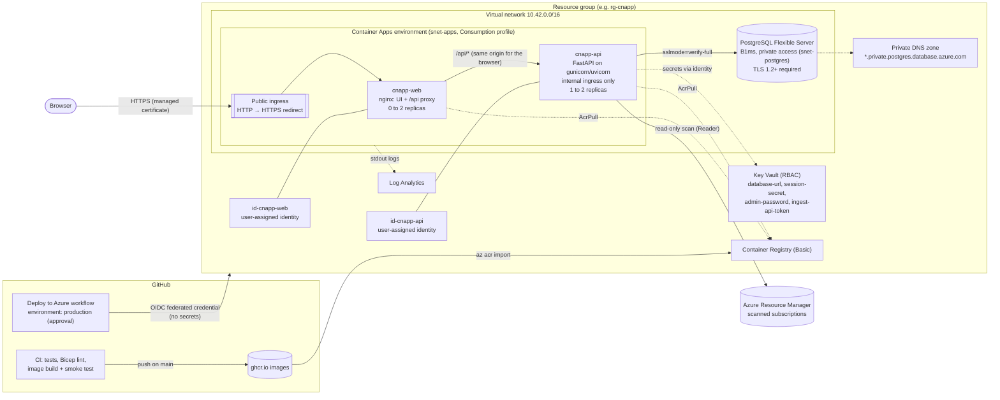

# Deploying CloudSecurity CNAPP to Azure

This guide takes the app from this repository to a production-style deployment on **Azure Container Apps**, with **Azure Database for PostgreSQL Flexible Server**, **Key Vault** and **managed identities**, deployed by GitHub Actions over **OIDC** (no Azure passwords or client secrets stored anywhere).

You run two things yourself: `infra/setup.sh` once, then the **Deploy to Azure** workflow. Nothing in this repository creates Azure resources until you do.

- [Architecture](#architecture)
- [What gets deployed](#what-gets-deployed)
- [Estimated monthly cost](#estimated-monthly-cost)
- [Prerequisites](#prerequisites)
- [First deployment](#first-deployment)
- [Later deployments](#later-deployments)
- [Enable the Azure scanner](#enable-the-azure-scanner)
- [Connect a runtime sensor](#connect-a-runtime-sensor)
- [Operations](#operations)
- [Production settings](#production-settings)
- [Security design](#security-design)
- [Tear down](#tear-down)
- [Troubleshooting](#troubleshooting)
- [Limitations](#limitations)

## Architecture



Request path: the browser only talks to `https://cnapp-web.<env>.<region>.azurecontainerapps.io`. nginx serves the UI and proxies `/api/` to the backend's internal endpoint, so the session cookie is first-party and same-origin (no CORS or third-party-cookie exceptions). The backend has no public endpoint.

## What gets deployed

All resources are in one resource group, defined in [`infra/main.bicep`](../infra/main.bicep) and [`infra/modules/`](../infra/modules):

| Resource | Name (prefix `cnapp`) | Default sizing | Purpose |
|---|---|---|---|
| Virtual network | `vnet-cnapp` | 10.42.0.0/16, subnets `snet-apps` (/23) and `snet-postgres` (/27) | Private network for apps and database |
| Container Apps environment | `cae-cnapp` | Consumption workload profile, VNet-integrated | Runs both apps |
| Container app | `cnapp-web` | 0.25 vCPU / 0.5 GiB, 0-2 replicas, **public HTTPS ingress** | nginx: UI and `/api` reverse proxy |
| Container app | `cnapp-api` | 0.5 vCPU / 1 GiB, 1-2 replicas, 2 gunicorn workers, **internal ingress** | FastAPI backend |
| PostgreSQL Flexible Server | `psql-cnapp-<suffix>` | Burstable **B1ms**, 32 GiB, PostgreSQL 16, 7-day backups, no HA | Database (private access only) |
| Private DNS zone | `psql-cnapp-<suffix>.private.postgres.database.azure.com` | | Name resolution for the private server |
| Key Vault | `kv-cnapp-<suffix>` | Standard, RBAC mode, soft delete 7 days | App secrets |
| Container Registry | `crcnapp<suffix>` | Basic, admin user disabled | Images pulled by managed identity |
| Managed identity | `id-cnapp-api` | user-assigned | Backend: Key Vault secrets, image pulls, Azure scanner |
| Managed identity | `id-cnapp-web` | user-assigned | Frontend: image pulls only |
| Log Analytics workspace | `log-cnapp` | PerGB2018, 30-day retention, 0.2 GB/day cap | Container logs (JSON) |

`<suffix>` is derived from the resource group ID, so names are stable across deployments. Every size is a parameter in `infra/main.bicep`.

## Estimated monthly cost

Approximate pay-as-you-go list prices in East US (USD); check the [Azure pricing calculator](https://azure.microsoft.com/pricing/calculator/) for your region and currency.

| Item | Estimate / month | Notes |
|---|---|---|
| PostgreSQL Flexible Server B1ms | ~$12.40 | ~$0.017/hour compute |
| PostgreSQL storage 32 GiB | ~$3.70 | Backup storage up to the provisioned size is free |
| Container Apps: `cnapp-api` (1 replica always on) | ~$10-34 | 0.5 vCPU + 1 GiB. ~$10 when mostly idle, ~$34 if it never idles; the monthly free grant (180,000 vCPU-s, 360,000 GiB-s, 2M requests) is already deducted |
| Container Apps: `cnapp-web` | ~$0-3 | Scales to zero when nobody uses the UI |
| Container Registry Basic | ~$5.00 | |
| Log Analytics | ~$0-2 | First 5 GB/month free; daily cap 0.2 GB |
| Key Vault, private DNS zone, VNet | ~$0.60 | |
| **Total** | **~$35-45 typical** (up to ~$60) | |

The biggest levers: `az group delete` when you are not using it (see [Tear down](#tear-down)), `backendCpu`/`backendMemory`, and `simulationMode=false` (the event simulator keeps the backend slightly busy). Stopping the PostgreSQL server (`az postgres flexible-server stop`) pauses compute billing for up to 7 days.

## Prerequisites

- An Azure subscription where you can create Entra applications and assign roles (**Owner**, or Contributor + User Access Administrator).
- [Azure CLI](https://learn.microsoft.com/cli/azure/install-azure-cli) 2.60+ and the [GitHub CLI](https://cli.github.com/) 2.40+, both signed in (`az login`, `gh auth login` with admin access to the repository).
- Bash (macOS, Linux, WSL or Cloud Shell).
- For the required-reviewer approval on the `production` environment, a **private** repository needs GitHub Pro, Team or Enterprise. Without it, `setup.sh` still creates the environment (deployments limited to `main`) and warns that approval is not enforced.

## First deployment

### 1. Merge the PR

The **Deploy to Azure** workflow must be on the default branch before it can be started, and CI pushes the images it tested to `ghcr.io/<owner>/cloudsecurity-backend` and `cloudsecurity-frontend` (private packages) on every push to `main`. Merge the Phase 2 PR first, then this one.

### 2. Run the one-time setup

```bash
git clone https://github.com/<owner>/CloudSecurity.git && cd CloudSecurity
az login
az account set --subscription "<subscription name or id>"
gh auth login

# See exactly what would happen; changes nothing:
infra/setup.sh --admin-email you@example.com --location eastus --dry-run

# Do it:
infra/setup.sh --admin-email you@example.com --location eastus
```

[`infra/setup.sh`](../infra/setup.sh) is idempotent (re-running only creates what is missing). It:

1. Registers the resource providers used (`Microsoft.App`, `Microsoft.DBforPostgreSQL`, `Microsoft.KeyVault`, ...).
2. Creates the resource group (default `rg-cnapp`).
3. Creates an Entra application `github-<repo>-deploy` and its service principal, with a **federated credential** that trusts only tokens for `repo:<owner>/<repo>:environment:production`. No client secret is ever created.
4. Assigns that service principal, **on the resource group only**:
   - `Contributor`: create and update the resources;
   - `Key Vault Secrets Officer`: generate the app secrets on the first run and read them back later;
   - `Role Based Access Control Administrator` with an ABAC **condition** that only allows granting or removing `AcrPull` and `Key Vault Secrets User` for service principals (what the Bicep assigns to the app identities). It cannot make anyone Owner.
5. Gives **you** `Key Vault Secrets User` on the resource group, so you can read the generated first-admin password.
6. Creates the GitHub environment `production` (you as required reviewer, deployments from `main` only) and sets these repository **variables** (identifiers, not secrets): `AZURE_CLIENT_ID`, `AZURE_TENANT_ID`, `AZURE_SUBSCRIPTION_ID`, `AZURE_RESOURCE_GROUP`, `AZURE_LOCATION`, `CNAPP_NAME_PREFIX`, `CNAPP_ADMIN_EMAIL`, `AZURE_DEPLOY_ON_PUSH`.

Options: `--resource-group`, `--name-prefix`, `--repo`, `--reviewer`, `--deploy-on-push`, `--help`.

### 3. Run the deploy workflow

GitHub → **Actions** → **Deploy to Azure** → **Run workflow** (branch `main`, leave *image_tag* empty) → approve the `production` deployment when prompted.

The first run takes about 15-20 minutes (PostgreSQL creation is the slow part). It:

1. Signs in to Azure with OIDC (`azure/login` with client, tenant and subscription IDs only).
2. Reads the app secrets from Key Vault, or generates them on the first run (`openssl rand`): PostgreSQL password, session secret, sensor ingest token and the first admin's password. They are masked in the logs and passed to Bicep as secure parameters through environment variables.
3. First run only: deploys everything except the container apps, so the registry exists.
4. Imports the commit's images from ghcr.io into the registry (`az acr import`; builds them in the runner if CI has not published that commit).
5. Deploys `infra/main.bicep` (infrastructure and app configuration, keeping the currently running images).
6. Rolls out the new images with `az containerapp update` (backend first: it applies database migrations on startup).
7. Smoke-tests the public URL with [`scripts/smoke_test.py`](../scripts/smoke_test.py) (UI, `/api/health` through the proxy, security headers, anonymous access rejected).

The URL is shown on the run summary and on the `production` environment.

### 4. First sign-in

```bash
KV=$(az keyvault list -g rg-cnapp --query "[0].name" -o tsv)
az keyvault secret show --vault-name "$KV" --name admin-password --query value -o tsv
```

Open the URL, sign in with the `--admin-email` you gave `setup.sh` and that password, then change it right away (user menu → **Change password**). The bootstrap password is only used while the users table is empty; changing it in the app does not change the Key Vault value, which is no longer used.

## Later deployments

- **Manual:** run the workflow again (optionally with a specific commit SHA as *image_tag*).
- **Continuous:** set the repository variable `AZURE_DEPLOY_ON_PUSH` to `true` (or pass `--deploy-on-push` to `setup.sh`). The workflow then runs after CI succeeds on `main`; the `production` approval still applies.
- Infrastructure changes are made in `infra/` and go out with the next deployment. Validate locally with `az bicep build -f infra/main.bicep` and `az bicep lint -f infra/main.bicep` (CI runs both).
- Other variables the workflow reads: `CNAPP_SIMULATION_MODE` (`true` by default; set `false` for real data only) and `CNAPP_SCAN_SUBSCRIPTION_IDS`.

Without the variables from `setup.sh`, the workflow does nothing except print how to configure it.

## Enable the Azure scanner

When deployed, the read-only Azure posture scanner authenticates with the backend's **managed identity** (`id-cnapp-api`, `AZURE_AUTH_MODE=managed_identity`): there is no client secret. Give the identity the built-in **Reader** role on each subscription to scan:

```bash
infra/setup.sh --grant-scanner <subscription-id> [--grant-scanner <another-id>]
```

This assigns Reader at subscription scope and adds the IDs to the `CNAPP_SCAN_SUBSCRIPTION_IDS` variable. Then run **Deploy to Azure** again so the backend gets `AZURE_SUBSCRIPTION_IDS`, open **Connectors**, and click **Run scan** (analyst or admin). Equivalent manual command:

```bash
PRINCIPAL=$(az identity show -g rg-cnapp -n id-cnapp-api --query principalId -o tsv)
az role assignment create --assignee-object-id "$PRINCIPAL" --assignee-principal-type ServicePrincipal \
  --role Reader --scope /subscriptions/<subscription-id>
# Many subscriptions: --scope /providers/Microsoft.Management/managementGroups/<mg-id>
```

Reader is enough: the scanner only issues `list*`/`get*` calls and the code-level `ReadOnlyClient` guard blocks everything else, including list calls that return secrets. Role assignments take a few minutes to propagate. Locally, the scanner still supports a service principal secret (`AZURE_TENANT_ID`/`AZURE_CLIENT_ID`/`AZURE_CLIENT_SECRET`, see the README) or `AZURE_USE_DEFAULT_CREDENTIAL=true` with `az login`.

## Connect a runtime sensor

The sensor ingest endpoint is reachable through the frontend: `https://<frontend-fqdn>/api/runtime/events`, authenticated with the ingest token from Key Vault:

```bash
az keyvault secret show --vault-name "$KV" --name ingest-api-token --query value -o tsv
```

Set it as `SENSOR_API_TOKEN` and `SENSOR_API_URL=https://<frontend-fqdn>/api/runtime/events` on the sensor (see `sensor/README.md`).

## Operations

| Task | Command |
|---|---|
| Backend logs (JSON) | `az containerapp logs show -g rg-cnapp -n cnapp-api --follow` |
| Query logs | Log Analytics → `ContainerAppConsoleLogs_CL \| where ContainerAppName_s == "cnapp-api"` |
| Revisions and health | `az containerapp revision list -g rg-cnapp -n cnapp-api -o table` |
| Shell in the backend | `az containerapp exec -g rg-cnapp -n cnapp-api --command sh` |
| Create a user / reset a password | `az containerapp exec ... --command "python -m app.cli reset-password --email you@example.com"` |
| Apply migrations explicitly | `python -m app.cli migrate` (also done on every start) |
| Rotate the session secret | `az keyvault secret set --vault-name $KV --name session-secret --value $(openssl rand -hex 32)`, then restart the revision (signs everyone out) |
| Pause the database | `az postgres flexible-server stop -g rg-cnapp -n <server>` (auto-restarts after 7 days) |

Database migrations: PostgreSQL is managed by Alembic (`backend/migrations/`). Each backend replica runs `alembic upgrade head` at startup under a PostgreSQL advisory lock, so concurrent replicas are safe. The background event simulator and Azure scans use advisory-lock leader election: exactly one process runs the simulator, and another takes over if it stops.

## Production settings

The backend runs with `APP_ENV=production`, which refuses to start (and logs why) unless:

- `SESSION_SECRET` is set (32+ characters; it keys the stored session-token digests);
- `COOKIE_SECURE=true` and `DEBUG` is off;
- `CORS_ORIGINS` lists only explicit `https://` origins (the deployment sets the frontend origin; the UI itself is same-origin);
- `INGEST_ALLOW_UNAUTHENTICATED` and `API_DOCS_PUBLIC` are off;
- `DATABASE_URL` is PostgreSQL (override with `ALLOW_SQLITE_IN_PRODUCTION=true` for a single-instance test).

In production it also logs one JSON object per line, sends `Strict-Transport-Security` (nginx sends it for the UI too), disables `/api/docs` and `/api/openapi.json` (`API_DOCS_ENABLED=true` re-enables them, still behind login) and adds `X-Content-Type-Options`, `X-Frame-Options`, `Referrer-Policy` and `Cache-Control: no-store` to API responses.

**Client IPs behind the proxies.** Requests pass the Container Apps ingress and nginx before reaching the backend. `TRUST_PROXY_HEADERS=true` with `TRUSTED_PROXY_CIDRS` (private ranges by default) makes the backend accept `X-Forwarded-For` only when the direct peer is one of those proxies, and use the right-most address that is not a proxy. A client cannot spoof its IP by sending the header, so per-IP login rate limiting and the audit log see the real client. gunicorn itself does not rewrite client addresses (`forwarded_allow_ips=127.0.0.1`).

## Security design

- **No stored credentials for deployment.** GitHub Actions gets a short-lived Entra token through the OIDC federated credential, which only trusts the `production` environment of this repository. The `production` environment requires approval and only accepts `main`.
- **Least privilege.** The deployer is scoped to one resource group, and its role-assignment rights are constrained by an ABAC condition. The backend identity can read Key Vault secrets, pull images and, if you grant it, read subscriptions. The frontend identity can only pull images.
- **Secrets** are generated once, stored only in Key Vault (RBAC mode, soft delete) and referenced by Container Apps through the backend identity; they never appear in the repository, in GitHub, in image layers or in plain container app configuration. `.env` files stay git-ignored; CI generates throwaway values at runtime.
- **Network.** The backend has internal ingress only. PostgreSQL has no public endpoint (VNet-integrated private access) and requires TLS 1.2+; the app connects with `sslmode=verify-full` against the image's CA bundle. The public endpoint is HTTPS-only (HTTP redirects to HTTPS) with a managed certificate.
- **Containers.** Multi-stage images running as non-root users (backend uid 10001, nginx uid 101), with health checks and no build tools in the runtime images.
- **Hardening options not enabled by default** (cost or convenience): Key Vault and the registry still have public endpoints, protected by Entra ID and RBAC. For stricter isolation add private endpoints (about $7.30/month each) or Key Vault firewall rules, Defender for Cloud plans, a custom domain, and a WAF (Azure Front Door) in front of the frontend.

## Tear down

Delete everything the deployment created (stops all charges):

```bash
az group delete -n rg-cnapp --yes
```

Then, optionally:

```bash
# Key Vault is soft-deleted for 7 days. Purge it to reuse the same name right away
# (a redeploy to a resource group with the same name otherwise fails on the vault name):
az keyvault list-deleted --query "[?properties.tags.app=='cloudsecurity-cnapp'].name" -o tsv
az keyvault purge -n <vault-name>

# Reader assignments given to the scanner identity live on the scanned subscriptions:
az role assignment list --all --assignee <principal-id-from-the-identity> -o table   # before deleting the group
az role assignment delete --ids <assignment-id>

# The GitHub deployment identity (Entra app) and repository variables:
az ad app delete --id "$(gh variable get AZURE_CLIENT_ID)"
for v in AZURE_CLIENT_ID AZURE_TENANT_ID AZURE_SUBSCRIPTION_ID AZURE_RESOURCE_GROUP AZURE_LOCATION \
         CNAPP_NAME_PREFIX CNAPP_ADMIN_EMAIL AZURE_DEPLOY_ON_PUSH CNAPP_SCAN_SUBSCRIPTION_IDS; do
  gh variable delete "$v"
done
```

## Troubleshooting

| Symptom | Cause and fix |
|---|---|
| Workflow says "Deployment skipped: Azure deployment is not configured" | The repository variables are missing: run `infra/setup.sh`. |
| `azure/login` fails with `AADSTS70021: No matching federated identity record found` | The federated credential subject must be `repo:<owner>/<repo>:environment:production`. Re-run `setup.sh` with the right `--repo` (repository renamed or transferred?) and make sure the job uses the `production` environment. |
| `AuthorizationFailed` on `roleAssignments/write` | The constrained RBAC administrator role only allows `AcrPull` and `Key Vault Secrets User`. If you changed role assignments in Bicep, update the condition in `setup.sh` and re-run it. |
| First deployment fails with `Forbidden` reading Key Vault secrets or pulling an image | New role assignments can take a few minutes to propagate. The workflow retries once after 90 s; if it still fails, re-run the workflow. |
| `ConflictError: vault name ... is already in use` / soft-deleted vault | A vault with the same name was deleted less than 7 days ago: `az keyvault purge -n <name>` (see [Tear down](#tear-down)) or use another `--name-prefix`. |
| PostgreSQL: `LocationIsOfferRestricted` or SKU not available | Some regions or subscription types (free/student) restrict Flexible Server SKUs. Try another region (`--location` in `setup.sh` and the `AZURE_LOCATION` variable). |
| `MissingSubscriptionRegistration` | A resource provider is not registered: re-run `setup.sh` (it registers them) and wait for registration to finish (`az provider show -n Microsoft.App --query registrationState`). |
| `az acr import` fails with `unauthorized` | The ghcr.io package is not linked to this repository. CI labels images with `org.opencontainers.image.source`; otherwise grant the repository access in the package settings. The workflow falls back to building the images itself. |
| Smoke test times out on `/api/health` | Check `az containerapp logs show -n cnapp-api`. The backend refuses to start with an insecure configuration and logs `refusing to start: ...`; a database error usually means the migration or TLS settings. |
| UI loads but sign-in fails with "Session expired" right away | The cookie is `Secure`: use the `https://` URL. |
| Login rate limit seems loose | The limiter is per process (`LOGIN_RATE_LIMIT` × workers × replicas). Account lockout is exact (stored in PostgreSQL). |
| Scanner says "not configured" | Set `CNAPP_SCAN_SUBSCRIPTION_IDS` (via `setup.sh --grant-scanner`) and redeploy. |
| Scan finishes with `AuthorizationFailed` errors | Reader is missing on that subscription or still propagating. |

## Limitations

- Single region, no zone redundancy, PostgreSQL without HA (Burstable tier): fine for a demo, not for an SLA. Increase `postgresSkuTier`/`postgresSkuName` and enable HA for production workloads.
- The login rate limiter is in-memory per process (see above).
- The default `*.azurecontainerapps.io` host name is used; add a custom domain and certificate in Container Apps for your own name.
- The workflow does not run `what-if` previews or blue/green revisions; it deploys straight to the single active revision after approval.
- Key Vault and the container registry use public endpoints protected by Entra ID and RBAC (see [Security design](#security-design) for private endpoints).
