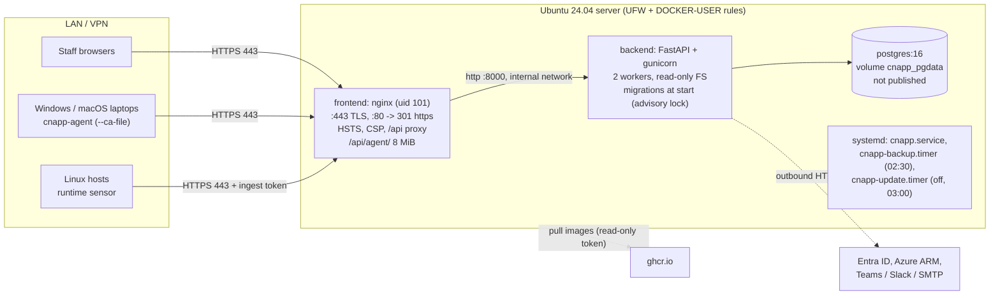

# Deploy on-prem (Ubuntu Server 24.04, Docker Compose)

This guide installs CloudSecurity CNAPP on **one Ubuntu Server 24.04 LTS machine** on your internal network or VPN. It is
an additional deployment target: the Azure deployment (`infra/`, `docs/DEPLOY_AZURE.md`) is unchanged.

Everything is driven by one script, **`cnapp-ctl`** (`deploy/onprem/cnapp-ctl`, installed to `/usr/local/bin`). Short
version for the day of the install: **[deploy/onprem/QUICKSTART.md](../deploy/onprem/QUICKSTART.md)**.

Contents: 1 Requirements and sizing, 2 Architecture, 3 Step by step, 4 TLS, 5 Firewall, 6 Updates, 7 Backups and
restore, 8 Application settings (Entra SSO, Azure scanner, notifications, sensor), 9 Hardening checklist,
10 Monitoring and troubleshooting, 11 Uninstall, 12 Reference.

## 1. Requirements and sizing

| | Minimum (default tuning) | Recommended for 500+ devices / several analysts |
|---|---|---|
| OS | Ubuntu Server 24.04 LTS, x86_64 | same |
| CPU | 2 vCPU | 4 vCPU (`WEB_CONCURRENCY=4`) |
| RAM | 4 GB | 8 GB |
| Disk | 50 GB (OS ~10, images ~3, database, 14 days of backups) | 100 GB+, SSD; backups also copied to a share |
| Network | static IP, internal DNS A record, outbound HTTPS (below) | |

Memory budget on the 4 GB default: PostgreSQL 1 GB, API 1.25 GB (2 workers), nginx 128 MB, leaving ~1.5 GB for the
OS, Docker and page cache. Every container has a hard memory limit, so one runaway service cannot OOM the host.
To size up, edit `/opt/cnapp/cnapp.env` and run `sudo cnapp-ctl restart`:

| Setting | 4 GB (default) | 8 GB | 16 GB |
|---|---|---|---|
| `WEB_CONCURRENCY` (API workers, ~1 per vCPU) | 2 | 4 | 6 |
| `BACKEND_MEM_LIMIT` | 1280m | 2560m | 4g |
| `PG_MEM_LIMIT` | 1g | 2g | 4g |
| `PG_SHARED_BUFFERS` (~25% of `PG_MEM_LIMIT`) | 256MB | 512MB | 1GB |
| `PG_EFFECTIVE_CACHE_SIZE` (~75%) | 768MB | 1536MB | 3GB |
| `PG_MAX_CONNECTIONS` (>= workers x 10 + 10) | 60 | 60 | 80 |

**Outbound (egress) HTTPS the server needs** - allow these on your proxy/firewall:

| Purpose | Destination |
|---|---|
| Images (install and `update`) | `ghcr.io`, `pkg-containers.githubusercontent.com` |
| `cnapp-ctl update` without `--tag` (newest published commit, self-refresh via `git pull`) | `api.github.com`, `github.com` |
| PostgreSQL image | `registry-1.docker.io`, `auth.docker.io`, `production.cloudflare.docker.com` |
| Docker Engine packages | `download.docker.com` |
| OS security updates | `archive.ubuntu.com`, `security.ubuntu.com` (or your mirror) |
| Entra ID sign-in (optional) | `login.microsoftonline.com` |
| Azure scanner (optional) | `login.microsoftonline.com`, `management.azure.com` |
| AWS scanner (optional, [CONNECT_AWS.md](CONNECT_AWS.md)) | `*.amazonaws.com` (STS, IAM, S3, S3 Control and EC2/EKS/RDS/KMS/Lambda/CloudTrail in each scanned region) |
| GCP scanner (optional, [CONNECT_GCP.md](CONNECT_GCP.md)) | `oauth2.googleapis.com`, `*.googleapis.com` (Resource Manager, Compute, Storage, GKE, Cloud SQL, IAM, KMS, Functions, Run) |
| Teams notifications (optional) | `*.webhook.office.com`, `*.logic.azure.com`, `*.api.powerplatform.com` |
| Slack notifications (optional) | `hooks.slack.com` |
| Email notifications (optional) | your SMTP relay, port 587/465 (set `NOTIFICATIONS_SMTP_ALLOW_PRIVATE=true` for an internal relay) |
| Agent release auto-import (on by default, [AGENT_UPDATES.md](AGENT_UPDATES.md)) | `api.github.com`, `github.com`, `release-assets.githubusercontent.com`, `objects.githubusercontent.com` |

The backend uses `HTTPS_PROXY` / `HTTP_PROXY` / `NO_PROXY` from `cnapp.env` (passed through by the compose file;
`localhost`, `127.0.0.1` and the stack's service names are always exempt), and `cnapp-ctl agent-release fetch`
uses the same values for `curl`. Without internet access the auto-import only logs and shows "offline" in the
console; import bundles with `cnapp-ctl agent-release import` instead (or set `AGENT_UPDATE_AUTO_IMPORT=false`).

Inbound: only TCP 80 (redirect) and 443 from your LAN/VPN ranges, plus SSH from admin ranges. Nothing else is published.

## 2. Architecture



Files on the server:

| Path | Contents | Permissions |
|---|---|---|
| `/opt/cnapp/cnapp.env` | settings (hostname, image tag, sizing, Entra/Azure settings) | `0600 root` |
| `/opt/cnapp/secrets/generated.env` | generated DB password, `SESSION_SECRET`, `INGEST_API_TOKEN`, `MFA_ENCRYPTION_KEY`, `NOTIFICATIONS_ENCRYPTION_KEY` | dir `0700`, file `0600` |
| `/opt/cnapp/secrets/docker/`, `ghcr-token` | GHCR read-only credentials | `0700` / `0600` |
| `/opt/cnapp/secrets/gcp/credentials.json` | GCP scanner key (`cnapp-ctl gcp-key install`), mounted read-only into the backend | dir `0700`, file `0600`, owner uid 10001 (backend) |
| `/opt/cnapp/ca/` | built-in root CA (`ca.key` never leaves this dir, never mounted into a container) | `0700`, key `0600` |
| `/opt/cnapp/tls/` | `server.crt` (full chain), `server.key`, `cnapp-root-ca.crt` (public) | `0750 root:cnapp-tls`, key `0640` |
| `/opt/cnapp/backups/` | database dumps and config archives | `0700`, files `0600` |
| `/opt/cnapp/app/` | compose file, nginx template, systemd units, a copy of `cnapp-ctl` | `0755` |
| `/opt/cnapp/state/` | current tag, update history, failed-update logs | `0700` |
| Docker volume `cnapp_pgdata` | PostgreSQL data | Docker-managed |

## 3. Step by step

### 3.1 Prepare Ubuntu 24.04
1. Install Ubuntu Server 24.04 LTS (minimal is fine), enable OpenSSH, create your admin user, add your SSH public key.
2. Give it a static IP (DHCP reservation or `/etc/netplan/*.yaml`), set the timezone (`sudo timedatectl set-timezone ...`),
   make sure NTP works (`timedatectl` shows "System clock synchronized: yes"; TOTP MFA needs a correct clock).
3. `sudo apt-get update && sudo apt-get -y full-upgrade && sudo reboot`.
4. Optional but recommended: put `/var/lib/docker` (or the whole disk) on an encrypted volume (LUKS, chosen in the
   installer), see section 9.

### 3.2 DNS
Create an A record on your internal DNS, e.g. `cnapp.corp.local -> 10.0.0.20`. Check from a laptop: `nslookup cnapp.corp.local`.
The hostname is baked into the certificate, the redirect and the Entra redirect URI; pick the final name now.

### 3.3 Create the GHCR read-only token
The images are private packages of the private repository. Create a token that can **only read packages**:
* **Classic PAT** (simplest): GitHub > Settings > Developer settings > Personal access tokens > Tokens (classic) >
  Generate new token; scope **`read:packages`** only; set an expiry (e.g. 1 year) and a calendar reminder.
* A fine-grained token works when your account/organisation allows fine-grained tokens for packages (Packages: read);
  if `docker login` or pulls fail with it, use the classic token above.

Copy it to the server in a file (`~/ghcr.token`, `chmod 600`); `cnapp-ctl install` stores it root-only and you can delete
the file. Rotate it later with `sudo cnapp-ctl install --ghcr-user USER --ghcr-token-file NEW_FILE` (keeps everything else).

### 3.4 Run the installer
Get the package onto the server (`git clone` with your GitHub credentials, or `scp -r deploy/onprem you@server:`), then:

```bash
cd CloudSecurity/deploy/onprem
sudo ./cnapp-ctl install \
  --hostname cnapp.corp.local --ip 10.0.0.20 \
  --admin-email you@corp.com \
  --allowed-cidrs 10.0.0.0/8,192.168.0.0/16 \
  --ghcr-user <github-user> --ghcr-token-file ~/ghcr.token \
  --image-tag latest
```

What it does (it is idempotent: re-running it keeps secrets, certificates and data, and only changes what you pass):
1. Preflight: Ubuntu 24.04, CPU/RAM/disk, ports 80/443 free.
2. Installs `ufw`, `unattended-upgrades` etc., and Docker Engine + compose plugin from **Docker's official apt repository**,
   verifying the repository key fingerprint `9DC8 5822 9FC7 DD38 854A E2D8 8D81 803C 0EBF CD88` (an existing Docker
   installation is used as is).
3. Creates `/opt/cnapp` (root-owned) and generates all secrets with `openssl rand` (never printed;
   `sudo cnapp-ctl show-secret NAME` prints one when you need it, e.g. the sensor ingest token).
4. Writes `/opt/cnapp/cnapp.env` (production settings: `APP_ENV=production`, `PUBLIC_BASE_URL=https://<hostname>`,
   same-origin API so `CORS_ORIGINS` is empty, secure cookies, `TRUST_PROXY_HEADERS=true` with
   `TRUSTED_PROXY_CIDRS` = the Docker network, simulated data off, `MFA_REQUIRED_ROLES=admin`).
5. TLS: uses certificates already in `/opt/cnapp/tls`, otherwise creates the built-in CA and a server certificate for the
   hostname and IP (section 4).
6. Logs in to ghcr.io with the read-only token.
7. Firewall: UFW allows SSH **first** (from `--ssh-cidrs`, default: the address you are connected from), then 80/443 from
   `--allowed-cidrs`, then denies everything else; and restricts Docker's published ports the same way (section 5).
8. Enables unattended **security** upgrades.
9. Installs systemd units: `cnapp.service` (stack at boot), `cnapp-firewall.service`, `cnapp-backup.timer` (enabled,
   nightly), `cnapp-update.timer` (installed, **disabled**; `cnapp-ctl auto-update enable`). Run from a git checkout, the
   installer also records the checkout path so `cnapp-ctl update` can refresh itself from it.
10. Pulls the images, starts the stack, waits until it is healthy over HTTPS, then creates the first admin and prints
    the **password once**.

Useful options: `--ssh-cidrs 10.1.0.0/24` (admin network), `--dns alias.corp.local` (extra certificate name),
`--mfa-required-roles admin,analyst`, `--skip-firewall` (if your network team manages host firewalls),
`--admin-password-file FILE`, `--dry-run` (print what would be done), `--force` (other Ubuntu versions, untested).

### 3.5 Trust the CA on clients
Only needed with the built-in CA (with your own AD CS certificate, domain machines already trust it).
The CA certificate is public: `scp you@server:/opt/cnapp/tls/cnapp-root-ca.crt .` (or `sudo cnapp-ctl tls export-ca`).
Verify the fingerprint against `sudo cnapp-ctl tls show` before distributing it.

* **Windows, one machine** (elevated): `certutil -addstore -f Root cnapp-root-ca.crt`
* **Windows, domain (GPO)**: Group Policy Management > edit a GPO linked to the computers' OU > Computer Configuration >
  Policies > Windows Settings > Security Settings > Public Key Policies > **Trusted Root Certification Authorities** >
  Import `cnapp-root-ca.crt`. Intune: Devices > Configuration > Create > Templates > **Trusted certificate**.
* **macOS, one machine**: `sudo security add-trusted-cert -d -r trustRoot -k /Library/Keychains/System.keychain cnapp-root-ca.crt`
* **macOS, managed**: MDM configuration profile with a **Certificate** payload (Jamf, Intune "Trusted certificate", Kandji...).
* **Linux**: `sudo cp cnapp-root-ca.crt /usr/local/share/ca-certificates/cnapp-root-ca.crt && sudo update-ca-certificates`
  (RHEL: `/etc/pki/ca-trust/source/anchors/` + `update-ca-trust`).
* **Browsers**: Chrome, Edge and Safari use the OS store. Firefox: Settings > Privacy & Security > Certificates > View
  Certificates > Authorities > Import (tick "identify websites"), or set the policy `ImportEnterpriseRoots` /
  `security.enterprise_roots.enabled=true`.

The built-in CA carries **name constraints**: it can only issue certificates for the configured hostname(s)/IP(s), so
trusting it does not let it impersonate other sites even if its key leaked.

### 3.6 First login and MFA
Open `https://cnapp.corp.local`. Sign in with the admin email and the printed password. Because `MFA_REQUIRED_ROLES=admin`,
you are taken straight to MFA enrolment: scan the QR code with an authenticator app, confirm a code and **store the
recovery codes** (password manager / safe). Then change the password (user menu). Lost the password or phone later?
On the server: `sudo cnapp-ctl reset-password --email you@corp.com` / `sudo cnapp-ctl reset-mfa --email you@corp.com`.

Add colleagues under **Users** (roles admin / analyst / viewer). To require MFA for analysts too, set
`MFA_REQUIRED_ROLES=admin,analyst` in `cnapp.env` and `sudo cnapp-ctl restart`.

### 3.7 Enroll devices
**All devices (recommended):** **Devices > Enroll devices > Download installer** gives one pre-configured
`cnapp-agent-setup.msi` (Windows) or `cnapp-agent-setup.pkg` (macOS) with the server URL (`PUBLIC_BASE_URL`), a
multi-use enrollment token (default 30 days / 500 devices) and, while you use the built-in CA, that CA. Deploy it with
GPO, Intune, SCCM, Jamf or Kandji, or double-click it; each device enrolls itself. Step-by-step:
[DEVICE_MANAGEMENT.md, Roll out to all devices](DEVICE_MANAGEMENT.md#roll-out-to-all-devices).

**One device by hand:** download the agent binaries (`cnapp-agent-binaries` artifact of the CI run you deploy, or your signed release; publish
them on an internal share). In the console: **Devices > Enroll devices >
Create token**. Then:

* **Windows** (elevated PowerShell, files in one folder):
  ```powershell
  .\install.ps1 -Server https://cnapp.corp.local -Token cne_xxxxxxxx `
     -BinaryPath .\cnapp-agent-windows-amd64.exe -CaFile .\cnapp-root-ca.crt
  ```
* **macOS** (Terminal, admin):
  ```bash
  sudo ./install.sh --server https://cnapp.corp.local --binary ./cnapp-agent-darwin-arm64 --ca-file ./cnapp-root-ca.crt
  ```

`-CaFile` / `--ca-file` (or `CNAPP_CA_FILE`) is only needed when the CA is not trusted machine-wide yet; the agent keeps
a protected copy next to its credentials. There is deliberately **no option to ignore certificate errors**. The device
appears within a minute. Details: [DEVICE_MANAGEMENT.md](DEVICE_MANAGEMENT.md).

### 3.8 Connect Teams / Slack / email
**Settings > Notifications > Add channel** ([NOTIFICATIONS.md](NOTIFICATIONS.md)). Teams: create a Workflows
("Post to a channel when a webhook request is received") or incoming-webhook URL; Slack: an incoming webhook. Send a
test. The server needs outbound HTTPS to those hosts (section 1). For an internal SMTP relay on a private IP set
`NOTIFICATIONS_SMTP_ALLOW_PRIVATE=true`. Links in messages use `PUBLIC_BASE_URL` (`https://<hostname>`), so they open
for staff on the LAN/VPN.

### 3.9 Configure the Azure scanner (service principal)
Managed identity is not available on-prem, so the scanner uses a **service principal with a client secret and the
Reader role**:

```bash
az ad sp create-for-rbac --name cnapp-onprem-scanner --role Reader \
  --scopes /subscriptions/<sub-id-1> /subscriptions/<sub-id-2>
# -> appId (client id), password (secret), tenant
```

Then in `/opt/cnapp/cnapp.env`:

```
AZURE_AUTH_MODE=client_secret
AZURE_TENANT_ID=<tenant>
AZURE_CLIENT_ID=<appId>
AZURE_CLIENT_SECRET='<password>'
AZURE_SUBSCRIPTION_IDS=<sub-id-1>,<sub-id-2>
```

`sudo cnapp-ctl restart`, then run a scan from the UI (after that it is also scanned automatically every 6 hours, see
[Scheduled scans](#8-application-settings-for-on-prem)). Reader is read-only; scope it to the subscriptions you want
scanned. The secret expires (default 1 year): set a reminder, rotate with `az ad sp credential reset`. Egress:
`login.microsoftonline.com`, `management.azure.com`.

### 3.10 Configure the AWS and GCP scanners (optional)
Both are read-only and step-by-step in their own guides:

- **AWS** ([CONNECT_AWS.md](CONNECT_AWS.md)): an IAM user with only `SecurityAudit` + `ViewOnlyAccess` (or a
  cross-account `CNAPPReadOnly` role with an external ID per account); fill `AWS_ACCESS_KEY_ID`,
  `AWS_SECRET_ACCESS_KEY`, optionally `AWS_ROLE_ARNS`, `AWS_EXTERNAL_ID`, `AWS_REGIONS` in `cnapp.env`, then
  `sudo cnapp-ctl restart`.
- **GCP** ([CONNECT_GCP.md](CONNECT_GCP.md)): a service account with `roles/viewer` + `roles/iam.securityReviewer`;
  install its key with `sudo cnapp-ctl gcp-key install KEY.json` (stored in `/opt/cnapp/secrets/gcp/`, never in
  `cnapp.env`), set `GCP_PROJECT_IDS` or `GCP_ORGANIZATION_ID` in `cnapp.env`, then `sudo cnapp-ctl restart`.

Behind a proxy, `HTTPS_PROXY` / `NO_PROXY` in `cnapp.env` apply to both scanners.

## 4. TLS

nginx terminates TLS on 443 (TLS 1.2/1.3, modern ciphers, HSTS, CSP and the other security headers) and redirects port 80
to `https://<CNAPP_HOSTNAME>`. The private key is readable only by root and the `cnapp-tls` group that nginx (uid 101)
runs with.

**Built-in CA (default).** `cnapp-ctl install` (or `sudo cnapp-ctl tls init --hostname H --ip A [--dns N]`) creates:
* a root CA (ECDSA P-384, 10 years, name-constrained to your names/IPs) in `/opt/cnapp/ca` - key `0600`, root only;
* a server certificate (ECDSA P-256, **397 days**, SANs = hostname + extra DNS names + IPs, EKU serverAuth).

Renewal: the nightly backup job renews the server certificate automatically when it expires within 30 days (same CA,
so clients notice nothing); manual: `sudo cnapp-ctl tls renew`. `sudo cnapp-ctl tls show` prints SANs, expiry and the
CA fingerprint. `sudo cnapp-ctl set-hostname NAME` changes the URL (`PUBLIC_BASE_URL`, the HTTP redirect, the Entra
redirect URI) and re-issues the certificate when NAME is within the CA's name constraints (one of the names/IPs it was
created for); for a different name import a certificate (below) or recreate the CA with
`sudo cnapp-ctl tls init --hostname new.corp.local --ip ... --new-ca` (devices enrolled with the old CA then need it
again, so prefer importing a certificate).

**Bring your own certificate (AD CS / internal PKI).** Request a "Web Server" certificate for `cnapp.corp.local` (SAN
must contain the DNS name; add the IP if people use it). Export certificate + unencrypted private key as PEM, then:

```bash
sudo cnapp-ctl tls import --cert cnapp.crt --key cnapp.key --chain issuing-ca.crt --ca root-ca.crt
```

It checks that key and certificate match, the certificate is valid for the hostname and chains to the root, installs it
with the right permissions and reloads nginx. (Equivalent manual way: put `server.crt` = certificate + intermediates and
`server.key` in `/opt/cnapp/tls` before running `install`.) Renewal is done at your CA; import the new files the same way.
For a PFX use `tls import-pfx` (next section).

### Switch to a DNS name and your own certificate (PFX)

Example (the Wakanow production move): the server ran as `https://10.10.11.57` with the built-in CA and now runs as
`https://cnapp.wakanow.com` with the company's publicly trusted DigiCert wildcard certificate (`*.wakanow.com`, exported
as `wakanow.pfx`). Because DigiCert is trusted by Windows and macOS out of the box, installers downloaded after the switch
embed no CA at all.

1. **DNS (split-horizon).** On the internal DNS (AD DNS, or the internal view of `wakanow.com`) add an A record
   `cnapp.wakanow.com -> 10.10.11.57`. Staff and devices resolve it internally; nothing is published on the internet
   (the server stays reachable only from `CNAPP_ALLOWED_CIDRS`). Check from a laptop: `nslookup cnapp.wakanow.com`.
   The certificate must contain `cnapp.wakanow.com` (or `*.wakanow.com`) in its Subject Alternative Names.
2. **Import the PFX and switch the hostname** (copy the file with `scp`; you are prompted for the password, which is
   never accepted on the command line):
   ```bash
   sudo cnapp-ctl tls import-pfx --pfx ~/wakanow.pfx --hostname cnapp.wakanow.com
   shred -u ~/wakanow.pfx
   ```
   It reads the PFX with OpenSSL's defaults and, for older exports protected with RC2-40/3DES (typical of Windows / AD CS;
   OpenSSL 3 reports `unsupported ... RC2-40-CBC`), automatically retries with OpenSSL's legacy provider. It extracts the
   certificate matching the private key, orders the intermediates into the chain, checks key match, expiry (warns under
   30 days) and that the certificate is valid for the hostname, decides whether the chain is publicly trusted (then
   installers embed no CA) or an enterprise root is included (then it is distributed to agents; pass `--ca root.pem` if the
   PFX lacks the root, `--no-ca` to force none), installs it, sets `CNAPP_HOSTNAME` / `PUBLIC_BASE_URL` / the Entra redirect
   URI, recreates the containers and checks HTTPS. Temporary files live in `/run` (RAM) and are shredded.
   Automation: `--password-file FILE` or the password on stdin.
3. **Devices already enrolled** with `https://10.10.11.57` keep working: the previous built-in certificate is still served to
   clients that connect by IP address or by the old name (nginx picks the certificate by the requested name), and those
   agents still trust the built-in CA. `sudo cnapp-ctl tls renew` keeps renewing that legacy certificate. Use
   `--no-legacy-cert` if nothing connects by IP any more.
4. **New installers.** Download new installers in the console: they contain `https://cnapp.wakanow.com` and, for a public
   certificate, no CA. Revoke the old installers' tokens under *Enrollment tokens*.
5. **SSO**: update the redirect URI in the Entra app registration to `https://cnapp.wakanow.com/api/auth/sso/entra/callback`.
6. **Renewal**: import the renewed PFX the same way (`--hostname` is not needed again).

`cnapp-ctl set-hostname NAME` alone changes the URL when the installed certificate already covers NAME.

**Agents and sensors** trust the OS store plus an optional CA file: agent `--ca-file` / `CNAPP_CA_FILE`, sensor
`--ca-file` / `SENSOR_CA_FILE` / `CNAPP_CA_FILE`.

## 5. Firewall

* **UFW** (host): default deny incoming, allow outgoing; SSH from `CNAPP_SSH_CIDRS`; 80/443 from `CNAPP_ALLOWED_CIDRS`.
  The SSH rule is always added before UFW is enabled, and defaults to the address of your current SSH session, so the
  installer does not lock you out. Add more admin ranges: `sudo ufw allow proto tcp from 10.9.0.0/24 to any port 22`.
* **Docker-published ports bypass UFW** (Docker DNATs them before UFW's INPUT rules). `cnapp-ctl` therefore also
  installs rules in Docker's `DOCKER-USER` chain (chain `CNAPP-INGRESS`) that drop new connections to the frontend from
  sources outside `CNAPP_ALLOWED_CIDRS`. `cnapp-firewall.service` re-creates them at boot before Docker starts, and
  `cnapp-ctl start` re-applies them. Check with `sudo cnapp-ctl firewall status`.
* Change the allowed ranges: edit `CNAPP_ALLOWED_CIDRS` / `CNAPP_SSH_CIDRS` in `cnapp.env`, then
  `sudo cnapp-ctl firewall configure` (old UFW rules are not removed automatically: `sudo ufw status numbered` +
  `sudo ufw delete N`).
* Alternatively bind to one interface only: `CNAPP_BIND_ADDRESS=10.0.0.20`.
* If a central firewall team manages host firewalls: install with `--skip-firewall` (sets `CNAPP_FIREWALL=false`).
* If `172.30.252.0/24` (the stack's Docker network) overlaps your LAN/VPN, change `CNAPP_DOCKER_SUBNET` before the first start.

### Publishing the agent endpoint to the internet

Laptops off the VPN can only report if the agent API is reachable from the internet. `cnapp-ctl public-agent enable`
publishes **only** the endpoint-agent API (`/api/agent/*`: enroll, check-in, commands, results, log upload, and future
`/api/agent/updates/*`) on port 443. The dashboard, the user API (`/api/*`, `/api/auth/*`), `/api/docs` and sensor
ingest (`/api/runtime/events`) stay internal-only.

```
 laptop (anywhere) --443--> firewall: DNAT public-IP:443 -> 10.10.11.57:443 (443 only, source address kept)
                                       |
                                       v
                nginx (frontend container, TLS)  -- /api/agent/*  --> backend (device-credential auth)
                                                 -- anything else from a non-internal address --> 404
 staff (10.10.0.0/19) --> https://cnapp.wakanow.com --> everything (dashboard, API, SSO)
```

**How it works**

| Layer | Internal clients (`CNAPP_ALLOWED_CIDRS` + `CNAPP_ADMIN_CIDRS`) | Everyone else |
|---|---|---|
| Firewall (UFW + `DOCKER-USER`) | 80 and 443 | **443 only** (80 and SSH stay restricted) |
| nginx, dashboard name / IP address | everything | `/api/agent/*` only; anything else **404** |
| nginx, agent name (`agents.wakanow.com`) | `/api/agent/*` only | `/api/agent/*` only |
| nginx limits on `/api/agent/*` | none | `limit_req` 20 r/s per IP (burst 200), enroll 60 r/min (burst 100), 200 connections per IP, 8 MiB bodies, GET/HEAD/POST only (others 405) |
| fail2ban (`CNAPP_FAIL2BAN`) | never banned (`ignoreip`) | `cnapp-agent-auth`: 60 rejected agent requests (401/403/405/429) in 10 min -> 1 h ban; `cnapp-probe`: 10 non-agent requests in 10 min -> 24 h ban; repeat offenders get longer bans (up to 7 days) |
| backend | per-device rate limit, enroll limits | same, plus the alerts below |

* **404 rather than 403** for blocked paths: a scanner gets the same answer as for a path that does not exist and
  learns nothing about the dashboard behind it.
* The allowed agent paths are matched on the raw request line (plain path segments only, no `..` and no
  percent-encoding), so `/api/agent/../auth/login` and encoded variants are blocked, not forwarded.
* Agents never use cookies: nginx drops any `Cookie` header on `/api/agent/*`, and a device credential is not accepted by
  any user endpoint (and vice versa), so CORS, CSRF and session cookies are unaffected.
* Health checks and `cnapp-ctl` reach nginx through Docker's proxy from the stack's network (`CNAPP_DOCKER_SUBNET`),
  which is treated as internal; IPv6 is not published.

**Client IP addresses.** nginx is the edge: it passes the address it sees as `X-Real-IP` / `X-Forwarded-For`
(overwriting anything a client sends), and the backend trusts these headers only from the Docker network
(`TRUSTED_PROXY_CIDRS`). This only shows the real client if the firewall **DNATs without SNAT** (destination NAT that
keeps the source address - the normal port-forward on FortiGate, Sophos, pfSense, Palo Alto, ...). If the firewall also
source-NATs (some "virtual server" / reverse-proxy modes, or hairpin NAT for internal clients using the public address),
every internet client appears as the firewall's address: the per-IP rate limits then apply to the whole internet at
once, fail2ban would ban the firewall (everything), audit logs and device "last IP" show the firewall, and IP
geolocation is useless. Use DNAT without SNAT; if that is impossible, run `public-agent enable --no-fail2ban` and raise
`--rate`/`--burst`.

**Many devices behind one address** (office egress NAT, mobile carrier NAT) share the per-IP budgets. Defaults are
sized for about 1,000 agents behind one address (an agent polls about once a minute and checks in every 15 minutes).
Enrollment allows 300 attempts per IP per 10 minutes (`ENROLL_RATE_LIMIT`) but only 20 *failed* ones
(`ENROLL_FAILURE_LIMIT`), so a mass Intune/GPO rollout works while token guessing is cut off. Device API limits are per
device, not per IP. Internal clients are never rate limited by nginx.

**Alerts.** The backend counts rejected agent requests (unknown, superseded or revoked credentials, failed enrollments,
rate limits). When `AGENT_AUTH_ALERT_THRESHOLD` (50) is reached within `AGENT_AUTH_ALERT_WINDOW_SECONDS` (300) it writes
an `agent_auth_failure_spike` audit record and emits a notification event (source **Agent API security**, event
`auth_failure_spike`, severity high, with counts by reason and the top source addresses), at most once per window.
Route it to Teams / Slack / email with a notification rule (Settings > Notifications, source "Agent API security").
The count is per backend worker (2 by default). Requests nginx rejects itself (rate limits, blocked paths) are handled
by fail2ban and visible in `/var/log/cnapp/edge-access.log`.

#### Step by step (cnapp.wakanow.com / agents.wakanow.com)

1. **Update the server** to a release that contains this feature (the package files and the images):

   ```bash
   cd ~/CloudSecurity && git pull                       # the clone used for the install
   cd deploy/onprem && sudo ./cnapp-ctl install --skip-ghcr-login --no-admin --yes --force   # --force: Ubuntu 26.04
   sudo cnapp-ctl update --tag <sha of the merge commit>   # or: sudo cnapp-ctl update (when tracking latest)
   ```

   Re-running `install` keeps the configuration, secrets and certificate; it copies the new compose file and nginx
   policy, and re-applies the firewall. The dashboard keeps working for `CNAPP_ALLOWED_CIDRS` (from now on nginx also
   answers 404 to anyone else, as a second layer behind the firewall).

2. **Enable** (on the server):

   ```bash
   sudo cnapp-ctl public-agent enable --hostname agents.wakanow.com
   #   optional: --admin-cidrs 10.20.0.0/24      extra networks with dashboard access (e.g. admin VPN)
   #             --cert agents.crt --key agents.key [--chain chain.pem]   only if *.wakanow.com does not cover the name
   #             --rate 20r/s --burst 200 --enroll-rate 60r/m             per-IP limits for internet clients
   #             --no-fail2ban
   sudo cnapp-ctl public-agent status
   ```

   It checks that the certificate covers the name (the `*.wakanow.com` wildcard does), sets `CNAPP_PUBLIC_AGENT=true`,
   `CNAPP_AGENT_HOSTNAME`, `PUBLIC_AGENT_URL=https://agents.wakanow.com`, opens 443 to any address in UFW and
   `DOCKER-USER` (80 and SSH unchanged), recreates the containers, waits for health, installs fail2ban with the two
   jails, and probes `https://agents.wakanow.com/api/agent/commands` locally (expects 401). Running it again is safe.

3. **Firewall NAT** (perimeter firewall): one rule, **TCP 443 only**: `public IP:443 -> 10.10.11.57:443`, destination NAT
   only (no source NAT), plus the matching allow policy. Do not forward 80 or 22. Optional but recommended: geo-blocking
   to the countries your staff travel to, and the firewall's IPS profile on the rule.

4. **DNS**
   * Public zone: `agents.wakanow.com  A  <public IP>`.
   * Internal zone (split-horizon): `agents.wakanow.com  A  10.10.11.57`, so devices in the office reach the server
     directly instead of hairpinning through the firewall (which would SNAT them). `cnapp.wakanow.com` stays internal
     only - **never publish it**.

5. **Installers**: download new ones (Devices > Enroll). Generated MSI/PKG installers and the manual enrollment
   commands now use `PUBLIC_AGENT_URL` (`https://agents.wakanow.com`) instead of `PUBLIC_BASE_URL`; the dashboard,
   notification links and Entra SSO keep using `https://cnapp.wakanow.com`. Devices enrolled earlier keep the URL they
   were enrolled with (`https://cnapp.wakanow.com` or `https://10.10.11.57`): they report while on the office network or
   VPN; re-run a new installer on them (it re-enrolls the same device) to let them report from anywhere.

6. **Verify from outside** (a phone hotspot, not the office network):

   ```bash
   curl -s -o /dev/null -w '%{http_code}\n' https://agents.wakanow.com/api/agent/commands   # 401 (agent API reachable)
   curl -s -o /dev/null -w '%{http_code}\n' https://agents.wakanow.com/                     # 404
   curl -s -o /dev/null -w '%{http_code}\n' -X POST https://agents.wakanow.com/api/auth/login   # 404
   curl -s -o /dev/null -w '%{http_code}\n' --resolve cnapp.wakanow.com:443:<public IP> https://cnapp.wakanow.com/   # 404
   curl -s -o /dev/null -w '%{http_code}\n' -k https://<public IP>/api/docs                  # 404
   curl -sv --max-time 5 http://<public IP>/ 2>&1 | tail -n 2                                 # timeout (80 closed)
   nc -vz -w 5 <public IP> 22                                                                 # timeout (SSH closed)
   ```

   Then on the server: `sudo tail /var/log/cnapp/edge-access.log` shows your hotspot address (if it shows the
   firewall's address instead, the firewall SNATs - fix the NAT rule). Install a freshly downloaded installer on a laptop
   on the hotspot: it appears under Devices within a minute. Stay below 10 non-agent requests or fail2ban bans your
   hotspot for 24 h (`sudo fail2ban-client set cnapp-probe unbanip <ip>`).

7. **Disable**: `sudo cnapp-ctl public-agent disable` closes 443 to the outside again and removes the fail2ban jails;
   `PUBLIC_AGENT_URL` is kept (devices enrolled with `https://agents.wakanow.com` keep working internally through the
   split-horizon record). `--forget-hostname` also clears it (download new installers afterwards). Remove the NAT rule
   and the public DNS record.

**What is exposed / not exposed**

| Exposed to the internet | Not exposed |
|---|---|
| TCP 443, TLS 1.2/1.3 with the `*.wakanow.com` certificate | Port 80, SSH, PostgreSQL (never published) |
| `/api/agent/*` (device-credential or enrollment-token auth, rate limited) | Dashboard (SPA), `/api/auth/*` (login, SSO, MFA), all user API endpoints, `/api/docs`, `/api/health` |
| | Sensor ingest `/api/runtime/events` (opt-in: `CNAPP_PUBLIC_SENSOR_INGEST=true` in `cnapp.env` + `cnapp-ctl restart`) |

**Hardening checklist (internet-facing)**

- [ ] NAT forwards **443 only**, DNAT without SNAT; IPS / geo-blocking on the firewall rule (optional).
- [ ] `cnapp.wakanow.com` has no public DNS record; `agents.wakanow.com` resolves internally to the server.
- [ ] From outside: the checks of step 6 give 401 / 404 / timeouts.
- [ ] fail2ban running (`sudo cnapp-ctl public-agent status`); notification rule for "Agent API security" to Teams/Slack.
- [ ] Unattended security upgrades on (default), reboots when `/var/run/reboot-required` exists, images updated
      regularly (`cnapp-ctl update`), Docker Engine updated with `apt upgrade`.
- [ ] Enrollment tokens / installers with short expiry and a device limit; revoke unused ones (Devices > Enroll).
- [ ] Watch `sudo cnapp-ctl public-agent status` (bans) and `/var/log/cnapp/edge-access.log` after go-live; HTTPS
      monitoring of `https://agents.wakanow.com/api/agent/commands` from outside (expects 401).

**Settings** (`/opt/cnapp/cnapp.env`; `cnapp-ctl public-agent enable` sets the first four): `CNAPP_PUBLIC_AGENT`,
`CNAPP_AGENT_HOSTNAME`, `PUBLIC_AGENT_URL`, `CNAPP_ADMIN_CIDRS`, `CNAPP_AGENT_RATE` / `CNAPP_AGENT_BURST` /
`CNAPP_AGENT_ENROLL_RATE` / `CNAPP_AGENT_ENROLL_BURST` / `CNAPP_AGENT_CONN_LIMIT` (nginx), `CNAPP_FAIL2BAN`,
`CNAPP_F2B_AGENT_MAXRETRY` / `_FINDTIME` / `_BANTIME` and `CNAPP_F2B_PROBE_MAXRETRY` / `_FINDTIME` / `_BANTIME`
(seconds; re-run `public-agent enable` to apply), `ENROLL_RATE_LIMIT`, `ENROLL_FAILURE_LIMIT`,
`AGENT_AUTH_ALERT_THRESHOLD` / `AGENT_AUTH_ALERT_WINDOW_SECONDS` (backend; `cnapp-ctl restart`). A separate
certificate for the agent name is stored as `/opt/cnapp/tls/agent.crt|key` and served by SNI. The nginx policy is
generated at container start by `deploy/onprem/nginx/cnapp-access.sh`; the edge log
(`/var/log/cnapp/edge-access.log`, external clients only) is rotated daily by logrotate (14 days).

## 6. Updates (pull-based)

The server pulls images from ghcr.io; nothing connects to it from outside. CI pushes `:<commit-sha>` and `:latest` for
every build of `main` whose backend/frontend checks and installer packages succeed - about **10 minutes** after the
merge (the images no longer wait for the slower Windows/macOS agent test runs, which still run and still gate the
installer end-to-end tests).

**One command** (the normal way to update):

```bash
sudo cnapp-ctl update
```

1. **Self-refresh.** If cnapp-ctl was installed from a git checkout (the installer records the path in
   `/opt/cnapp/state/source_checkout`; otherwise `~/CloudSecurity` of the user running `sudo`), it runs
   `git pull --ff-only` there **as the checkout's owner** (never as root), refreshes the installed `cnapp-ctl`,
   `docker-compose.prod.yml`, nginx and systemd files exactly like `install --force` does for those files, and re-runs
   the new `cnapp-ctl`. It does **not** touch `cnapp.env`, generated secrets, TLS certificates/CA, the admin user or the
   firewall. Without a checkout it says so and continues with the installed files (`--no-refresh` skips this step).
2. **Target.** It asks the GitHub API (anonymously; the repository and packages are public) for the newest commits of
   `main` and picks the newest one whose backend **and** frontend images are published in ghcr.io. If the newest commit's
   images are still being built, it shows the CI run and **waits** for it (polls every 30 s, `--wait-timeout SECONDS`,
   default 2400 = 40 min; on timeout nothing is changed). `--no-wait` takes the newest already-published commit instead.
   If CI failed for the newest commit, it says so and uses the newest published one.
3. Prints the current and target commit and stops if the server is **already up to date**; otherwise runs the update
   below (backup, health check, automatic rollback).

`HTTPS_PROXY` / `NO_PROXY` from `cnapp.env` are used for these lookups and for `git pull`. Outbound access needed:
`api.github.com`, `github.com` (git), `ghcr.io`, `pkg-containers.githubusercontent.com`. **Offline / no internet:** the
lookup fails with a clear error; update to a known commit instead:

```bash
sudo cnapp-ctl update --tag <full commit sha>   # a specific commit (exactly as before; no self-refresh, no lookup)
sudo cnapp-ctl update --check                    # current tag/digest vs. 'latest', and which commit 'latest' is
sudo cnapp-ctl update --dry-run                  # show what would happen (no changes)
```

Upgrading from a cnapp-ctl without these options: run it once from the checkout, it refreshes the installed copy:
`cd ~/CloudSecurity && git pull && sudo ./deploy/onprem/cnapp-ctl update`. (`update` without `--tag` used to re-pull the
current tag; use `update --tag latest` for that.)

`update` (with or without `--tag`) does, in order: tag the running images locally as `cnapp-rollback`; pull the target (aborts with nothing
changed if the pull fails); exit early if nothing changed; **`pg_dump` backup** (`cnapp-pre-update-*`); recreate the
containers; wait for health (containers healthy **and** `https://<host>/api/health` through nginx + TLS; default 300 s,
`--health-timeout`). On success it prints image ids, commit labels and schema revision before/after and records the
update in `/opt/cnapp/state/history.log`.

**Automatic rollback** when health fails: backend logs are saved to `/opt/cnapp/state/failed-update-*.log`; the previous
images and tag are restored; if the failed release changed the database schema (Alembic revision differs), the
pre-update backup is **restored** first, then the old version is started and checked.

Rollback limits, honestly:
* Restoring the pre-update backup discards anything written between the backup and the rollback (normally a minute or
  two during the update; agent check-ins in that window are re-sent by the agents later, sensor events in it are lost).
* Rollback only triggers on a failed health check during the update. A release that starts fine but misbehaves later
  needs a manual rollback: `sudo cnapp-ctl update --tag <previous-sha>` - and, if its migrations are not backward
  compatible, `sudo cnapp-ctl restore /opt/cnapp/backups/cnapp-pre-update-...dump.gz` (data since then is lost).
* Health checks prove the app starts and serves `/api/health`; they do not test every feature.
* Database migrations in this project are additive so far (old code tolerates new tables), but that is not guaranteed
  for future releases.
* `--no-backup` disables the safety net (no restore possible).

**Automatic updates** (off by default):

```bash
sudo cnapp-ctl auto-update enable                # nightly at 03:00 server time (+ up to 20 min random delay)
sudo cnapp-ctl auto-update enable --time 01:30   # another time (HH:MM, 24 h, server time)
sudo cnapp-ctl auto-update status                # enabled?, schedule, next run, last log lines
sudo cnapp-ctl auto-update disable
```

The `cnapp-update.timer` runs `cnapp-ctl update --auto`, i.e. the same one-command update as above, non-interactively
(self-refresh, newest published `main` commit, waits for a running build, pre-update backup, health check, automatic
rollback). Output goes to the journal (`journalctl -u cnapp-update`) and `/var/log/cnapp/auto-update.log`. A rollback
or failure raises a **"Server updates"** notification (and a successful automatic update an info one) through your
notification rules (Settings > Notifications: add a rule for the source "Server updates" to get it in Teams, Slack or
email); if the backend itself is down, the failure is only logged. To track a fixed tag instead of `main`, set
`AUTO_UPDATE_TAG=<tag>` in `cnapp.env` (or `auto-update enable --tag <tag>`). `uninstall` removes the timer. For strict
change control, keep it off and update manually with `--tag`.

The PostgreSQL image (`postgres:16-alpine`, major version 16) is pulled at install; refresh minor versions with
`sudo docker pull postgres:16-alpine && sudo cnapp-ctl restart` after a backup. A major upgrade (17+) needs
dump/restore and is not automated. OS packages: unattended security upgrades; Docker Engine from Docker's repository
is upgraded with your regular `apt upgrade` (not automatically).

## 7. Backups and restore

* `cnapp-backup.timer` runs nightly at 02:30 (`Persistent=true`: a missed run happens at next boot):
  `pg_dump -Fc | gzip` -> `/opt/cnapp/backups/cnapp-db-<timestamp>.dump.gz` (+ `.sha256`), verified (gzip test and
  pg_dump header), plus `cnapp-db-<timestamp>.config.tar.gz` (cnapp.env, generated secrets, TLS, CA).
* Retention: `BACKUP_RETENTION_DAYS` (14), always keeping the newest 3; the last 5 pre-update/pre-restore copies.
* Off-box copy: set `BACKUP_COPY_DIR=/mnt/backup/cnapp` to a mounted NFS/SMB share (e.g. `/etc/fstab` with
  `//nas/backup /mnt/backup cifs credentials=/root/.smbcred,uid=0,gid=0,file_mode=0600,dir_mode=0700 0 0`). Dumps are
  copied there; the config archive only with `BACKUP_COPY_CONFIG=true` because it contains the encryption keys and
  the CA key. Keep that archive somewhere safe (vault/password manager): **without `MFA_ENCRYPTION_KEY`,
  `NOTIFICATIONS_ENCRYPTION_KEY` and `SESSION_SECRET` a database restore on a new server loses MFA enrolments and
  notification secrets**.
* Manual: `sudo cnapp-ctl backup`.
* Restore: `sudo cnapp-ctl restore /opt/cnapp/backups/cnapp-db-<ts>.dump.gz` - verifies the checksum, takes a safety
  backup of the current data, stops the app, recreates the database, `pg_restore`s and waits for health. This path is
  exercised in CI on every push.
* Disaster recovery on a new server (same hostname/IP): **first** extract the config archive
  (`sudo install -d -m 0755 /opt/cnapp && sudo tar -C /opt/cnapp -xzf cnapp-db-<ts>.config.tar.gz`), **then** run
  `sudo ./cnapp-ctl install --ghcr-user ... --ghcr-token-file ... --no-admin` (it keeps the restored secrets, CA and
  certificate, so the new database gets the old password and clients keep trusting the CA), then
  `sudo cnapp-ctl restore cnapp-db-<ts>.dump.gz`.

## 8. Application settings for on-prem

All in `/opt/cnapp/cnapp.env` (apply with `sudo cnapp-ctl restart`; values containing `$` in single quotes). Production
startup checks (secure cookies, session secret, MFA key, PostgreSQL, no wildcard CORS, ...) run at every start and the API
refuses to start if one fails - `sudo cnapp-ctl logs backend` shows which.

**Entra ID single sign-on** ([AUTH.md](AUTH.md)). Browser-based OIDC: the user's browser goes to Microsoft and comes
back to the internal URL, so an internal hostname works. The **server** needs outbound HTTPS to
`login.microsoftonline.com` (token exchange and signing keys). App registration > Authentication > Add a platform >
**Web** > redirect URI `https://cnapp.corp.local/api/auth/sso/entra/callback`; Certificates & secrets > New client secret.
Then:

```
ENTRA_TENANT_ID=<tenant id>
ENTRA_CLIENT_ID=<application (client) id>
ENTRA_CLIENT_AUTH=secret
ENTRA_CLIENT_SECRET='<secret value>'
ENTRA_REDIRECT_URI=https://cnapp.corp.local/api/auth/sso/entra/callback   # preset by the installer
```

Keep the bootstrap admin as break-glass account (`AUTH_BREAK_GLASS_EMAILS`, default `ADMIN_EMAIL`).

**Scheduled cloud scans** (README "Scheduled scans"). Every configured cloud connector (Azure today) is scanned
automatically, by default every 6 hours; unconfigured connectors are skipped. Settings in `cnapp.env`:

```
SCAN_SCHEDULE_ENABLED=true        # false: manual "Run scan" only
SCAN_INTERVAL_HOURS=6             # 0.25 to 168, fractions allowed (0.5 = every 30 minutes)
SCAN_STARTUP_DELAY_SECONDS=120    # wait after a restart before an overdue scan runs
```

These are the defaults: an admin can also turn the schedule off/on or change the interval in **Connectors & scans**
(stored in the database, audited, applied within a minute without a restart; **Reset to defaults** returns to the
`cnapp.env` values). Installations created before this release do not have the lines in `cnapp.env` and use the
defaults above; add them to change them. Timing is kept in the database, so `cnapp-ctl restart` / updates do not
trigger a burst of scans: an overdue scan runs once, two minutes after start. Manual scans do not move the schedule,
and a scheduled scan that is due while another scan of the connector is still running is skipped (shown as `skipped`
in the scan history). Failed scans raise a **Cloud scans** notification - create a rule for it under
**Notifications > Rules** to be alerted.

**Proxy/cookie settings** are set by the compose file: `TRUST_PROXY_HEADERS=true` with `TRUSTED_PROXY_CIDRS` = the
stack's Docker network (only nginx can reach the API), `COOKIE_SECURE=true`, `CORS_ORIGINS` empty (same origin).

**Runtime sensor** on Linux hosts ([sensor/README.md](../sensor/README.md)): `SENSOR_API_URL=https://cnapp.corp.local/api/runtime/events`,
`SENSOR_API_TOKEN=$(sudo cnapp-ctl show-secret INGEST_API_TOKEN)`, `SENSOR_CA_FILE=/etc/runtime-sensor/ca.pem`
(copy of `cnapp-root-ca.crt`).

**Not exposed to the internet** by default: laptops off the VPN queue nothing - agents retry and report when back on
the network. To let them report from anywhere, publish only the agent API:
[Publishing the agent endpoint to the internet](#publishing-the-agent-endpoint-to-the-internet).

**Two-person approval / self-approval** ([DEVICE_MANAGEMENT.md](DEVICE_MANAGEMENT.md#two-person-approval)). Remote wipe
and medium/high-risk device scripts need a **second admin** to approve them in **Approvals**. A server with only one
admin can allow self-approval:

```bash
sudo cnapp-ctl approvals self-approval enable [--cooldown-minutes 15]   # asks for confirmation, restarts the API
sudo cnapp-ctl approvals self-approval status
sudo cnapp-ctl approvals self-approval disable
```

It sets `DEVICE_APPROVAL_ALLOW_SELF=true` and `DEVICE_APPROVAL_SELF_COOLDOWN_MINUTES` in `cnapp.env`. The requester then
types the device name again and the action waits the cooling-off delay (cancellable by any admin). **Risk:** one
stolen admin session (or one careless admin) is then enough to wipe a laptop; add a second admin and turn it off as
soon as you can. `DEVICE_APPROVAL_TTL_HOURS` (24) and `DEVICE_WIPE_COMMAND_TTL_MINUTES` (60) are set the same way.

**Approved device scripts** ([DEVICE_SCRIPTS.md](DEVICE_SCRIPTS.md)): import the signed bundle published by the
*Device scripts release* workflow:

```bash
sudo cnapp-ctl scripts fetch --tag scripts-v1.0.0     # from GitHub Releases (server needs outbound HTTPS to github.com)
sudo cnapp-ctl scripts import device-scripts-bundle.tar.gz   # or a file you copied
sudo cnapp-ctl scripts list
```

## 9. Hardening checklist

- [ ] SSH: keys only (`PasswordAuthentication no`, `KbdInteractiveAuthentication no` in `/etc/ssh/sshd_config.d/99-hardening.conf`),
      `PermitRootLogin no`, then `sudo systemctl reload ssh`. Test a second session before closing the first.
- [ ] SSH only from admin ranges (`CNAPP_SSH_CIDRS`; check `sudo ufw status numbered`).
- [ ] Optional: `sudo apt-get install fail2ban` (the default sshd jail is enough). `cnapp-ctl public-agent enable`
      installs it with jails for the internet-facing agent endpoint.
- [ ] Agent endpoint published to the internet? Follow the checklist in
      [Publishing the agent endpoint to the internet](#publishing-the-agent-endpoint-to-the-internet).
- [ ] Disk encryption: choose LUKS ("Encrypt the new Ubuntu installation") at install time, or at least for the volume
      holding `/var/lib/docker` and `/opt/cnapp`. Without it, anyone with the disk/VM image has the database and keys.
- [ ] MFA enforced for admins (default) - consider `MFA_REQUIRED_ROLES=admin,analyst`.
- [ ] Recovery codes and the config archive stored off the server.
- [ ] Off-box backups (`BACKUP_COPY_DIR`) and a restore tested once.
- [ ] GHCR token: classic PAT with `read:packages` only, expiry set, reminder to rotate.
- [ ] `unattended-upgrades` active (`systemctl status unattended-upgrades`); reboot when `/var/run/reboot-required` exists
      (`sudo cnapp-ctl status` after the reboot).
- [ ] Monitoring (section 10) - at minimum an HTTPS check on `/api/health` and disk-space alerting.
- [ ] Sign agent builds (Authenticode / Developer ID) before wide rollout (DEVICE_MANAGEMENT.md).

Already done by the package: containers run as non-root (API uid 10001, nginx uid 101) with all capabilities dropped,
`no-new-privileges`, read-only root filesystem for the API, memory/PID limits, PostgreSQL on an internal network only,
secrets root-only, log rotation (10 MB x 5 per container).

## 10. Monitoring and troubleshooting

* `sudo cnapp-ctl status` - containers, health over HTTPS, version, schema, certificate expiry, backups, memory.
* `sudo cnapp-ctl logs [backend|frontend|postgres] [-f] [--tail N]` - JSON logs from the API; also
  `journalctl -u cnapp -u cnapp-backup -u cnapp-update`.
* External monitoring: HTTPS GET `https://cnapp.corp.local/api/health` (expects `{"status":"ok"}`); alert on disk > 80%
  (`df -h /var/lib/docker /opt/cnapp`) and certificate expiry.

| Symptom | Check / fix |
|---|---|
| Browser: "not secure" / NET::ERR_CERT_AUTHORITY_INVALID | CA not trusted on that client (3.5); hostname typed differs from the certificate SANs (`cnapp-ctl tls show`) |
| Agent: `x509: certificate signed by unknown authority` | enroll with `--ca-file` or trust the CA machine-wide |
| Page does not load from some network | that range is not in `CNAPP_ALLOWED_CIDRS` (`cnapp-ctl firewall status`) |
| `install`: port 80/443 in use | stop the other web server (`sudo ss -ltnp`) |
| `install` / `update`: pull fails (401/403/denied) | token lacks `read:packages`, expired, or GHCR_USER wrong; `--ghcr-token-file` again |
| backend unhealthy, "refusing to start" in logs | a production check failed; the log names the setting |
| backend restarts, OOM in `docker inspect` | raise `BACKEND_MEM_LIMIT` or lower `WEB_CONCURRENCY` |
| Entra sign-in error after Microsoft login | redirect URI mismatch, secret expired, or no egress to `login.microsoftonline.com` |
| Notifications stuck | egress to Teams/Slack/SMTP; `NOTIFICATIONS_SMTP_ALLOW_PRIVATE` for internal relays |
| Update rolled back | read `/opt/cnapp/state/failed-update-*.log` |

## 11. Uninstall

```bash
sudo cnapp-ctl uninstall            # removes containers, systemd units and firewall rules; KEEPS /opt/cnapp and the DB volume
sudo /opt/cnapp/app/cnapp-ctl install   # ...brings it back with the same data and secrets
sudo cnapp-ctl uninstall --purge    # also deletes the database volume, backups, config, secrets, CA (asks for confirmation)
```

Docker Engine, UFW (with its SSH rules, so you keep access) and unattended-upgrades stay installed. Copy backups off
the server before `--purge`.

## 12. Reference

`cnapp-ctl help` lists every command and option. Highlights:

| Command | |
|---|---|
| `install [...]` | install or reconfigure (idempotent) |
| `status`, `logs`, `start`, `stop`, `restart` | day to day (`restart` applies `cnapp.env` changes) |
| `update [--tag T] [--check] [--health-timeout S]` | pull-based update with backup and rollback |
| `auto-update enable [TAG] / disable / status` | optional daily timer |
| `backup`, `restore FILE` | database backup/restore |
| `tls init / renew / show / import / import-pfx / export-ca` | certificates (`import-pfx` prompts for the password, supports legacy RC2 PFX) |
| `set-hostname NAME` | change the URL (PUBLIC_BASE_URL, redirects, Entra redirect URI) |
| `firewall status / configure` | UFW + DOCKER-USER rules |
| `create-admin`, `reset-password`, `reset-mfa`, `show-secret` | account recovery, secrets |
| `uninstall [--purge]` | removal |

The CI job **On-prem** (`.github/workflows/ci.yml`) runs the real `cnapp-ctl install` on an Ubuntu 24.04 runner on
every push, with built-in TLS for `cnapp.test`, then: HTTPS checks with the generated CA, admin login + CSRF, agent
enrollment with `--ca-file` and check-in, sensor ingest, firewall checks from network namespaces, backup + restore,
an update to a second tag, a deliberately broken update (new migration + crash) that must roll back and restore the
database, certificate renewal, password reset, `tls import-pfx` of a legacy RC2-40 PFX with chain plus a hostname switch
(the old name and the IP address keep the built-in certificate), `set-hostname`, back to the built-in CA, uninstall,
reinstall and purge.
