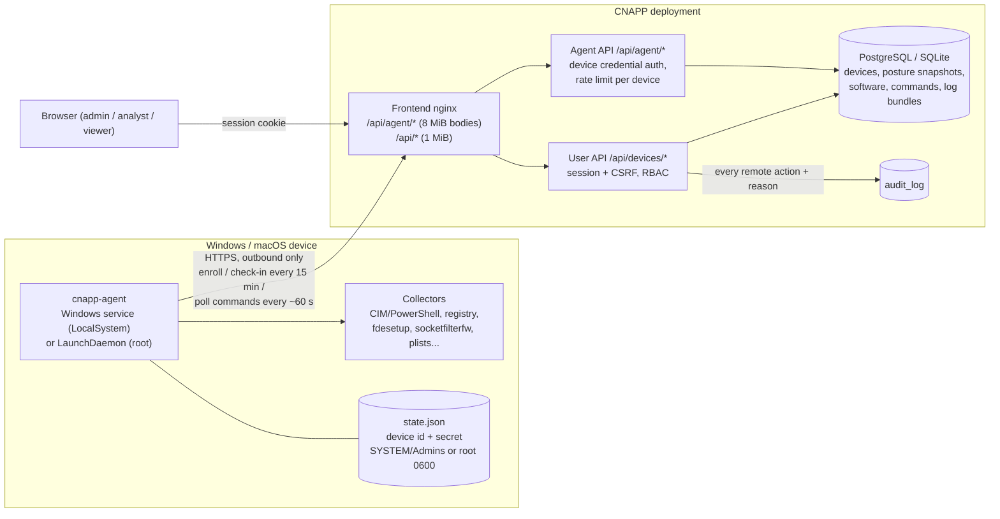

# Device management (endpoint agent)

CloudSecurity can track company laptops and desktops alongside cloud workloads. A small agent of our own (`cnapp-agent`, in [`endpoint-agent/`](../endpoint-agent)) runs on **Windows 10/11** and **macOS**. It reports hardware/OS inventory, security posture and installed software, and it runs a short, fixed list of remote actions that an admin or analyst queues in the UI.

It works in the spirit of Intune, with deliberate limits:

- **Our own agent only.** There is no Microsoft Graph / Intune integration and no Apple or Windows MDM protocol, so no MDM enrollment profiles or Apple Push certificates are needed.
- **Inventory, posture and safe remote actions.** The OS and installed software are matched against public CVE data (NVD by CPE, CISA KEV, EPSS; see [VULNERABILITIES.md](VULNERABILITIES.md)) and shown on the device's **Vulnerabilities** tab. Compliance policies are not implemented yet.
- **No arbitrary command execution.** The agent never runs scripts or shell commands written on the server. The only scripts it runs are **approved scripts**: reviewed in this repository, signed with a dedicated script-signing key the server never holds, verified by the agent right before running, with typed, validated parameters ([DEVICE_SCRIPTS.md](DEVICE_SCRIPTS.md), [ADR-0001](ADR-0001-signed-device-scripts.md)).
- **High-risk actions need two admins.** Remote wipe (Windows only) and medium/high-risk scripts run only after a second admin approves them ([Two-person approval](#two-person-approval)).

Linux is not supported yet. The code is split so it can be added later: see [Adding Linux](#adding-linux).

## Contents

- [Architecture](#architecture)
- [Roll out to all devices](#roll-out-to-all-devices) (one pre-configured MSI / pkg: GPO, Intune, SCCM, Jamf, Kandji)
- [Enrolling devices](#enrolling-devices) one by one: [Windows](#windows-1011) and [macOS](#macos)
- [What data is collected](#what-data-is-collected) (privacy)
- [Device health and issues](#device-health-and-issues)
- [Remote actions](#remote-actions)
- [Two-person approval](#two-person-approval)
- [Lost mode](#lost-mode)
- [Remote wipe (Windows)](#remote-wipe-windows)
- [Approved scripts](#approved-scripts) (details: [DEVICE_SCRIPTS.md](DEVICE_SCRIPTS.md))
- [Security model](#security-model)
- [Service install, upgrade and uninstall](#service-install-upgrade-and-uninstall) (and **[automatic, signed agent updates](AGENT_UPDATES.md)**)
- [Packaging and code signing](#packaging-and-code-signing)
- [API reference](#api-reference)
- [Configuration](#configuration)
- [Testing](#testing)
- [Limitations](#limitations)

## Architecture



**Pull model.** The agent never listens on a port. It makes outbound HTTPS requests only:

| Request | When | Purpose |
|---|---|---|
| `POST /api/agent/enroll` | once (and on re-enrollment) | exchange an enrollment token for a per-device credential |
| `POST /api/agent/checkin` | at start, then every check-in interval (default 15 min, ±10% jitter) | full inventory, posture and software report |
| `GET /api/agent/commands` | about every 60 s (±10% jitter) | small request that fetches queued remote actions and works as a heartbeat |
| `POST /api/agent/commands/{id}/result` | after running a command | status and output |
| `POST /api/agent/commands/{id}/logs` | for `collect_logs` | upload a gzip log bundle |

When a request fails, the agent backs off exponentially with full jitter (30 s, 1 min, 2 min, ... up to 30 min). If the server rejects the credential (revoked or superseded), the agent logs that it must be re-enrolled and retries only once an hour. It does not exit, so the service manager does not get stuck in a restart loop.

## Roll out to all devices

**One installer file for every device, with no per-device token.** In **Devices → Enroll devices → Download installer** (admin only) choose:

| Setting | Default | Meaning |
|---|---|---|
| Platform | Windows (MSI, x64) | or macOS (pkg, Intel + Apple silicon) |
| Expires after | 30 days | the installer stops enrolling *new* devices after this (1–365) |
| Maximum devices | 500 | each new device uses one enrollment; re-installs and upgrades do not |
| Device group | (none) | label applied to every device enrolled with it (filter `GET /api/devices?group=`) |
| Include the server's CA certificate | on when the server has a private CA | see [TLS and the CA](#tls-and-the-ca) |
| Allow remote wipe | **off** | Windows only: devices installed from this package opt in to [remote wipe](#remote-wipe-windows). Stored in the device's protected local policy; the server cannot turn it on later |

The server mints a dedicated **package-bound enrollment token** (stored hashed like every token, listed under *Enrollment tokens* with an "installer" tag, revocable there, every download audit-logged as `agent_installer_created` with the file's SHA-256) and returns one file:

- `cnapp-agent-setup.msi`: the generic MSI with the enrollment config written into its hidden `CNAPP_PRESET` property;
- `cnapp-agent-setup.pkg`: the generic pkg with `enroll.json` added next to its install scripts.

The plaintext token exists **only inside that file**: it is not stored, logged or shown again. Treat the file like a password until it expires or you revoke its token, and do not post it anywhere public.

**What happens on a device.** The installer puts the agent in place, registers the service (Windows: `CNAPPAgent`, LocalSystem, automatic start, restart on failure; macOS: LaunchDaemon) and stores the enrollment config in the protected state directory (`%ProgramData%\CNAPP Agent\enroll.json` / `/Library/Application Support/CNAPP Agent/enroll.json`, SYSTEM/Administrators or root only). When the service starts it enrolls, retrying with backoff while the server is unreachable, then **deletes enroll.json**. The device shows up in **Devices** within a minute or two.

- Already enrolled (re-install, repair, upgrade): the config is ignored and deleted; the device keeps its identity and uses no enrollment. To move a device on purpose, run `cnapp-agent enroll`, or `uninstall --purge` and reinstall.
- Token expired, revoked or out of devices: the agent logs `enrollment token rejected by the server ...` and retries every 30 minutes. Download a new installer, or raise the limit by issuing a new one.
- The same machine enrolling again (for example after a reinstall with `--purge`) gets its **existing device record** back (matched by OS machine id), so counts stay correct.

### Windows: Group Policy, Intune, SCCM, manual

The MSI is per-machine and supports silent install, repair and uninstall. It registers the `CNAPPAgent` service (LocalSystem, automatic delayed start) and sets its recovery actions (restart after 5 s / 30 s / 2 min) through a small deferred action that runs `cnapp-agent service-recovery`, because Windows Installer's own `MsiServiceConfigFailureActions` table rejects restart actions (error 1939).

```bat
msiexec /i cnapp-agent-setup.msi /qn /l*v %TEMP%\cnapp-agent-install.log
msiexec /x cnapp-agent-setup.msi /qn            :: or Settings > Apps > CNAPP Endpoint Agent > Uninstall
```

Uninstall stops and removes the service, the binary, the credential and the logs (set `CNAPP_KEEP_STATE=1` to keep the credential). An upgrade (newer MSI) keeps the device identity.

- **Group Policy (Active Directory).** Copy the MSI to a share that domain computers can read (`\\fileserver\deploy$\cnapp\cnapp-agent-setup.msi`, *Domain Computers*: Read). Create a GPO linked to the computers' OU: **Computer Configuration → Policies → Software Settings → Software Installation → New → Package**, pick the UNC path, choose **Assigned**. Computers install it at the next restart (`gpupdate /force` then reboot to test). A **startup script** works too: Computer Configuration → Policies → Windows Settings → Scripts → Startup → `msiexec.exe /i \\fileserver\deploy$\cnapp\cnapp-agent-setup.msi /qn`.
- **Intune.** *Apps → Windows → Add → Line-of-business app*, upload the MSI (Intune detects the product code and installs it silently in the device context), assign to a device group. Or as a **Win32 app** (wrap with `IntuneWinAppUtil.exe -c . -s cnapp-agent-setup.msi -o .`): install command `msiexec /i cnapp-agent-setup.msi /qn`, uninstall `msiexec /x {ProductCode} /qn`, install behavior *System*, detection rule *MSI product code*.
- **SCCM / ConfigMgr.** Create an Application from the MSI (*Windows Installer (\*.msi file)* deployment type); the install program is `msiexec /i "cnapp-agent-setup.msi" /qn`, detection by product code, deploy to a device collection.
- **Manual.** Double-click the MSI (one UAC prompt, no questions), or run the `msiexec` line above in an elevated prompt.

**Option B: your own signed generic MSI + properties.** The CI artifact `cnapp-agent-windows-msi` (`cnapp-agent-windows-x64.msi`) carries no enrollment. Sign it yourself and pass the enrollment on the command line:

```bat
msiexec /i cnapp-agent-windows-x64.msi /qn CNAPP_SERVER=https://cnapp.wakanow.com CNAPP_TOKEN=cne_... [CNAPP_CA_B64=<base64 of the CA PEM>]
```

Create the multi-use token under *Enrollment tokens* (it is shown once). The properties are hidden from MSI logs. For **Group Policy**, which cannot pass properties directly, create a transform with Orca or the Windows SDK's `msitran`/`WiRunSQL.vbs`: add rows `CNAPP_SERVER` and `CNAPP_TOKEN` to the `Property` table and save it as `cnapp.mst`, then on *Software Installation → New → Package → Advanced → Modifications* add the `.mst`. For **Intune**, put the properties on the Win32 app's install command (or the LOB app's *Command-line arguments*). `CNAPP_CA_B64` is only needed for a private CA that the devices do not already trust: `[Convert]::ToBase64String([IO.File]::ReadAllBytes('cnapp-root-ca.crt'))`.

### macOS: Jamf, Kandji, Intune, manual

```bash
sudo installer -pkg cnapp-agent-setup.pkg -target /
sudo /usr/local/cnapp-agent/bin/cnapp-uninstall.sh     # uninstall (add --keep-state to keep the credential)
```

- **Jamf Pro.** *Settings → Computer management → Packages → New*, upload the pkg; add it to a policy (trigger *Recurring check-in* / *Enrollment complete*, execution *Once per computer*) scoped to your Macs.
- **Kandji.** *Library → Add new → Custom App*, installer type *Package*, upload the pkg, assign to a Blueprint.
- **Intune.** *Apps → macOS → Add → macOS app (PKG)* (for an unsigned package; the LOB type requires a signed pkg), upload, assign.
- **Manual.** Double-click (an unsigned downloaded pkg needs right-click → Open the first time), or the `installer` command above.

**MDM with your own signed pkg.** Install the generic, signable pkg (CI artifact `cnapp-agent-macos-pkg`); the LaunchDaemon starts and waits. Then push the enrollment from an MDM script (it is picked up within a minute):

```bash
printf '%s\n' 'cne_...' | /usr/local/cnapp-agent/bin/cnapp-agent configure --server https://cnapp.wakanow.com --token-stdin [--ca-file /path/cnapp-root-ca.crt]
```

### TLS and the CA

Agents always verify the server certificate (system trust store, plus a private CA when one is configured). The installer embeds the CA **only when needed**:

- **Built-in CA (`cnapp-ctl` default) or an internal/enterprise CA**: `cnapp-ctl` sets `AGENT_CA_CERT_B64` and the download includes the CA by default. Untick it once your CA is deployed to all devices by GPO/MDM.
- **Publicly trusted certificate**: no CA is configured, nothing is embedded, and the box is disabled. This is the Wakanow production setup: `https://cnapp.wakanow.com` with a publicly trusted DigiCert wildcard certificate (`*.wakanow.com`, imported with `cnapp-ctl tls import-pfx`). Installers downloaded there contain only `https://cnapp.wakanow.com` and the token; Windows and macOS already trust DigiCert, so devices need no CA file, GPO certificate deployment or MDM certificate payload. (If `AGENT_CA_CERT_B64` is still set from the earlier built-in CA, re-run `cnapp-ctl tls import-pfx` or set it empty and `cnapp-ctl restart`; `GET /api/devices/installers` shows `ca_configured: false` when correct.)

The server URL inside the installer is `PUBLIC_BASE_URL` (on-prem: `https://<CNAPP_HOSTNAME>`, changed with `cnapp-ctl set-hostname`). Download new installers after changing the hostname or certificate. Devices that are already enrolled keep using the URL they enrolled with; on-prem, `cnapp-ctl tls import-pfx` keeps serving the old built-in certificate to clients that connect by IP address or by the old name, so they keep working ([DEPLOY_ONPREM.md](DEPLOY_ONPREM.md#switch-to-a-dns-name-and-your-own-certificate-pfx)).

### Token lifetime, limits and revocation

- An installer works until its token **expires** (default 30 days) or reaches **maximum devices** (default 500), whichever comes first. Devices already enrolled are not affected by either: they authenticate with their own per-device credential.
- **Revoke** the installer's token under *Enrollment tokens* when the rollout is done or if the file leaks. Devices that have not enrolled yet then log the rejection and retry every 30 minutes; enrolled devices keep working.
- Shorter is safer: pick the smallest expiry and device count that cover your rollout window, and download a fresh installer for later waves.

### Code signing

- The **pre-configured MSI and pkg are unsigned**: injecting the enrollment changes the file, which would invalidate any signature (signing them on the server would need your code-signing key there, which this feature deliberately does not do). Windows SmartScreen and macOS Gatekeeper therefore warn on a *double-click* of a downloaded file. Deployment tools (GPO, Intune, SCCM, Jamf, `installer`) are not affected.
- The **agent binary inside** can be signed: CI builds it, you sign `cnapp-agent.exe` (Authenticode) or the macOS binary (Developer ID) and build the MSI/pkg from it ([Packaging](#packaging-and-code-signing)). Signing the binary keeps EDR/AV allow-listing simple even when the package is unsigned.
- For SmartScreen-free rollouts and Intune's macOS LOB type, use **option B**: sign the *generic* MSI / pkg yourself and supply the enrollment via properties (Windows) or `cnapp-agent configure` (macOS). Use the pre-configured download for convenience.
- Why MSI rather than a `setup.exe`: MSI is what GPO Software Installation, Intune LOB and SCCM install natively (silent, per-machine, repair, clean uninstall, upgrade, product-code detection). A bootstrapper `.exe` would add another unsigned binary without adding a capability, so none is built.

### Troubleshooting

| Check | Windows | macOS |
|---|---|---|
| Service running | `sc.exe query CNAPPAgent` / `Get-Service CNAPPAgent` | `sudo launchctl print system/com.cloudsecurity.cnapp-agent` |
| Enrollment state | `& "$env:ProgramFiles\CNAPP Agent\cnapp-agent.exe" status` (elevated) | `sudo /usr/local/cnapp-agent/bin/cnapp-agent status` |
| Agent log | `%ProgramData%\CNAPP Agent\logs\agent.log` | `/Library/Logs/CNAPP Agent/agent.log` and `launchd.log` |
| Installer log | `msiexec /i ... /l*v install.log` (properties shown as `**********`) | `/var/log/install.log` |

`status` prints `"enrolled": false` with `pending_enrollment` while the service is still trying. Typical log lines: `enrollment failed; retrying ... x509: certificate signed by unknown authority` (CA not embedded and not trusted: download with *Include CA*, or deploy the CA), `... no such host` / `connection refused` (DNS / firewall to the server), `enrollment token rejected` (expired, revoked or used up).

## Enrolling devices

For a handful of devices, or scripted installs, you can also enroll one by one with a token.


You need the URL of your CNAPP deployment (for example `https://cnapp-web.<env>.<region>.azurecontainerapps.io`) and an **admin** account.

1. In the UI open **Devices → Enroll devices** and click **Create token**. Choose:
   - a **name** (for example "Finance laptops, Oct 2026");
   - **single device** or **multiple devices** (an optional maximum; empty means unlimited until expiry);
   - an **expiry** (default 24 h, maximum 90 days).

   The token (`cne_...`) is shown **once**. Anyone who holds a valid token can enroll a device, so keep tokens short-lived and revoke them when you are done.
2. Get the agent build for the platform from the CI artifacts (see [Packaging](#packaging-and-code-signing)) or your internal download location.
3. Run the commands below on the device. The device appears in **Devices** within about a minute.

### Windows 10/11

Open **PowerShell as administrator** in the folder that contains `cnapp-agent-windows-amd64.exe` (use `-arm64` on ARM devices) and `install.ps1`:

```powershell
.\install.ps1 -Server https://cnapp.example.com -Token cne_xxxxxxxx -BinaryPath .\cnapp-agent-windows-amd64.exe
```

Or download directly from your release location with an integrity check:

```powershell
.\install.ps1 -Server https://cnapp.example.com -Token cne_xxxxxxxx `
  -DownloadUrl https://downloads.example.com/cnapp-agent/0.1.0/cnapp-agent-windows-amd64.exe `
  -Sha256 <value from SHA256SUMS> -RequireSignature
```

`install.ps1` checks that it is elevated and that the URL is https. It verifies the SHA-256 and, with `-RequireSignature`, the Authenticode signature. It enrolls the device, passing the token on **stdin** so it never appears in the process list, and then runs `cnapp-agent install`. That copies the binary to `C:\Program Files\CNAPP Agent\cnapp-agent.exe` and registers the **CNAPP Endpoint Agent** (`CNAPPAgent`) service. The service is set to automatic (delayed) start, runs as LocalSystem and restarts on failure.

Without the script:

```powershell
$env:CNAPP_ENROLL_TOKEN = 'cne_xxxxxxxx'
.\cnapp-agent-windows-amd64.exe enroll --server https://cnapp.example.com
.\cnapp-agent-windows-amd64.exe install
Remove-Item Env:CNAPP_ENROLL_TOKEN
```

**Server with an internal certificate (on-prem).** If the server's certificate comes from an internal CA that Windows does not trust yet (for example the CA created by `cnapp-ctl tls init`, see [DEPLOY_ONPREM.md](DEPLOY_ONPREM.md)), either deploy that root CA to the machine store first (Group Policy, or `certutil -addstore -f Root cnapp-root-ca.crt`), or pass it to the agent: `.\install.ps1 ... -CaFile .\cnapp-root-ca.crt` (or `enroll --ca-file`). The agent keeps a protected copy next to its credentials, so the file can be deleted afterwards. There is no option to skip certificate verification.

Check the result with `Get-Service CNAPPAgent`, `& 'C:\Program Files\CNAPP Agent\cnapp-agent.exe' status` and the log at `C:\ProgramData\CNAPP Agent\logs\agent.log`.

### macOS

In **Terminal**, as an administrator. Use `darwin-arm64` on Apple silicon and `darwin-amd64` on Intel Macs:

```bash
chmod +x cnapp-agent-darwin-arm64
xattr -d com.apple.quarantine cnapp-agent-darwin-arm64 2>/dev/null   # unsigned builds only
echo 'cne_xxxxxxxx' | sudo ./cnapp-agent-darwin-arm64 enroll --server https://cnapp.example.com --token-stdin
sudo ./cnapp-agent-darwin-arm64 install
```

`install` copies the binary to `/usr/local/cnapp-agent/bin/cnapp-agent` and writes `/Library/LaunchDaemons/com.cloudsecurity.cnapp-agent.plist`, with `RunAtLoad`, `KeepAlive` and a 30 s throttle. It then loads and starts the daemon with `launchctl bootstrap` and `kickstart`.

You can also use the installer package from CI (`cnapp-agent-macos-universal.pkg`, a universal binary):

```bash
sudo installer -pkg cnapp-agent-macos-universal.pkg -target /
echo 'cne_xxxxxxxx' | sudo /usr/local/cnapp-agent/bin/cnapp-agent enroll --server https://cnapp.example.com --token-stdin
sudo /usr/local/cnapp-agent/bin/cnapp-agent install
```

A deployment tool can enroll during package install instead. Before running the installer, write `/var/root/.cnapp-enroll` (root, `0600`) with the server URL on line 1 and the token on line 2. The `postinstall` script enrolls, deletes the file and starts the daemon. On an upgrade of an enrolled Mac, `postinstall` simply restarts the daemon.

`packaging/macos/install.sh --server URL --binary PATH [--ca-file cnapp-root-ca.crt]` combines the binary steps and prompts for the token.

**Server with an internal certificate (on-prem).** Add `--ca-file cnapp-root-ca.crt` to `enroll` (or to `install.sh`), or put the CA path on a third line of `/var/root/.cnapp-enroll` for package installs. Alternatively trust the root CA system-wide first (`sudo security add-trusted-cert -d -r trustRoot -k /Library/Keychains/System.keychain cnapp-root-ca.crt`, or an MDM certificate payload); the agent always uses the system trust store too. Example:

```bash
echo 'cne_xxxxxxxx' | sudo ./cnapp-agent-darwin-arm64 enroll --server https://cnapp.corp.local --token-stdin --ca-file ./cnapp-root-ca.crt
sudo ./cnapp-agent-darwin-arm64 install
```

Check with `sudo /usr/local/cnapp-agent/bin/cnapp-agent status`, `sudo launchctl print system/com.cloudsecurity.cnapp-agent` and `/Library/Logs/CNAPP Agent/agent.log`.

### Re-enrollment and revocation

- Running `enroll` again with a new token **re-enrolls** the device. The server recognizes the machine by a SHA-256 of its OS machine identifier (Windows `MachineGuid`, macOS `IOPlatformUUID`). It keeps the same device record and history, issues a new secret and invalidates the old one. This also reactivates a revoked device.
- **Revoke** (admin, device page) invalidates the credential immediately and cancels pending actions. The agent keeps running but is rejected (`403`) until someone re-enrolls it.
- **Delete** (admin, after revoking) removes the device and all its data.
- The device secret is never displayed. `cnapp-agent status` prints the state with the secret redacted.

### Local testing over plain http

`enroll --insecure-dev` allows `http://` URLs, for example `http://localhost:8000` with `uvicorn`. Never use it in production. Without it the agent refuses anything but https. `--home DIR` (or `CNAPP_AGENT_HOME`) keeps state and logs under `DIR`, so you can try the agent without root:

```bash
cd endpoint-agent && go build -o cnapp-agent ./cmd/cnapp-agent
./cnapp-agent inventory --print            # what would be sent (no network)
./cnapp-agent enroll --server http://localhost:8000 --token cne_... --insecure-dev --home /tmp/agent
./cnapp-agent checkin --home /tmp/agent    # one check-in + command poll
```

## What data is collected

Everything is **read-only** and uses OS-native tools with timeouts, so the user sees no prompts or pop-ups. Each collector fails independently. When one fails, its check is reported as `unknown` with the error, and the agent does not crash.

| Area | Windows | macOS |
|---|---|---|
| Device | hostname, BIOS serial, manufacturer/model, CPU and cores, RAM, fixed disks (size/free), OS caption/version/build (incl. UBR, display version), architecture, last boot/uptime, users with an interactive session (owners of `explorer.exe`), time zone | hostname, serial (`ioreg`), model, CPU (`sysctl`), RAM, root volume (size/free), `sw_vers`, architecture, boot time/uptime, console user and `who`, time zone |
| Network | adapters that are up, with MAC and IP addresses, and the agent version | same |
| Disk encryption | BitLocker on the OS volume (`Win32_EncryptableVolume`: protection and conversion status) | FileVault (`fdesetup status`) |
| Firewall | Windows Defender Firewall, every profile (`Get-NetFirewallProfile -PolicyStore ActiveStore`) | application firewall (`socketfilterfw --getglobalstate`, stealth mode) |
| Antivirus / EDR | Microsoft Defender (`Get-MpComputerStatus`: real-time protection, signature age and version, tamper protection) and products registered in Windows Security Center (`SecurityCenter2`, client SKUs) | XProtect version and age (`xprotect version` on macOS 15+, else the XProtect bundle) |
| Screen lock | machine inactivity limit policy (`InactivityTimeoutSecs`) or a password-protected screen saver of 15 min or less for each signed-in user | `sysadminctl -screenLock status` for the console user, or a managed `com.apple.screensaver` profile |
| OS updates | pending updates from the **local** Windows Update cache (offline search, no network scan), last install date, reboot required | `/Library/Preferences/com.apple.SoftwareUpdate.plist` (results the OS itself caches; no `softwareupdate --list`), last OS install |
| Platform | Secure Boot (`Confirm-SecureBootUEFI`), TPM (`Get-Tpm`) | SIP (`csrutil status`), Gatekeeper (`spctl --status`) |
| Local admins | members of the Administrators group (by SID, so it works in any language) | members of the `admin` group |
| Software | uninstall registry keys: HKLM 64-bit, HKLM 32-bit and loaded user hives (name, version, publisher, install date; system components and updates excluded) | `.app` bundles in `/Applications` (2 levels) and `~/Applications` (name, version, bundle id) |

**Privacy note.** The agent does **not** collect files, documents, browsing data, screenshots, keystrokes, location, process lists or network traffic. It records the user names of signed-in users and local administrators, IP and MAC addresses, the serial number and the installed applications. Tell your users about it as your policies require. Data is kept until the device is deleted. Posture history is capped per device (`DEVICE_HISTORY_LIMIT`, default 200 snapshots).

## Device health and issues

The server derives **issues** from the latest posture and timestamps whenever a device is read. They are built-in signals, not configurable compliance policies:

| Issue | Severity | Raised when |
|---|---|---|
| `disk_encryption_off` | high | BitLocker / FileVault check fails (off, suspended, or still encrypting) |
| `firewall_off` | high | any Windows firewall profile, or the macOS application firewall, is off |
| `antivirus_off` | high | no active real-time antivirus |
| `av_signatures_outdated` | medium | Defender (or a Security Center product) signatures older than `DEVICE_AV_SIGNATURE_MAX_AGE_DAYS` (7) |
| `os_updates_pending` | medium | updates have been pending for more than `DEVICE_UPDATES_GRACE_DAYS` (14), counted from the first check-in that reported them |
| `screen_lock_off` | low | screen lock explicitly not enforced |
| `sip_disabled` | high | macOS System Integrity Protection off or weakened |
| `gatekeeper_off` | medium | Gatekeeper disabled |
| `secure_boot_off` | medium | Secure Boot reported off |
| `stale` | medium | no contact for more than `DEVICE_STALE_HOURS` (24) |
| `inactive` | high | no contact for more than `DEVICE_INACTIVE_DAYS` (7) |

**Health** is *At risk* if any issue is high, *Warning* if there are only medium or low issues, *Healthy* if there are none, and *No data* before the first check-in. The dashboard tile and the Devices page show fleet totals: device counts, % encrypted, % with the firewall on, and stale devices. Checks that report `unknown` (for example BitLocker on Windows Server, or Secure Boot on a VM) never raise issues.

**Notifications:** new issues, devices becoming stale/inactive and remote action results are also events of the *Endpoint device* notification source, so admins can route them to Teams, Slack, email or webhooks with a rule (see [NOTIFICATIONS.md](NOTIFICATIONS.md#endpoint-device-events)).

## Remote actions

There is no generic "run command". Only the following actions exist, and each one is allow-listed **on the server** (the API rejects any other type or parameter) and **again in the agent**, which refuses anything not on its own list whatever the server sends:

| Action | Minimum role | What the agent does |
|---|---|---|
| `recheck_posture` | analyst | immediate full check-in |
| `collect_logs` | analyst | uploads a gzip tar with the agent's own logs (last 2 MiB + 1 MiB of the rotated file), its state with the **secret redacted**, and a fresh inventory/posture snapshot without software. No user files. At most 4 MiB from the agent, at most 5 MiB on the server, stored in the database. Downloading needs analyst. |
| `lock_device` | admin | locks the interactive session (details below); the UI asks you to type the hostname to confirm |
| `restart_agent` | admin | reports success, then exits so the service manager restarts it (Windows SCM recovery actions; launchd `KeepAlive`) |
| `update_check_in_interval` | admin | sets the full check-in interval to 300-86,400 s and stores it in the agent state |
| `enable_lost_mode` / `disable_lost_mode` | admin | shows a message + contact phone on the sign-in / lock screen and locks the sessions until cleared; exiting restores the previous settings ([Lost mode](#lost-mode)). Typed hostname to enable; no second approval (reversible) |
| `wipe_device` | admin **+ a second admin** | Windows only, device opted in at install time: factory-resets the device through `MDM_RemoteWipe` ([Remote wipe](#remote-wipe-windows)). Never queued directly: `POST /api/devices/{id}/wipe` creates an approval request |
| `run_script` | admin (**+ a second admin** unless the signed manifest says `risk: low`) | runs one approved, signed script with validated parameters ([Approved scripts](#approved-scripts)) |

Every action requires a **reason**. Creating one is written to the audit log (`device_command_created`, with actor, device, type, parameters and reason), and so are cancellation, completion (reported by the device), log-bundle downloads, token creation and revocation, enrollment, re-enrollment, revocation and deletion.

**Lifecycle.** `pending` → `delivered` (handed to the agent exactly once, through a conditional update) → `succeeded` / `failed` / `rejected`. A pending command can also become `cancelled` (pending only) or `expired`. Commands are bound to one device and have an expiry (default 24 h, `DEVICE_COMMAND_TTL_HOURS`) and a random nonce. The agent checks the device binding and the expiry, adjusted for clock skew using the server time, before it runs a command. It records the command id **before** executing it, so it never runs a command twice, even after a crash or a replay. The result must echo the nonce.

### How `lock_device` works

| Platform | Mechanism | Notes |
|---|---|---|
| Windows | The service (LocalSystem, session 0) enumerates active sessions (`WTSEnumerateSessions`). For each one it gets the user's token (`WTSQueryUserToken`) and starts `rundll32.exe user32.dll,LockWorkStation` on that session's `winsta0\default` desktop (`CreateProcessAsUser`). If that fails, it disconnects the session (`WTSDisconnectSession`), which also returns it to the sign-in screen without logging the user off. Run interactively, the agent calls `LockWorkStation` directly. | Works for console and RDP sessions. The result lists every session and how it was locked. With no one signed in it reports `failed: no active interactive session`. |
| macOS | If `CGSession -suspend` exists (macOS 10.x only; removed in 11+) it runs in the console user's context. Otherwise it runs `pmset displaysleepnow`, which locks the session only when the user requires a password **immediately** (or within the delay) after sleep or screen saver. That is the macOS default, and our `screen_lock` posture check reports it. | The result output includes the user's actual `screenLock` setting. If no password is required, the action is reported as **failed** ("screen is NOT locked"). There is no supported API that lets a root daemon force-lock a macOS session without MDM. |

## Two-person approval

Remote wipe and running a **medium**- or **high**-risk approved script are "maker-checker" actions:

1. An admin requests the action with a reason (`POST /api/devices/{id}/wipe`, or *Run script* for a non-low-risk script). Nothing is sent to the device yet; the request appears under **Approvals** (badge in the navigation) and raises an `approval_requested` notification (source *Device approvals*, route it to Teams / Slack / email with a rule, [NOTIFICATIONS.md](NOTIFICATIONS.md#device-approval-events)).
2. A **different** active admin approves or rejects it (with an optional / required reason). For a wipe the approver must type the device name again. Approval queues the command at once; every step is in the audit log (`device_approval_requested`, `_approved`, `_rejected`, `_cancelled`, `_expired`, `device_command_created` with `approval_id` and `approved_by`).
3. Requests **expire** after `DEVICE_APPROVAL_TTL_HOURS` (24 h). The requester or any admin can cancel a pending request. Decisions are race-safe (conditional update: two admins cannot both decide).

**Lost mode is not an approval action**: it is reversible and audited like every remote action.

**Single-admin installs: self-approval.** Off by default: the requester's own *Approve* is refused (`403`). On-prem, `sudo cnapp-ctl approvals self-approval enable` (or `DEVICE_APPROVAL_ALLOW_SELF=true`) lets the requester approve their own request, but then they must **type the device name** and the action only runs after a **cooling-off delay** (`DEVICE_APPROVAL_SELF_COOLDOWN_MINUTES`, default 15) during which any admin can cancel it (the request shows *self-approved: runs at ...*). The delayed action is released by the device's next command poll, so no background job is needed.

> **Risk of self-approval.** It removes the second person: a single compromised admin account or session, or one mistaken click plus a typed name, is enough to factory-reset a laptop or run a risky script. The typed name and delay only protect against accidents and give you time to notice the `approval_approved` notification. Create a second admin account (ideally a different person, with MFA at sign-in) and disable self-approval as soon as you can.

There is deliberately **no MFA step-up** in the approval flow (MFA is asked only at sign-in, see [AUTH.md](AUTH.md)); the second admin is the control.

## Lost mode

*Lost mode* (admin, **Devices > device > Lost mode**) puts a message and a contact phone number on the device's sign-in / lock screen and locks the interactive sessions; while it is active the agent locks any active session again every 5 minutes, until an admin clicks **Exit lost mode**. The device reports its state with every check-in (posture check `lost_mode`), and the device shows **Lost** (`device_state: "lost"`, issue `lost_mode`) in the console. Enabling needs the hostname typed; no second admin is needed (it is reversible). Exiting restores exactly the values that were there before (they are saved in `lostmode.json` in the protected state directory; uninstalling the agent also restores them).

| | Windows | macOS |
|---|---|---|
| Message | `HKLM\SOFTWARE\Microsoft\Windows\CurrentVersion\Policies\System` `LegalNoticeCaption` ("This device has been reported lost") and `LegalNoticeText` (message + "If found, please call: <phone>") | `/Library/Preferences/com.apple.loginwindow` `LoginwindowText` (the "Show message when screen is locked" text), then `diskutil apfs updatePreboot /` so the FileVault unlock screen shows it too (best effort) |
| Where it shows | Winlogon shows the notice **before the credential prompt at every sign-in** (after a restart, sign-out or *switch user*). Windows 10/11 do **not** show it when unlocking an already signed-in, locked session; the agent locks the sessions (same mechanism as `lock_device`), so the message appears as soon as anyone restarts the device or signs in again | on the **lock screen** and the login window (and the FileVault screen after the Preboot update) |
| Lock | every active session locked (console and RDP); with nobody signed in the lock is skipped and the message still stays | `pmset displaysleepnow`: locks only if the user requires a password after sleep (the macOS default; see `lock_device`) |
| Limits | a domain GPO that sets the same legal-notice values overwrites them at the next policy refresh | no supported way for a root daemon to force a lock without MDM; no Apple "Lost Mode" (that is an MDM command for supervised iOS devices) |

Without an MDM this is a **deterrent and a contact channel, not a kill switch**: the device still boots and a user who knows a password can sign in. For a stolen Windows device, combine it with [remote wipe](#remote-wipe-windows) (and BitLocker); for a Mac, FileVault + a firmware password, and an MDM if you need remote lock/erase.

## Remote wipe (Windows)

**Windows only.** Erasing a Mac requires a real Apple MDM (`EraseDevice` over APNs), which this product deliberately does not have; the console does not offer wipe for macOS and explains why.

**How it works.** The agent (LocalSystem) calls the **MDM Bridge WMI provider**: namespace `root\cimv2\mdm\dmmap`, class `MDM_RemoteWipe` (instance `ParentID='./Vendor/MSFT'`, `InstanceID='RemoteWipe'`), which exposes the RemoteWipe CSP to SYSTEM without MDM enrollment:

| Mode | Method | Behaviour |
|---|---|---|
| `protected` (**default**) | `doWipeProtectedMethod` | "Reset this PC - remove everything", cleaning the drive. Unlike `doWipe` it **keeps trying after a power cycle**, so switching the device off does not stop it. Microsoft warns that some device configurations may be left unable to boot. |
| `standard` | `doWipeMethod` | the same reset, but it can be stopped by power-cycling during the reset |
| (not offered) | `doWipePersistUserDataMethod` | keeps user data: not a wipe of a lost device |

**Prerequisites** (reported with every check-in as posture check `remote_wipe`, shown on the device page): the Windows Recovery Environment must be **enabled** (`reagentc /info`; `reagentc /enable` fixes it), the `MDM_RemoteWipe` class and the method must exist (the RemoteWipe CSP documents `doWipeProtected` from Windows 10 1703; Microsoft lists Pro, Enterprise and Education; the agent reports the edition and whether the class and methods are present, so check the device page rather than assume), and the device must have **opted in**. A reset can take an hour or more. Using the WMI bridge without MDM enrollment is a widely used, but not formally documented, way to trigger the CSP: **test it on a spare device of each model/edition** before relying on it. The agent, its credential and every user file are removed by the reset.

**Safety controls**

- **Install-time opt-in, off by default.** Only devices installed with `CNAPP_ALLOW_WIPE=1` (MSI property; or the *Allow remote wipe* option of a pre-configured installer, or `cnapp-agent configure --allow-wipe=1` as administrator) can be wiped. The opt-in lives in `policy.json` in the protected state directory (SYSTEM/Administrators only); **no server command can write it**, so a compromised server cannot wipe devices that did not opt in. `CNAPP_ALLOW_WIPE=0` opts out; an upgrade without the property keeps the setting.
- **Two-person approval** (always), with the device name typed by the requester **and** the approver.
- **Short validity window, single use.** The approved command expires after `DEVICE_WIPE_COMMAND_TTL_MINUTES` (60; the device must be online by then, or request again). The agent refuses wipe commands whose validity window exceeds 24 h, that name another hostname, or that it has already executed (command ids are recorded before execution; the server hands a command out once and accepts one acknowledgement and one result).
- **Final acknowledgement.** Before calling the method the agent sends `POST /api/agent/commands/{id}/ack`; it only wipes when the server confirms. The console then shows **Wipe pending** (`wipe.status`: `queued` -> `acknowledged` -> `started`; `device_state: "wipe_pending"`), even if the device never reports again.
- Nothing from the server reaches the PowerShell that calls WMI: the method name is one of two constants.

**After a wipe** the device record stays (state *Wipe pending / started*) for your asset records; revoke and delete it when the hardware is disposed of or re-imaged (a reset device enrolls as a new machine).

**Testing.** CI never calls the method. Unit tests drive the whole command path with a fake WMI executor (opt-in, hostname, validity window, WinRE, ack-before-wipe, replay), and on `windows-latest` CI runs `cnapp-agent wipe-readiness` **as SYSTEM** (scheduled task) and checks that `MDM_RemoteWipe` exposes `doWipeMethod` and `doWipeProtectedMethod`. Try a real wipe on a spare device before relying on it.

## Approved scripts

Admins can run **approved scripts** from a signed library on a device (**Devices > device > Run script**, or **Devices > Scripts** for the library and run history): Windows PowerShell or macOS zsh/bash, run as SYSTEM / root with a timeout, the exit code and truncated stdout/stderr returned. Scripts live in [`device-scripts/`](../device-scripts) and only change by reviewed pull request; a tag `scripts-vX.Y.Z` signs them with the **script-signing key** (separate from the agent release key) and the server imports the bundle. Read-only scripts marked `risk: low` run with one admin; `medium` / `high` need a second admin. Full guide, threat model and setup: **[DEVICE_SCRIPTS.md](DEVICE_SCRIPTS.md)**; why this keeps the agent bounded: **[ADR-0001](ADR-0001-signed-device-scripts.md)**.

## Security model

- **Outbound-only pull model.** No inbound ports on endpoints. A compromised server cannot push code: it can only queue the allow-listed actions above, which the agent validates itself; it cannot forge an approved script (the agent verifies the script-signing key compiled into it and the script hash) nor wipe a device that did not opt in locally.
- **Enrollment tokens** are 256-bit random values (`cne_...`). Only their SHA-256 is stored. They are single- or multi-use with a maximum count, expire, can be revoked, and are used up atomically, so concurrent enrollments cannot exceed the limit. Enrollment is rate-limited per client IP.
- **Per-device credentials** are 256-bit random secrets (`cnd_...`) issued at enrollment. The server stores only their SHA-256, unique-indexed for lookup. A random 256-bit secret cannot be brute-forced, so a slow hash adds nothing, and unlike the session HMAC this does not depend on `SESSION_SECRET` (rotating that secret does not cut off devices). Credentials are rotated on re-enrollment and revoked server-side.
- **Credential storage on the device:**
  - Windows: `%ProgramData%\CNAPP Agent\state.json`. The directory gets a **protected DACL** granting full control to `SYSTEM` and `BUILTIN\Administrators` only (`D:P(A;OICI;FA;;;SY)(A;OICI;FA;;;BA)`), with no ACEs inherited from ProgramData.
  - macOS: `/Library/Application Support/CNAPP Agent/state.json`, owned by root, file `0600`, directory `0700`.
  - The file is written atomically (temp file and rename).
- **Separate authentication planes.** `/api/agent/*` only accepts `Authorization: Bearer cnd_...` and never reads cookies, so there is no CSRF surface. `/api/devices/*` and every other user API only accept a user session (with CSRF on writes) and RBAC. A device credential cannot call user APIs, a session cannot act as a device, and the sensor ingest token is not a device credential. The tests cover all of these.
- **Transport.** HTTPS only (TLS 1.2+), the system trust store plus an optional `--ca-file` (or `CNAPP_CA_FILE`) for private PKI, copied into the protected state directory at enrollment, no redirects followed (so the credential cannot be sent elsewhere), and responses capped at 1 MiB. Plain http is possible only with the explicit `--insecure-dev` flag.
- **Strict input validation.** Agent payloads are validated by Pydantic models that reject unknown fields and limit every string, list and map: at most 10,000 software items, 40 posture checks and 16 KiB of data per check. `/api/agent/*` bodies are capped at 6 MiB (`AGENT_MAX_REQUEST_BYTES`; nginx allows 8 MiB on that path only) and other APIs stay at 1 MiB. Log bundles must be gzip and at most `DEVICE_LOG_BUNDLE_MAX_BYTES`. Each device is rate-limited (`DEVICE_RATE_LIMIT` requests per `DEVICE_RATE_WINDOW_SECONDS`).
- **No shells.** Collectors run fixed commands by absolute path with fixed arguments. PowerShell scripts are constants passed with `-EncodedCommand`, and nothing from the server is ever interpolated into them.
- **Agent logs** rotate at 5 MiB with one backup, in an owner-only directory.

## Service install, upgrade and uninstall

| | Windows | macOS |
|---|---|---|
| Install | MSI (above), or `cnapp-agent install` (elevated) | pkg (above), or `sudo cnapp-agent install` |
| Binary | `C:\Program Files\CNAPP Agent\cnapp-agent.exe` | `/usr/local/cnapp-agent/bin/cnapp-agent` |
| Service | `CNAPPAgent`, LocalSystem, automatic (delayed), restart on failure (5 s / 30 s / 2 min) | `/Library/LaunchDaemons/com.cloudsecurity.cnapp-agent.plist`, root, `RunAtLoad` + `KeepAlive` |
| State | `C:\ProgramData\CNAPP Agent\state.json` | `/Library/Application Support/CNAPP Agent/state.json` |
| Logs | `C:\ProgramData\CNAPP Agent\logs\agent.log` | `/Library/Logs/CNAPP Agent/agent.log` (+ `launchd.log`) |
| Pending enrollment | `C:\ProgramData\CNAPP Agent\enroll.json` (deleted after enrolling) | `/Library/Application Support/CNAPP Agent/enroll.json` (same) |
| Upgrade | **automatic**: signed releases in rollout rings with automatic rollback ([AGENT_UPDATES.md](AGENT_UPDATES.md)); or a newer MSI (keeps identity), or the new binary's `install` | **automatic** (same); or install the new `.pkg`, or the new binary's `install` |
| Uninstall | `msiexec /x` / Apps & features (MSI), or `packaging\windows\uninstall.ps1 [-Purge]` / `cnapp-agent uninstall [--purge]` | `sudo /usr/local/cnapp-agent/bin/cnapp-uninstall.sh`, or `sudo cnapp-agent uninstall [--purge]` |

`--purge` also deletes the credential and logs. Revoke or delete the device in the console as well.

**Auto-update.** The service installs agent releases that an admin imported and
assigned to its rollout ring (Devices > Agent updates), but only if the release
manifest is signed by a release key compiled into the agent; the CNAPP server
cannot sign anything itself. A new version that does not check in successfully
is rolled back automatically. Setup (signing key, GitHub secret), release
process, rings and the interaction with MSI/GPO deployments:
**[docs/AGENT_UPDATES.md](AGENT_UPDATES.md)**.

Other commands: `configure` (store a pending enrollment for the service: `--server URL --token-stdin [--ca-file PEM | --ca-b64 B64]` or `--from-file enroll.json`; a no-op on an enrolled device), `purge` (delete credential, pending enrollment and logs), `install --wait-for-enrollment` (install the service before any enrollment), `status`, `inventory --print [--no-software]`, `checkin` (one check-in and command poll now), `run` (foreground loop, which is what the service runs) and `version`.

## Packaging and code signing

CI produces:

- **`cnapp-agent-binaries`**: static (`CGO_ENABLED=0`) binaries for `windows/amd64`, `windows/arm64`, `darwin/amd64` and `darwin/arm64`, plus `install.ps1`, `uninstall.ps1`, `install.sh` and `SHA256SUMS`;
- **`cnapp-agent-macos-pkg`**: an unsigned universal (`lipo`) `.pkg` built with `pkgbuild` on the macOS runner;
- **`cnapp-agent-windows-msi`**: the generic x64 MSI (`endpoint-agent/packaging/windows/msi/cnapp-agent.wxs`, WiX Toolset v5, built on the Windows runner by `build-msi.ps1`).

The two installers are also **bundled into the backend image** (`backend/installers/` with a `manifest.json` of their SHA-256, checked before every use), so pre-configured downloads work offline on-prem. To serve your own (e.g. signed) generic builds instead, put them with a matching `manifest.json` in a directory and set `AGENT_INSTALLERS_DIR`; remember a pre-configured download of a signed MSI/pkg is no longer validly signed.

**How the enrollment is injected** (`backend/app/services/installers.py`):

- **MSI**: the generic MSI carries a hidden property `CNAPP_PRESET` whose value is a fixed-length (16,000 character) placeholder. The server overwrites exactly those bytes of the MSI's string data with `CNAPPPRESET:v1:<base64 enroll.json>` padded to the same length, and replaces the package code (a same-length GUID in the summary information), in pure Python (`msipatch.py`, `olefile`). Nothing changes size or position, so tables, row order, the cabinet and file hashes stay exactly as WiX built them (rewriting MSI tables with a generic library proved fragile: msitools' `msibuild` reused freed string ids, leaving the `Property` table unsorted, which Windows Installer then refused to query). The MSI's deferred custom action (as SYSTEM, target hidden from logs) runs `cnapp-agent configure`, which prefers explicit `CNAPP_SERVER`/`CNAPP_TOKEN`/`CNAPP_CA_B64` properties, otherwise decodes the preset, validates it and writes the protected `enroll.json`; with neither (generic MSI) it does nothing and the service waits.
- **pkg**: the component package's `Scripts` archive (gzip cpio) gets `enroll.json` added next to `postinstall`; the xar container is rewritten in pure Python (`pkgtools.py`, TOC checksums recomputed, any signature removed). The `Payload` and `Bom` are copied byte-for-byte. The postinstall hands the file to `cnapp-agent configure`.

Signing needs your organization's certificates, so it is a **manual** step:

**Windows (Authenticode).** With a code-signing certificate (ideally EV, or Azure Trusted Signing):

```powershell
signtool sign /fd SHA256 /tr http://timestamp.digicert.com /td SHA256 /a cnapp-agent-windows-amd64.exe
signtool verify /pa cnapp-agent-windows-amd64.exe
# Optionally sign the installer scripts as well:
Set-AuthenticodeSignature -FilePath install.ps1 -Certificate (Get-ChildItem Cert:\CurrentUser\My -CodeSigningCert)[0] -TimestampServer http://timestamp.digicert.com
```

Then build the MSI from the signed binary and sign the MSI (`build-msi.ps1` shows the `signtool` lines), or deploy with `install.ps1 -RequireSignature`.

**macOS (Developer ID + notarization).** With a *Developer ID Application* and a *Developer ID Installer* certificate in the keychain:

```bash
lipo -create -output cnapp-agent cnapp-agent-darwin-amd64 cnapp-agent-darwin-arm64
CODESIGN_IDENTITY="Developer ID Application: Example Corp (TEAMID)" \
PKG_SIGN_IDENTITY="Developer ID Installer: Example Corp (TEAMID)" \
  endpoint-agent/packaging/macos/build-pkg.sh 0.1.0 cnapp-agent cnapp-agent-0.1.0.pkg
xcrun notarytool submit cnapp-agent-0.1.0.pkg --keychain-profile <profile> --wait
xcrun stapler staple cnapp-agent-0.1.0.pkg
```

`build-pkg.sh` signs the binary with the hardened runtime and a timestamp, and signs the package, when those variables are set. Unsigned builds work. Downloaded files carry the quarantine attribute, which the instructions remove, and Gatekeeper blocks double-clicking an unsigned `.pkg`; `sudo installer -pkg` from Terminal still works.

Publish signed builds somewhere your devices can reach (an internal share or release page) for manual installs. `AGENT_DOWNLOAD_URL` is still accepted and returned by `GET /api/devices/enrollment/info`, but the console no longer shows it: the **Download installer** button is the primary path.

## API reference

Agent API (device credential):

| Method & path | Body / response |
|---|---|
| `POST /api/agent/enroll` | `{token, device:{hostname, os_family, os_name, os_version, serial_number, machine_id, agent_version}}` → `{device_id, device_secret, check_in_interval_seconds, command_poll_seconds, server_time, reenrolled}` |
| `POST /api/agent/checkin` | `{schema_version:1, collected_at, device:{...}, posture:{name:{status,detail,error,data}}, software:[...] or null, errors:{}}` → `{device_id, server_time, pending_commands, issues}` |
| `GET /api/agent/commands` | → `{server_time, commands:[{id, device_id, type, params, nonce, issued_at, expires_at}]}` |
| `POST /api/agent/commands/{id}/result` | `{nonce, status: succeeded / failed / rejected, output}` → 204 |
| `POST /api/agent/commands/{id}/logs` | gzip body, header `X-Command-Nonce` → `{id, size_bytes, sha256}` |
| `POST /api/agent/commands/{id}/ack` | `wipe_device` only: `{nonce}` → `{proceed: true}` (once; the agent wipes only after it) |
| `GET /api/agent/scripts/bundles/{id}/manifest`, `GET .../scripts/{name}` | signed script manifest envelope; script bytes (only while a `run_script` is delivered to the device) |

User API (session; viewer unless noted): `GET /api/devices` (filters `q`, `os`, `health`, `issue`, `connectivity`, `status`), `GET /api/devices/summary`, `GET /api/devices/issue-types`, `GET /api/devices/{id}`, `.../software?q=`, `.../history`, `.../commands`, `POST .../commands` (role per action, `{type, reason, params}`), `POST .../commands/{cid}/cancel` (same role as the action), `GET .../log-bundles/{bid}` (analyst), `POST .../revoke` and `DELETE /api/devices/{id}?reason=` (admin), and `GET/POST /api/devices/enrollment-tokens`, `POST .../enrollment-tokens/{id}/revoke` and `GET /api/devices/enrollment/info` (admin). Device detail also returns `lost_mode` and `wipe` (status, opt-in, readiness), and every device `device_state` (`active` / `lost` / `wipe_pending` / `revoked`). `POST /api/devices/{id}/wipe` (admin, `{reason, confirm_hostname, mode: protected|standard}`) creates an approval request.

Approvals (admin): `GET /api/approvals?status=open|pending|approved|final|all&device_id=`, `GET /api/approvals/summary` (badge counts + settings), `GET /api/approvals/{id}`, `POST .../{id}/approve` (`{reason?, confirm_hostname?}`), `POST .../{id}/reject` and `.../cancel` (`{reason}`). Scripts: see [DEVICE_SCRIPTS.md](DEVICE_SCRIPTS.md#api).

Installers (admin; CSRF on POST; `AGENT_INSTALLER_RATE_LIMIT` downloads per admin per `AGENT_INSTALLER_RATE_WINDOW_SECONDS`):

| Method & path | Body / response |
|---|---|
| `GET /api/devices/installers` | → `{server_url, server_error, ca_configured, include_ca_default, platforms:{windows-msi|macos-pkg:{available, version, label, filename, reason}}, defaults}` (never a token) |
| `POST /api/devices/installers` | `{platform: "windows-msi" | "macos-pkg", expires_in_days: 1-365 [30], max_devices: 1-100000 [500], device_group?, name?, include_ca?: bool (null = when configured)}` → the file (`Content-Disposition: attachment`, `Cache-Control: no-store`, headers `X-Content-SHA256`, `X-Enrollment-Token-Id`, `X-Agent-Version`, `X-CA-Included`). 409: `PUBLIC_BASE_URL` missing / not https, or CA requested but none configured; 503: base installer not bundled or checksum mismatch; 429: rate limit. |

## Configuration

Backend environment variables (defaults in brackets): `AGENT_MAX_REQUEST_BYTES` [6 MiB], `DEVICE_LOG_BUNDLE_MAX_BYTES` [5 MiB], `DEVICE_RATE_LIMIT` [120] per `DEVICE_RATE_WINDOW_SECONDS` [600], `ENROLL_RATE_LIMIT` [20] per `ENROLL_RATE_WINDOW_SECONDS` [600], `DEVICE_STALE_HOURS` [24], `DEVICE_INACTIVE_DAYS` [7], `DEVICE_UPDATES_GRACE_DAYS` [14], `DEVICE_AV_SIGNATURE_MAX_AGE_DAYS` [7], `DEVICE_HISTORY_LIMIT` [200], `DEVICE_COMMAND_TTL_HOURS` [24] and `AGENT_DOWNLOAD_URL` [unset]. Approvals and wipe: `DEVICE_APPROVAL_TTL_HOURS` [24], `DEVICE_APPROVAL_ALLOW_SELF` [false], `DEVICE_APPROVAL_SELF_COOLDOWN_MINUTES` [15], `DEVICE_WIPE_COMMAND_TTL_MINUTES` [60]. Scripts: `DEVICE_SCRIPT_TRUSTED_KEYS`, `DEVICE_SCRIPT_MAX_BUNDLE_BYTES` [512 KiB]. Migration `0009_device_approvals_scripts` adds the approval and script tables and the lost-mode / wipe columns.

Installers: `PUBLIC_BASE_URL` (required, https; embedded in installers), `AGENT_CA_CERT_B64` (base64 PEM of a private CA to embed; set by `cnapp-ctl` on-prem) or `AGENT_CA_CERT_FILE`, `AGENT_INSTALLERS_DIR` [`/app/installers`], `AGENT_INSTALLER_RATE_LIMIT` [10] per `AGENT_INSTALLER_RATE_WINDOW_SECONDS` [600], `AGENT_INSTALLER_MAX_PARALLEL` [2]. Migration `0005_agent_installers` adds the package/group columns.

**Azure deployment.** No infrastructure change is needed. Agents use the public frontend URL (`https://<frontend-fqdn>`). nginx proxies `/api/agent/*` to the internal backend with an 8 MiB body limit, and the Container Apps ingress needs nothing else. Per-IP enrollment rate limiting uses the real client IP through `TRUSTED_PROXY_CIDRS`. The database tables come with Alembic migration `0002_device_management`, applied automatically on startup.

## Testing

- **Backend** (`backend/tests/test_devices.py`, on SQLite and PostgreSQL in CI): enrollment (single/multi-use, expiry, revocation, rate limit, re-enrollment and credential rotation), authentication isolation in both directions, revoked-device rejection, strict check-in validation and size limits, issue and health derivation, command RBAC, server-side allowlist and parameter validation, expiry, at-most-once delivery, device binding, nonces, log-bundle upload, size cap and download RBAC, audit entries, and delete cascade.
- **Agent** (`go test ./...`): fixture-based parser tests for every Windows and macOS collector (they run on any OS, see `endpoint-agent/testdata/`), including PowerShell 5.1 JSON quirks; the command allowlist; validation and expiry; backoff and jitter; state file permissions; the HTTP client (https enforcement, no redirects); and an agent loop test against a fake server covering replay protection, the log bundle and revoked-device back-off.
- **CI on real `windows-latest` and `macos-latest` runners**:
  - `go vet` and `go test`;
  - the real collectors (`cnapp-agent inventory --print` must produce valid JSON with all posture checks and software);
  - `scripts/agent_e2e.py --service`, which starts the real backend, creates a token through the API, enrolls the agent, checks in, runs `recheck_posture`, `collect_logs` and `update_check_in_interval`, then **installs the real Windows service / LaunchDaemon**, waits for its check-in, sends `restart_agent` and verifies that the service manager restarts it, verifies the Windows state-directory ACL, uninstalls, re-enrolls, revokes and checks that the agent is rejected.
  - The macOS leg also builds the `.pkg`.
- Release binaries are cross-compiled for all four targets.
- **Installers** (`backend/tests/test_installers.py`): pkg injection read back (enroll.json, untouched Payload/Bom), MSI injection read back with msitools' `msiinfo` (preset decodes to the config, same size, new package code, generic MSI unchanged), token limits / expiry / revocation, RBAC and CSRF, rate limit, configuration errors, tampered or missing base artifacts, audit detail, and that the plaintext token is in no database table. Agent: `internal/agent/autoenroll_test.go` (auto-enroll over TLS with the embedded CA, token deleted, idempotent on an enrolled device, rejected-token retry, waiting for a config) and `internal/state/enroll_test.go`.
- **Installer end-to-end** (`scripts/installer_e2e.py`): the CI `images` job builds the backend image with the bundled installers, runs it, and downloads a pre-configured MSI and pkg through the API (generated on Linux by the image's Python code; read back with msitools' `msiinfo` as an independent check). Then on real `windows-latest` and `macos-latest` runners the backend runs over HTTPS with a private CA on the same database, and the job installs the package silently (`msiexec /qn` / `installer -pkg`), checks the service is running, the device auto-enrolled (group label, CA trusted from the installer), the token file is gone and absent from the MSI log; re-installs/repairs without re-enrolling; uninstalls and checks service, files, state (and the pkg receipt) are gone; then repeats with the generic MSI + `CNAPP_*` properties and the generic pkg + `cnapp-agent configure`.

- **Approvals, lost mode, wipe, scripts** (`backend/tests/test_approvals_lost_wipe.py`, `test_device_scripts.py`): different-admin rule, self-approval off by default / typed name / cooling-off / cancel, expiry, RBAC, race-safe decisions, single-use wipe command + acknowledgement + replay, device state, notifications; bundle signature / tampering / expiry / anti-rollback / wrong signing context, typed parameter validation, low-risk direct runs vs approval. Agent: `internal/wipe` (fake WMI executor), `internal/lostmode` (fake notice backend, restore), `internal/scripts` (signature, hash, parameters, timeout and process-tree kill, output cap), `internal/agent/protect_test.go` (end to end against a fake server). The real e2e (`agent_e2e.py --script-key-file`) runs a signed script on the Windows and macOS runners, sets and restores the Windows legal notice, and checks a non-opted-in device cannot be wiped.

`lock_device` is **not** exercised in CI, because CI runners have no interactive user session to lock. Its logic is unit-tested with a stub, but the Windows session-token path and the macOS `pmset` path have to be checked on real hardware before you rely on them.

## Limitations

- Windows 10/11 and macOS only. Windows Server works for inventory, but Security Center and BitLocker checks may report `unknown` there. Linux reports only basic inventory.
- No compliance policies, no software deployment, no MDM features (configuration profiles, Apple Business Manager / Autopilot). Remote wipe is Windows only (no macOS erase without MDM); lost mode on macOS cannot force a lock.
- `lock_device` on macOS depends on the user's "require password after sleep" setting (see above). On Windows it needs a signed-in session.
- Commands run within about a minute only while the device is online and polling. Offline devices pick them up within the 24 h expiry.
- Windows screen-lock detection reads the machine inactivity policy and the screen-saver settings of signed-in users. When neither is configured it reports `unknown`, although Windows may still require sign-in on wake.
- Software inventory covers registry uninstall entries (Windows) and `.app` bundles (macOS). Packages installed without either (for example Homebrew formulae, portable apps or Microsoft Store apps for other users) are not listed.
- CVE matching covers the operating system build and the applications in the curated CPE mapping; everything else is listed as "not checked" on the device's Vulnerabilities tab. Microsoft 365 Apps / Office are recognised but not matched, because NVD publishes no fixed build numbers for them ([VULNERABILITIES.md](VULNERABILITIES.md#limits)).
- Rate limiting is in-memory per backend process, like the login limiter.
- Log bundles are stored in the database (capped). Large fleets should move them to Blob Storage.
- Binaries are not signed by CI. See [Packaging and code signing](#packaging-and-code-signing). Pre-configured installers are always unsigned ([Code signing](#code-signing)).
- The Windows MSI is x64 only (it runs on Windows on ARM through emulation); the native `windows-arm64` binary is available for `install.ps1`.
- A pre-configured installer contains a live enrollment token: anyone holding the file can enroll devices until it expires, is revoked or hits its device limit.

### Adding Linux

Add `internal/collect/collect_linux.go` (build tag `linux`, replacing the generic `collect_other.go`), `internal/commands/lock_linux.go` (for example `loginctl lock-sessions`) and a systemd unit in `internal/service/`. Parsers belong in an OS-independent file with fixtures, like `windows.go` and `macos.go`. The server already accepts `os_family: "linux"`.
