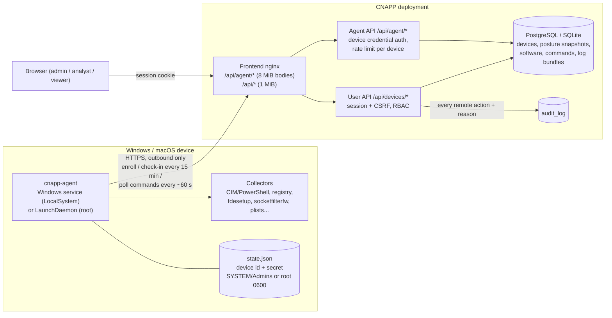

# Device management (endpoint agent)

CloudSecurity can track company laptops and desktops alongside cloud workloads. A small agent of our own (`cnapp-agent`, in [`endpoint-agent/`](../endpoint-agent)) runs on **Windows 10/11** and **macOS**. It reports hardware/OS inventory, security posture and installed software, and it runs a short, fixed list of remote actions that an admin or analyst queues in the UI.

It works in the spirit of Intune, with deliberate limits:

- **Our own agent only.** There is no Microsoft Graph / Intune integration and no Apple or Windows MDM protocol, so no MDM enrollment profiles or Apple Push certificates are needed.
- **Inventory, posture and safe remote actions.** Compliance policies and vulnerable-software (CVE) matching are not implemented yet. The data they need (posture history and the installed-software list with versions) is already stored.
- **No arbitrary command execution.** The agent never runs scripts or shell commands sent by the server.

Linux is not supported yet. The code is split so it can be added later: see [Adding Linux](#adding-linux).

## Contents

- [Architecture](#architecture)
- [Enrolling devices](#enrolling-devices): [Windows](#windows-1011) and [macOS](#macos)
- [What data is collected](#what-data-is-collected) (privacy)
- [Device health and issues](#device-health-and-issues)
- [Remote actions](#remote-actions)
- [Security model](#security-model)
- [Service install, upgrade and uninstall](#service-install-upgrade-and-uninstall)
- [Packaging and code signing](#packaging-and-code-signing)
- [API reference](#api-reference)
- [Configuration](#configuration)
- [Testing](#testing)
- [Limitations](#limitations)

## Architecture



**Pull model.** The agent never listens on a port. It makes outbound HTTPS requests only:

| Request | When | Purpose |
|---|---|---|
| `POST /api/agent/enroll` | once (and on re-enrollment) | exchange an enrollment token for a per-device credential |
| `POST /api/agent/checkin` | at start, then every check-in interval (default 15 min, ±10% jitter) | full inventory, posture and software report |
| `GET /api/agent/commands` | about every 60 s (±10% jitter) | small request that fetches queued remote actions and works as a heartbeat |
| `POST /api/agent/commands/{id}/result` | after running a command | status and output |
| `POST /api/agent/commands/{id}/logs` | for `collect_logs` | upload a gzip log bundle |

When a request fails, the agent backs off exponentially with full jitter (30 s, 1 min, 2 min, ... up to 30 min). If the server rejects the credential (revoked or superseded), the agent logs that it must be re-enrolled and retries only once an hour. It does not exit, so the service manager does not get stuck in a restart loop.

## Enrolling devices

You need the URL of your CNAPP deployment (for example `https://cnapp-web.<env>.<region>.azurecontainerapps.io`) and an **admin** account.

1. In the UI open **Devices → Enroll devices** and click **Create token**. Choose:
   - a **name** (for example "Finance laptops, Oct 2026");
   - **single device** or **multiple devices** (an optional maximum; empty means unlimited until expiry);
   - an **expiry** (default 24 h, maximum 90 days).

   The token (`cne_...`) is shown **once**, together with ready-to-paste install commands. Anyone who holds a valid token can enroll a device, so keep tokens short-lived and revoke them when you are done.
2. Get the agent build for the platform from the CI artifacts (see [Packaging](#packaging-and-code-signing)) or your internal download location.
3. Run the commands below on the device. The device appears in **Devices** within about a minute.

### Windows 10/11

Open **PowerShell as administrator** in the folder that contains `cnapp-agent-windows-amd64.exe` (use `-arm64` on ARM devices) and `install.ps1`:

```powershell
.\install.ps1 -Server https://cnapp.example.com -Token cne_xxxxxxxx -BinaryPath .\cnapp-agent-windows-amd64.exe
```

Or download directly from your release location with an integrity check:

```powershell
.\install.ps1 -Server https://cnapp.example.com -Token cne_xxxxxxxx `
  -DownloadUrl https://downloads.example.com/cnapp-agent/0.1.0/cnapp-agent-windows-amd64.exe `
  -Sha256 <value from SHA256SUMS> -RequireSignature
```

`install.ps1` checks that it is elevated and that the URL is https. It verifies the SHA-256 and, with `-RequireSignature`, the Authenticode signature. It enrolls the device, passing the token on **stdin** so it never appears in the process list, and then runs `cnapp-agent install`. That copies the binary to `C:\Program Files\CNAPP Agent\cnapp-agent.exe` and registers the **CNAPP Endpoint Agent** (`CNAPPAgent`) service. The service is set to automatic (delayed) start, runs as LocalSystem and restarts on failure.

Without the script:

```powershell
$env:CNAPP_ENROLL_TOKEN = 'cne_xxxxxxxx'
.\cnapp-agent-windows-amd64.exe enroll --server https://cnapp.example.com
.\cnapp-agent-windows-amd64.exe install
Remove-Item Env:CNAPP_ENROLL_TOKEN
```

Check the result with `Get-Service CNAPPAgent`, `& 'C:\Program Files\CNAPP Agent\cnapp-agent.exe' status` and the log at `C:\ProgramData\CNAPP Agent\logs\agent.log`.

### macOS

In **Terminal**, as an administrator. Use `darwin-arm64` on Apple silicon and `darwin-amd64` on Intel Macs:

```bash
chmod +x cnapp-agent-darwin-arm64
xattr -d com.apple.quarantine cnapp-agent-darwin-arm64 2>/dev/null   # unsigned builds only
echo 'cne_xxxxxxxx' | sudo ./cnapp-agent-darwin-arm64 enroll --server https://cnapp.example.com --token-stdin
sudo ./cnapp-agent-darwin-arm64 install
```

`install` copies the binary to `/usr/local/cnapp-agent/bin/cnapp-agent` and writes `/Library/LaunchDaemons/com.cloudsecurity.cnapp-agent.plist`, with `RunAtLoad`, `KeepAlive` and a 30 s throttle. It then loads and starts the daemon with `launchctl bootstrap` and `kickstart`.

You can also use the installer package from CI (`cnapp-agent-macos-universal.pkg`, a universal binary):

```bash
sudo installer -pkg cnapp-agent-macos-universal.pkg -target /
echo 'cne_xxxxxxxx' | sudo /usr/local/cnapp-agent/bin/cnapp-agent enroll --server https://cnapp.example.com --token-stdin
sudo /usr/local/cnapp-agent/bin/cnapp-agent install
```

A deployment tool can enroll during package install instead. Before running the installer, write `/var/root/.cnapp-enroll` (root, `0600`) with the server URL on line 1 and the token on line 2. The `postinstall` script enrolls, deletes the file and starts the daemon. On an upgrade of an enrolled Mac, `postinstall` simply restarts the daemon.

`packaging/macos/install.sh --server URL --binary PATH` combines the binary steps and prompts for the token.

Check with `sudo /usr/local/cnapp-agent/bin/cnapp-agent status`, `sudo launchctl print system/com.cloudsecurity.cnapp-agent` and `/Library/Logs/CNAPP Agent/agent.log`.

### Re-enrollment and revocation

- Running `enroll` again with a new token **re-enrolls** the device. The server recognizes the machine by a SHA-256 of its OS machine identifier (Windows `MachineGuid`, macOS `IOPlatformUUID`). It keeps the same device record and history, issues a new secret and invalidates the old one. This also reactivates a revoked device.
- **Revoke** (admin, device page) invalidates the credential immediately and cancels pending actions. The agent keeps running but is rejected (`403`) until someone re-enrolls it.
- **Delete** (admin, after revoking) removes the device and all its data.
- The device secret is never displayed. `cnapp-agent status` prints the state with the secret redacted.

### Local testing over plain http

`enroll --insecure-dev` allows `http://` URLs, for example `http://localhost:8000` with `uvicorn`. Never use it in production. Without it the agent refuses anything but https. `--home DIR` (or `CNAPP_AGENT_HOME`) keeps state and logs under `DIR`, so you can try the agent without root:

```bash
cd endpoint-agent && go build -o cnapp-agent ./cmd/cnapp-agent
./cnapp-agent inventory --print            # what would be sent (no network)
./cnapp-agent enroll --server http://localhost:8000 --token cne_... --insecure-dev --home /tmp/agent
./cnapp-agent checkin --home /tmp/agent    # one check-in + command poll
```

## What data is collected

Everything is **read-only** and uses OS-native tools with timeouts, so the user sees no prompts or pop-ups. Each collector fails independently. When one fails, its check is reported as `unknown` with the error, and the agent does not crash.

| Area | Windows | macOS |
|---|---|---|
| Device | hostname, BIOS serial, manufacturer/model, CPU and cores, RAM, fixed disks (size/free), OS caption/version/build (incl. UBR, display version), architecture, last boot/uptime, users with an interactive session (owners of `explorer.exe`), time zone | hostname, serial (`ioreg`), model, CPU (`sysctl`), RAM, root volume (size/free), `sw_vers`, architecture, boot time/uptime, console user and `who`, time zone |
| Network | adapters that are up, with MAC and IP addresses, and the agent version | same |
| Disk encryption | BitLocker on the OS volume (`Win32_EncryptableVolume`: protection and conversion status) | FileVault (`fdesetup status`) |
| Firewall | Windows Defender Firewall, every profile (`Get-NetFirewallProfile -PolicyStore ActiveStore`) | application firewall (`socketfilterfw --getglobalstate`, stealth mode) |
| Antivirus / EDR | Microsoft Defender (`Get-MpComputerStatus`: real-time protection, signature age and version, tamper protection) and products registered in Windows Security Center (`SecurityCenter2`, client SKUs) | XProtect version and age (`xprotect version` on macOS 15+, else the XProtect bundle) |
| Screen lock | machine inactivity limit policy (`InactivityTimeoutSecs`) or a password-protected screen saver of 15 min or less for each signed-in user | `sysadminctl -screenLock status` for the console user, or a managed `com.apple.screensaver` profile |
| OS updates | pending updates from the **local** Windows Update cache (offline search, no network scan), last install date, reboot required | `/Library/Preferences/com.apple.SoftwareUpdate.plist` (results the OS itself caches; no `softwareupdate --list`), last OS install |
| Platform | Secure Boot (`Confirm-SecureBootUEFI`), TPM (`Get-Tpm`) | SIP (`csrutil status`), Gatekeeper (`spctl --status`) |
| Local admins | members of the Administrators group (by SID, so it works in any language) | members of the `admin` group |
| Software | uninstall registry keys: HKLM 64-bit, HKLM 32-bit and loaded user hives (name, version, publisher, install date; system components and updates excluded) | `.app` bundles in `/Applications` (2 levels) and `~/Applications` (name, version, bundle id) |

**Privacy note.** The agent does **not** collect files, documents, browsing data, screenshots, keystrokes, location, process lists or network traffic. It records the user names of signed-in users and local administrators, IP and MAC addresses, the serial number and the installed applications. Tell your users about it as your policies require. Data is kept until the device is deleted. Posture history is capped per device (`DEVICE_HISTORY_LIMIT`, default 200 snapshots).

## Device health and issues

The server derives **issues** from the latest posture and timestamps whenever a device is read. They are built-in signals, not configurable compliance policies:

| Issue | Severity | Raised when |
|---|---|---|
| `disk_encryption_off` | high | BitLocker / FileVault check fails (off, suspended, or still encrypting) |
| `firewall_off` | high | any Windows firewall profile, or the macOS application firewall, is off |
| `antivirus_off` | high | no active real-time antivirus |
| `av_signatures_outdated` | medium | Defender (or a Security Center product) signatures older than `DEVICE_AV_SIGNATURE_MAX_AGE_DAYS` (7) |
| `os_updates_pending` | medium | updates have been pending for more than `DEVICE_UPDATES_GRACE_DAYS` (14), counted from the first check-in that reported them |
| `screen_lock_off` | low | screen lock explicitly not enforced |
| `sip_disabled` | high | macOS System Integrity Protection off or weakened |
| `gatekeeper_off` | medium | Gatekeeper disabled |
| `secure_boot_off` | medium | Secure Boot reported off |
| `stale` | medium | no contact for more than `DEVICE_STALE_HOURS` (24) |
| `inactive` | high | no contact for more than `DEVICE_INACTIVE_DAYS` (7) |

**Health** is *At risk* if any issue is high, *Warning* if there are only medium or low issues, *Healthy* if there are none, and *No data* before the first check-in. The dashboard tile and the Devices page show fleet totals: device counts, % encrypted, % with the firewall on, and stale devices. Checks that report `unknown` (for example BitLocker on Windows Server, or Secure Boot on a VM) never raise issues.

## Remote actions

There is no generic "run command". Only the following actions exist, and each one is allow-listed **on the server** (the API rejects any other type or parameter) and **again in the agent**, which refuses anything not on its own list whatever the server sends:

| Action | Minimum role | What the agent does |
|---|---|---|
| `recheck_posture` | analyst | immediate full check-in |
| `collect_logs` | analyst | uploads a gzip tar with the agent's own logs (last 2 MiB + 1 MiB of the rotated file), its state with the **secret redacted**, and a fresh inventory/posture snapshot without software. No user files. At most 4 MiB from the agent, at most 5 MiB on the server, stored in the database. Downloading needs analyst. |
| `lock_device` | admin | locks the interactive session (details below); the UI asks you to type the hostname to confirm |
| `restart_agent` | admin | reports success, then exits so the service manager restarts it (Windows SCM recovery actions; launchd `KeepAlive`) |
| `update_check_in_interval` | admin | sets the full check-in interval to 300-86,400 s and stores it in the agent state |

Every action requires a **reason**. Creating one is written to the audit log (`device_command_created`, with actor, device, type, parameters and reason), and so are cancellation, completion (reported by the device), log-bundle downloads, token creation and revocation, enrollment, re-enrollment, revocation and deletion.

**Lifecycle.** `pending` → `delivered` (handed to the agent exactly once, through a conditional update) → `succeeded` / `failed` / `rejected`. A pending command can also become `cancelled` (pending only) or `expired`. Commands are bound to one device and have an expiry (default 24 h, `DEVICE_COMMAND_TTL_HOURS`) and a random nonce. The agent checks the device binding and the expiry, adjusted for clock skew using the server time, before it runs a command. It records the command id **before** executing it, so it never runs a command twice, even after a crash or a replay. The result must echo the nonce.

### How `lock_device` works

| Platform | Mechanism | Notes |
|---|---|---|
| Windows | The service (LocalSystem, session 0) enumerates active sessions (`WTSEnumerateSessions`). For each one it gets the user's token (`WTSQueryUserToken`) and starts `rundll32.exe user32.dll,LockWorkStation` on that session's `winsta0\default` desktop (`CreateProcessAsUser`). If that fails, it disconnects the session (`WTSDisconnectSession`), which also returns it to the sign-in screen without logging the user off. Run interactively, the agent calls `LockWorkStation` directly. | Works for console and RDP sessions. The result lists every session and how it was locked. With no one signed in it reports `failed: no active interactive session`. |
| macOS | If `CGSession -suspend` exists (macOS 10.x only; removed in 11+) it runs in the console user's context. Otherwise it runs `pmset displaysleepnow`, which locks the session only when the user requires a password **immediately** (or within the delay) after sleep or screen saver. That is the macOS default, and our `screen_lock` posture check reports it. | The result output includes the user's actual `screenLock` setting. If no password is required, the action is reported as **failed** ("screen is NOT locked"). There is no supported API that lets a root daemon force-lock a macOS session without MDM. |

## Security model

- **Outbound-only pull model.** No inbound ports on endpoints. A compromised server cannot push code: it can only queue the five actions above, and the agent validates them itself.
- **Enrollment tokens** are 256-bit random values (`cne_...`). Only their SHA-256 is stored. They are single- or multi-use with a maximum count, expire, can be revoked, and are used up atomically, so concurrent enrollments cannot exceed the limit. Enrollment is rate-limited per client IP.
- **Per-device credentials** are 256-bit random secrets (`cnd_...`) issued at enrollment. The server stores only their SHA-256, unique-indexed for lookup. A random 256-bit secret cannot be brute-forced, so a slow hash adds nothing, and unlike the session HMAC this does not depend on `SESSION_SECRET` (rotating that secret does not cut off devices). Credentials are rotated on re-enrollment and revoked server-side.
- **Credential storage on the device:**
  - Windows: `%ProgramData%\CNAPP Agent\state.json`. The directory gets a **protected DACL** granting full control to `SYSTEM` and `BUILTIN\Administrators` only (`D:P(A;OICI;FA;;;SY)(A;OICI;FA;;;BA)`), with no ACEs inherited from ProgramData.
  - macOS: `/Library/Application Support/CNAPP Agent/state.json`, owned by root, file `0600`, directory `0700`.
  - The file is written atomically (temp file and rename).
- **Separate authentication planes.** `/api/agent/*` only accepts `Authorization: Bearer cnd_...` and never reads cookies, so there is no CSRF surface. `/api/devices/*` and every other user API only accept a user session (with CSRF on writes) and RBAC. A device credential cannot call user APIs, a session cannot act as a device, and the sensor ingest token is not a device credential. The tests cover all of these.
- **Transport.** HTTPS only (TLS 1.2+), the system trust store plus an optional `--ca-file` for private PKI, no redirects followed (so the credential cannot be sent elsewhere), and responses capped at 1 MiB. Plain http is possible only with the explicit `--insecure-dev` flag.
- **Strict input validation.** Agent payloads are validated by Pydantic models that reject unknown fields and limit every string, list and map: at most 10,000 software items, 40 posture checks and 16 KiB of data per check. `/api/agent/*` bodies are capped at 6 MiB (`AGENT_MAX_REQUEST_BYTES`; nginx allows 8 MiB on that path only) and other APIs stay at 1 MiB. Log bundles must be gzip and at most `DEVICE_LOG_BUNDLE_MAX_BYTES`. Each device is rate-limited (`DEVICE_RATE_LIMIT` requests per `DEVICE_RATE_WINDOW_SECONDS`).
- **No shells.** Collectors run fixed commands by absolute path with fixed arguments. PowerShell scripts are constants passed with `-EncodedCommand`, and nothing from the server is ever interpolated into them.
- **Agent logs** rotate at 5 MiB with one backup, in an owner-only directory.

## Service install, upgrade and uninstall

| | Windows | macOS |
|---|---|---|
| Install | `cnapp-agent install` (elevated) | `sudo cnapp-agent install` |
| Binary | `C:\Program Files\CNAPP Agent\cnapp-agent.exe` | `/usr/local/cnapp-agent/bin/cnapp-agent` |
| Service | `CNAPPAgent`, LocalSystem, automatic (delayed), restart on failure (5 s / 30 s / 2 min) | `/Library/LaunchDaemons/com.cloudsecurity.cnapp-agent.plist`, root, `RunAtLoad` + `KeepAlive` |
| State | `C:\ProgramData\CNAPP Agent\state.json` | `/Library/Application Support/CNAPP Agent/state.json` |
| Logs | `C:\ProgramData\CNAPP Agent\logs\agent.log` | `/Library/Logs/CNAPP Agent/agent.log` (+ `launchd.log`) |
| Upgrade | run the new binary's `install` (stops, replaces and restarts) | install the new `.pkg`, or the new binary's `install` |
| Uninstall | `packaging\windows\uninstall.ps1 [-Purge]` or `cnapp-agent uninstall [--purge]` | `sudo /usr/local/cnapp-agent/bin/cnapp-agent uninstall [--purge]` |

`--purge` also deletes the credential and logs. Revoke or delete the device in the console as well.

Other commands: `status`, `inventory --print [--no-software]`, `checkin` (one check-in and command poll now), `run` (foreground loop, which is what the service runs) and `version`.

## Packaging and code signing

CI produces:

- **`cnapp-agent-binaries`**: static (`CGO_ENABLED=0`) binaries for `windows/amd64`, `windows/arm64`, `darwin/amd64` and `darwin/arm64`, plus `install.ps1`, `uninstall.ps1`, `install.sh` and `SHA256SUMS`;
- **`cnapp-agent-macos-pkg`**: an unsigned universal (`lipo`) `.pkg` built with `pkgbuild` on the macOS runner.

Signing needs your organization's certificates, so it is a **manual** step:

**Windows (Authenticode).** With a code-signing certificate (ideally EV, or Azure Trusted Signing):

```powershell
signtool sign /fd SHA256 /tr http://timestamp.digicert.com /td SHA256 /a cnapp-agent-windows-amd64.exe
signtool verify /pa cnapp-agent-windows-amd64.exe
# Optionally sign the installer scripts as well:
Set-AuthenticodeSignature -FilePath install.ps1 -Certificate (Get-ChildItem Cert:\CurrentUser\My -CodeSigningCert)[0] -TimestampServer http://timestamp.digicert.com
```

Then deploy with `install.ps1 -RequireSignature`. An MSI (for example WiX) is not included yet. The PowerShell installer works with any software-deployment tool that can run an elevated script.

**macOS (Developer ID + notarization).** With a *Developer ID Application* and a *Developer ID Installer* certificate in the keychain:

```bash
lipo -create -output cnapp-agent cnapp-agent-darwin-amd64 cnapp-agent-darwin-arm64
CODESIGN_IDENTITY="Developer ID Application: Example Corp (TEAMID)" \
PKG_SIGN_IDENTITY="Developer ID Installer: Example Corp (TEAMID)" \
  endpoint-agent/packaging/macos/build-pkg.sh 0.1.0 cnapp-agent cnapp-agent-0.1.0.pkg
xcrun notarytool submit cnapp-agent-0.1.0.pkg --keychain-profile <profile> --wait
xcrun stapler staple cnapp-agent-0.1.0.pkg
```

`build-pkg.sh` signs the binary with the hardened runtime and a timestamp, and signs the package, when those variables are set. Unsigned builds work. Downloaded files carry the quarantine attribute, which the instructions remove, and Gatekeeper blocks double-clicking an unsigned `.pkg`; `sudo installer -pkg` from Terminal still works.

Publish signed builds somewhere your devices can reach and set `AGENT_DOWNLOAD_URL` on the backend so the enrollment page links to them.

## API reference

Agent API (device credential):

| Method & path | Body / response |
|---|---|
| `POST /api/agent/enroll` | `{token, device:{hostname, os_family, os_name, os_version, serial_number, machine_id, agent_version}}` → `{device_id, device_secret, check_in_interval_seconds, command_poll_seconds, server_time, reenrolled}` |
| `POST /api/agent/checkin` | `{schema_version:1, collected_at, device:{...}, posture:{name:{status,detail,error,data}}, software:[...] or null, errors:{}}` → `{device_id, server_time, pending_commands, issues}` |
| `GET /api/agent/commands` | → `{server_time, commands:[{id, device_id, type, params, nonce, issued_at, expires_at}]}` |
| `POST /api/agent/commands/{id}/result` | `{nonce, status: succeeded / failed / rejected, output}` → 204 |
| `POST /api/agent/commands/{id}/logs` | gzip body, header `X-Command-Nonce` → `{id, size_bytes, sha256}` |

User API (session; viewer unless noted): `GET /api/devices` (filters `q`, `os`, `health`, `issue`, `connectivity`, `status`), `GET /api/devices/summary`, `GET /api/devices/issue-types`, `GET /api/devices/{id}`, `.../software?q=`, `.../history`, `.../commands`, `POST .../commands` (role per action, `{type, reason, params}`), `POST .../commands/{cid}/cancel` (same role as the action), `GET .../log-bundles/{bid}` (analyst), `POST .../revoke` and `DELETE /api/devices/{id}?reason=` (admin), and `GET/POST /api/devices/enrollment-tokens`, `POST .../enrollment-tokens/{id}/revoke` and `GET /api/devices/enrollment/info` (admin).

## Configuration

Backend environment variables (defaults in brackets): `AGENT_MAX_REQUEST_BYTES` [6 MiB], `DEVICE_LOG_BUNDLE_MAX_BYTES` [5 MiB], `DEVICE_RATE_LIMIT` [120] per `DEVICE_RATE_WINDOW_SECONDS` [600], `ENROLL_RATE_LIMIT` [20] per `ENROLL_RATE_WINDOW_SECONDS` [600], `DEVICE_STALE_HOURS` [24], `DEVICE_INACTIVE_DAYS` [7], `DEVICE_UPDATES_GRACE_DAYS` [14], `DEVICE_AV_SIGNATURE_MAX_AGE_DAYS` [7], `DEVICE_HISTORY_LIMIT` [200], `DEVICE_COMMAND_TTL_HOURS` [24] and `AGENT_DOWNLOAD_URL` [unset].

**Azure deployment.** No infrastructure change is needed. Agents use the public frontend URL (`https://<frontend-fqdn>`). nginx proxies `/api/agent/*` to the internal backend with an 8 MiB body limit, and the Container Apps ingress needs nothing else. Per-IP enrollment rate limiting uses the real client IP through `TRUSTED_PROXY_CIDRS`. The database tables come with Alembic migration `0002_device_management`, applied automatically on startup.

## Testing

- **Backend** (`backend/tests/test_devices.py`, on SQLite and PostgreSQL in CI): enrollment (single/multi-use, expiry, revocation, rate limit, re-enrollment and credential rotation), authentication isolation in both directions, revoked-device rejection, strict check-in validation and size limits, issue and health derivation, command RBAC, server-side allowlist and parameter validation, expiry, at-most-once delivery, device binding, nonces, log-bundle upload, size cap and download RBAC, audit entries, and delete cascade.
- **Agent** (`go test ./...`): fixture-based parser tests for every Windows and macOS collector (they run on any OS, see `endpoint-agent/testdata/`), including PowerShell 5.1 JSON quirks; the command allowlist; validation and expiry; backoff and jitter; state file permissions; the HTTP client (https enforcement, no redirects); and an agent loop test against a fake server covering replay protection, the log bundle and revoked-device back-off.
- **CI on real `windows-latest` and `macos-latest` runners**:
  - `go vet` and `go test`;
  - the real collectors (`cnapp-agent inventory --print` must produce valid JSON with all posture checks and software);
  - `scripts/agent_e2e.py --service`, which starts the real backend, creates a token through the API, enrolls the agent, checks in, runs `recheck_posture`, `collect_logs` and `update_check_in_interval`, then **installs the real Windows service / LaunchDaemon**, waits for its check-in, sends `restart_agent` and verifies that the service manager restarts it, verifies the Windows state-directory ACL, uninstalls, re-enrolls, revokes and checks that the agent is rejected.
  - The macOS leg also builds the `.pkg`.
- Release binaries are cross-compiled for all four targets.

`lock_device` is **not** exercised in CI, because CI runners have no interactive user session to lock. Its logic is unit-tested with a stub, but the Windows session-token path and the macOS `pmset` path have to be checked on real hardware before you rely on them.

## Limitations

- Windows 10/11 and macOS only. Windows Server works for inventory, but Security Center and BitLocker checks may report `unknown` there. Linux reports only basic inventory.
- No compliance policies, no CVE matching for installed software, no software deployment, no remote wipe, no MDM features (configuration profiles, Apple Business Manager / Autopilot).
- `lock_device` on macOS depends on the user's "require password after sleep" setting (see above). On Windows it needs a signed-in session.
- Commands run within about a minute only while the device is online and polling. Offline devices pick them up within the 24 h expiry.
- Windows screen-lock detection reads the machine inactivity policy and the screen-saver settings of signed-in users. When neither is configured it reports `unknown`, although Windows may still require sign-in on wake.
- Software inventory covers registry uninstall entries (Windows) and `.app` bundles (macOS). Packages installed without either (for example Homebrew formulae, portable apps or Microsoft Store apps for other users) are not listed.
- Rate limiting is in-memory per backend process, like the login limiter.
- Log bundles are stored in the database (capped). Large fleets should move them to Blob Storage.
- Binaries are not signed by CI. See [Packaging and code signing](#packaging-and-code-signing).

### Adding Linux

Add `internal/collect/collect_linux.go` (build tag `linux`, replacing the generic `collect_other.go`), `internal/commands/lock_linux.go` (for example `loginctl lock-sessions`) and a systemd unit in `internal/service/`. Parsers belong in an OS-independent file with fixtures, like `windows.go` and `macos.go`. The server already accepts `os_family: "linux"`.
