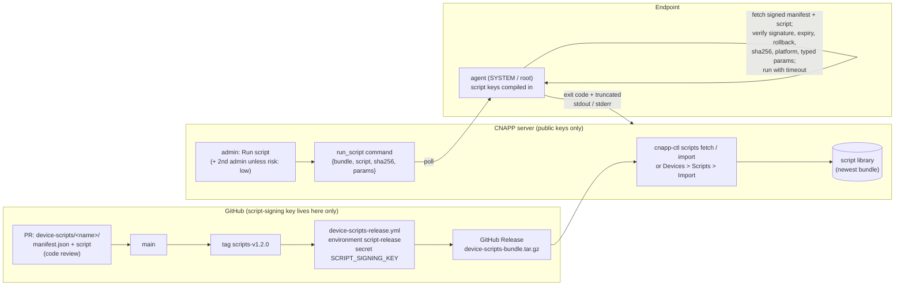

# Approved device scripts

Admins can run a small library of **approved scripts** on enrolled Windows and
macOS devices: "list local administrators", "restart the print spooler",
"clear old temp files". It is not a remote shell. A script can only run if it:

1. lives in this repository under [`device-scripts/<name>/`](../device-scripts)
   and was changed by a **reviewed pull request**;
2. was published in a bundle **signed with the script-signing key** (a GitHub
   environment secret, never on the CNAPP server, separate from the agent
   release key);
3. is verified by the **agent itself**, right before running: signature against
   keys compiled into the agent, expiry, anti-rollback, SHA-256 of the script,
   platform, and every parameter against the **typed schema in the signed
   manifest**.

Read-only scripts marked `risk: low` run with one admin; `medium` and `high`
need a second admin ([two-person approval](DEVICE_MANAGEMENT.md#two-person-approval)).
Why this keeps the agent bounded: [ADR-0001](ADR-0001-signed-device-scripts.md).

## Contents

- [How it works](#how-it-works)
- [Writing a script](#writing-a-script)
- [One-time setup: the script-signing key](#one-time-setup-the-script-signing-key)
- [Releasing scripts](#releasing-scripts)
- [Running a script](#running-a-script)
- [Security model](#security-model)
- [API](#api)
- [Testing](#testing)
- [Limitations](#limitations)

## How it works



A **bundle** is a `.tar.gz` with `manifest.json` (signed envelope, same shape as
agent releases) and `<name>/<file>` per script. The signature is Ed25519 over
`"cnapp-device-scripts-manifest-v1\0" || payload` (a different domain-separation
string from agent releases, so a signature of one kind never verifies as the
other). Payload:

```json
{"schema": 1, "product": "cnapp-device-scripts", "version": "1.2.0",
 "released_at": "...Z", "expires_at": "...Z", "notes": "...",
 "scripts": [{"name": "windows-clear-temp-files", "description": "...", "platform": "windows",
              "interpreter": "powershell", "file": "script.ps1", "timeout_seconds": 600, "risk": "medium",
              "parameters": [{"name": "older_than_days", "type": "int", "min": 1, "max": 365, "default": 7}],
              "sha256": "<hex>", "size": 1742}]}
```

## Writing a script

```
device-scripts/<name>/manifest.json
device-scripts/<name>/script.ps1 | script.zsh | script.sh
```

| Field | Rules |
|---|---|
| `name` | `^[a-z0-9][a-z0-9-]{1,63}$`, equal to the directory name |
| `description` | shown in the console (what it does, what it changes) |
| `platform` / `interpreter` | `windows` + `powershell` (Windows PowerShell 5.1, `-NoProfile -NonInteractive -ExecutionPolicy Bypass -File`), or `macos` + `zsh` (`/bin/zsh -f`) / `bash` (`/bin/bash --noprofile --norc`) |
| `file` | plain file name with the interpreter's extension (`.ps1`, `.zsh`/`.sh`, `.sh`) |
| `timeout_seconds` | 5-3600; the whole process tree is killed after it |
| `risk` | `low` (read-only information: one admin can run it), `medium`, `high` (a second admin must approve) |
| `parameters` | up to 10, see below; none = the script takes no input |

**Parameters** (`name` `^[a-z][a-z0-9_]{0,31}$`, optional `description`, `required` (default true), `default`):

| `type` | Extra fields | Value |
|---|---|---|
| `int` | `min`, `max` (required) | integer within the range |
| `enum` | `values` (1-50 of `^[A-Za-z0-9][A-Za-z0-9._-]{0,63}$`) | one of the values |
| `bool` | | `true` / `false` |
| `string` | `pattern` (required, anchored `^...$`, no backreferences / lookarounds / inline flags), `max_length` (<= 256) | matches the whole pattern, no control characters |

The script receives each value **only as an environment variable**
`CNAPP_PARAM_<NAME>` (upper-case), e.g. `$env:CNAPP_PARAM_OLDER_THAN_DAYS` /
`$CNAPP_PARAM_SCOPE`. Values are never placed on a command line or into the
script text, and inherited `CNAPP_*` variables are removed, so a parameter can
only ever be data. Still validate and quote them in the script (`-LiteralPath`,
`"$var"`), and prefer `enum` / `int` / `bool` over `string`.

Output: write what an admin needs to stdout; the agent returns the exit code
and up to ~15 KB of stdout + stderr (each stream capped at 64 KB while
running). Exit code 0 = *succeeded*, anything else = *failed*. Scripts run as
**SYSTEM** (Windows) / **root** (macOS) in a temporary directory inside the
agent's protected state directory, without a user profile or UI.

Validate locally: `python scripts/device_scripts.py lint` (CI runs the same
checks in Python and Go). Reviewers: is the `risk` honest? Can a parameter
make the script do more than its description says? Does it avoid printing
secrets?

Shipped examples:

| Script | Platform | Risk | Parameters |
|---|---|---|---|
| `windows-list-local-admins` | Windows | low | - |
| `windows-restart-print-spooler` | Windows | medium | - |
| `windows-clear-temp-files` | Windows | medium | `older_than_days` (int 1-365, 7), `scope` (system / users / all), `dry_run` (bool) |
| `macos-list-local-admins` | macOS | low | - |

## One-time setup: the script-signing key

On a trusted workstation with Python 3 and `pip install cryptography`:

```bash
scripts/device-scripts-keygen --comment "CNAPP device-script key 2026"
```

1. Add the printed **public** line to **both**
   `endpoint-agent/internal/scripts/trusted_keys.txt` and
   `backend/app/script_signing_keys.txt` (a test checks they match and that it
   is not the agent release key); commit through a PR and merge.
2. Create the GitHub environment **`script-release`** (Settings > Environments)
   with *required reviewers* and store the private key there:
   `gh secret set SCRIPT_SIGNING_KEY --env script-release < script-signing-key.pem`.
   Then delete the file (or keep it only offline). Never commit it, never copy
   it to the CNAPP server.
3. **Agents only trust keys compiled into them**: release an agent built after
   step 1 (`git tag agent-vX.Y.Z`, see [AGENT_UPDATES.md](AGENT_UPDATES.md)) and
   let it roll out. Older agents refuse every script ("this agent build trusts
   no script-signing keys"). `cnapp-agent script-keys` shows what a binary trusts.

Key rotation works like the agent release key: add the new key next to the
old one, ship an agent that trusts both, switch the secret, later remove the
old key. If the key leaks: remove it from both files, add a new one, ship an
agent release, and stop importing bundles signed with the old key.

## Releasing scripts

1. Merge the script change to `main` (CI green).
2. `git tag scripts-v1.2.0 && git push origin scripts-v1.2.0` (semantic
   version, higher than the last one: agents refuse older bundles than the
   newest they have used).
3. The **Device scripts release** workflow waits for the environment approval,
   validates the manifests, signs the bundle, verifies it against the committed
   agent keys and publishes `device-scripts-bundle.tar.gz` as a GitHub Release.
4. Import it: on-prem `sudo cnapp-ctl scripts fetch --tag scripts-v1.2.0` (or
   `scripts import FILE`), or **Devices > Scripts > Import signed bundle**
   (admin). The server verifies signature, hashes and expiry (`DEVICE_SCRIPT_TRUSTED_KEYS`
   adds keys for the server-side check only). The newest non-expired bundle is
   the library. Bundles expire after 180 days by default (`--valid-days`).

Manual signing with an offline key:
`python scripts/device_scripts.py bundle --version 1.2.0 --key-file /media/usb/script-signing-key.pem --out device-scripts-bundle.tar.gz`
and `python scripts/device_scripts.py verify device-scripts-bundle.tar.gz --keys endpoint-agent/internal/scripts/trusted_keys.txt`.

*TODO:* the server already imports signed **agent** releases from GitHub
Releases automatically ([AGENT_UPDATES.md](AGENT_UPDATES.md#auto-import-from-github-releases));
device-script bundles are not covered by that job yet and could reuse it. Until
then, import them with `cnapp-ctl scripts fetch` or the console upload.

## Running a script

**Devices > device > Run script** (admin): pick a script for the device's
platform, fill the generated form (defaults pre-filled), give a reason.

- `risk: low`: the `run_script` command is queued immediately.
- `medium` / `high`: an approval request is created; a **different admin**
  approves it under **Approvals** (or self-approval with cooling-off on
  single-admin installs, [DEVICE_MANAGEMENT.md](DEVICE_MANAGEMENT.md#two-person-approval)).

The device picks it up within about a minute; **Devices > Scripts** and the
device's *Commands* tab show status, exit code, who requested / approved, and
the output. Everything is audited (`device_command_created` with the script,
bundle version and parameters, `device_command_completed` with the exit code).

## Security model

| Threat | Mitigation |
|---|---|
| Compromised CNAPP server / database / admin session wants to run code | Only scripts in a bundle signed by a key compiled into the agent run; the server cannot sign. It can choose among signed scripts and pass parameters, which the agent validates against the signed schema. Medium/high-risk scripts need a second admin (server-side control). |
| Tampered script bytes | SHA-256 and size are in the signed manifest; the agent hashes the download before writing it. |
| Parameter injection | Typed schema (int / enum / bool / anchored-pattern string), no control characters, values only in environment variables, unknown parameters refused. No free-form shell. |
| Replaying an old, vulnerable signed script | Manifests expire (180 days default); the agent refuses bundles older than the newest it has used (anti-rollback, stored in its protected state); the server refuses to import an older version. |
| Agent release key misuse | Separate key, separate trusted-key file, separate domain-separation string, CI check that the two key sets do not overlap. |
| Runaway script | Timeout with process-tree kill (`taskkill /T` on Windows, the process group on macOS), output caps, one command at a time. |
| Same command replayed | Commands are single-use (server delivers once; the agent records the id before running). |

Remaining risk: whoever controls **both** the script-signing key (GitHub
environment approval) **and** an admin account can run the signed scripts with
schema-valid parameters. Keep scripts narrow, honest about risk, and reviewed.

## API

User (session; viewer reads, admin writes):
`GET /api/scripts` (library: newest bundle, scripts, trusted key ids),
`GET /api/scripts/bundles`, `POST /api/scripts/bundles` (raw `application/gzip`),
`POST /api/scripts/run` `{device_id, script, parameters, reason}` → `{mode: "command"|"approval", command_id, approval}`,
`GET /api/scripts/runs?device_id=&script=&limit=`, `GET /api/scripts/pending-approvals`.

Device (per-device credential): `GET /api/agent/scripts/bundles/{id}/manifest`,
`GET /api/agent/scripts/bundles/{id}/scripts/{name}` (only while a
`run_script` command is delivered to that device). The command result carries
`exit_code`.

## Testing

- Python: `backend/tests/test_device_scripts.py` (manifest rules incl. the
  repository's scripts, signature / untrusted key / wrong signing context /
  tampering / expiry / anti-rollback, RBAC, low-risk direct run, approval for
  medium risk, parameter validation, device download endpoints, run history).
- Go: `endpoint-agent/internal/scripts` (verify, hash, platform, every
  parameter type, rollback, truncation, the real OS runner with timeout and
  tree kill), `internal/agent/protect_test.go` (end to end against a fake
  server); the repository's manifests are validated by Go too.
- CI: lint + an ephemeral-key bundle signed and verified on every run; on the
  Windows and macOS runners `scripts/agent_e2e.py --script-key-file` builds an
  agent trusting an ephemeral key, imports a signed bundle into the real
  backend and runs the "list local admins" script on the real OS.

## Limitations

- Windows PowerShell 5.1 and macOS zsh/bash only; no Linux.
- Scripts run as SYSTEM/root, never in the user's session (no UI, no user
  profile); no file upload/download beyond the script's own output.
- One bundle (the newest) is the library; older bundles stay in the database
  for history.
- Output is truncated to ~15 KB.
